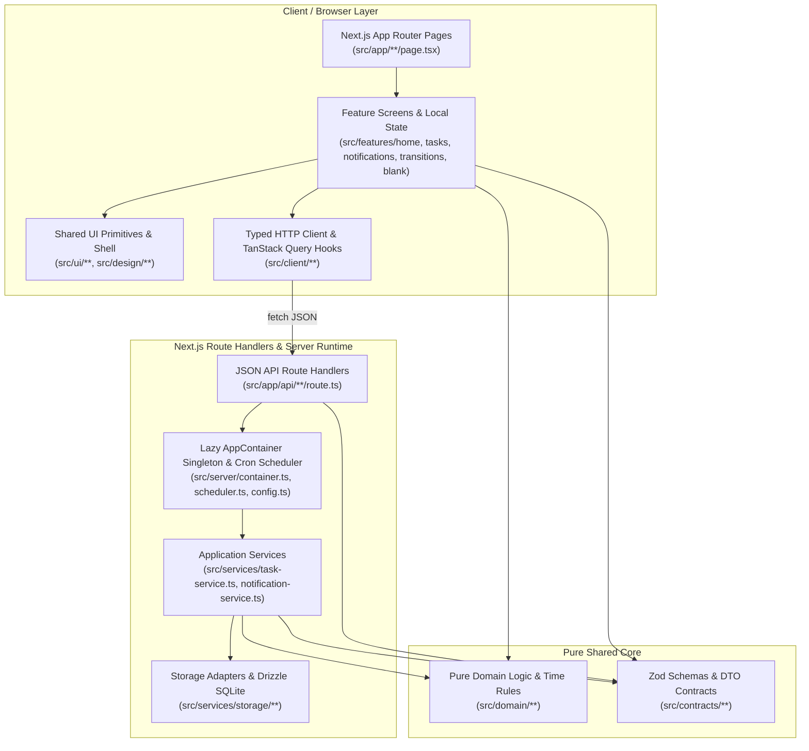

# Project Description — Hiep Trong Space

`PROJECT_DESCRIPTION.md` is the canonical system-wide engineering reference for **Hiep Trong Space**. It owns project purpose, standardized terminology, layered architecture, shared data models and domain rules, the 13-feature route catalog, the cross-layer change impact map, the audit and verification baseline, and the central Open Decisions Register.

For contributor onboarding and navigation rules, start with [`AGENTS.md`](AGENTS.md) and [`md/readme.md`](md/readme.md). For visual tokens, typography, motion, and shared primitives, see [`md/agents/shared/uiux.md`](md/agents/shared/uiux.md). For deep epic specifications, see [`md/agents/homepage/readme.md`](md/agents/homepage/readme.md) and [`md/agents/tasks/readme.md`](md/agents/tasks/readme.md).

---

## 1. Purpose & Scope

### 1.1 Product Vision

Hiep Trong Space is a local-first, single-user personal operating space designed for Hiep Trong (`Asia/Ho_Chi_Minh`, `UTC+07:00`). Rather than functioning as a generic multi-tenant SaaS dashboard, the application combines two complementary experiences:

1. **The Cosmos (`/`):** A dark, contemplative, museum-grade 3D Earth scroll journey and feature collection gallery where the user enters their personal universe and launches into individual tools.
2. **The Workspace (`/tasks/*` and future domain routes):** Focused, calm productivity workspaces framed by a sticky top navigation shell (`WorkspaceShell`), Universe quick-jump menu (`Ctrl+K` / `Cmd+K`), Notification Center, and cosmic route transitions (`Cosmic Launch`).

### 1.2 Active Scope vs. Planned Expansion

The repository defines **13 features** in [`src/features/registry.ts`](src/features/registry.ts):

- **3 built user-facing surfaces across 2 active epics:**
  - **Homepage / Landing Journey (`/`):** Fully implemented in [`src/features/home/`](src/features/home/) and documented in [`md/agents/homepage/readme.md`](md/agents/homepage/readme.md).
  - **Daily Task Management (`/tasks/daily`)** and **Tasks Hub (`/tasks/hub`):** Fully implemented in [`src/features/tasks/`](src/features/tasks/) alongside the **Notification Center** in [`src/features/notifications/`](src/features/notifications/), documented together in [`md/agents/tasks/readme.md`](md/agents/tasks/readme.md).
- **11 intentional placeholder workspace routes:** Render the shared [`BlankPage`](src/features/blank/BlankPage.tsx) shell (`Blank page — waiting for future features.`) while remaining navigable from the homepage feature collection and the Universe menu. Their planned domain intent is cataloged in [Section 5](#5-route--feature-catalog) without creating premature epic directories.

### 1.3 Non-Goals & Trust Model

- **Trusted local single-user runtime:** No login, session management, RBAC, or multi-user tenant isolation is implemented or required.
- **Offline-capable local persistence:** SQLite (`better-sqlite3` + Drizzle ORM) and local filesystem media storage (`./data/media`) are the primary runtime stores. Google Drive (`STORAGE_PROVIDER=drive`) is an intentional stub in [`src/services/storage/drive/drive-storage-adapter.ts`](src/services/storage/drive/drive-storage-adapter.ts).
- **No external runtime dependencies required:** If Google Fonts are unreachable at build or runtime, typography falls back cleanly through CSS font stacks (`Cormorant Garamond` → `Georgia` → `serif`; `Inter` → `system-ui` → `sans-serif`).

---

## 2. Standardized Terminology

Use the canonical terms below across all documentation, task briefs, code reviews, and UI copy discussions. The table maps each canonical product term to its primary code symbols and retired/legacy aliases.

| Canonical Term | Scope / Route | Primary Code Symbols | Retired / Legacy Aliases (Do Not Use) | Definition |
| :--- | :--- | :--- | :--- | :--- |
| **Homepage / Landing Journey** | `/` | [`HomeJourney`](src/features/home/HomeJourney.tsx), [`FeatureCollection`](src/features/home/feature-collection/FeatureCollection.tsx), [`Starfield`](src/features/home/starfield/Starfield.tsx) | "Phase 01 review demo", "Cosmos portal" | The root scroll-driven 3D Earth experience and feature collection gallery. |
| **Tasks epic** | `/tasks/daily`, `/tasks/hub`, topbar bell | `src/features/tasks/*`, `src/features/notifications/*`, [`TaskService`](src/services/task-service.ts), [`NotificationService`](src/services/notification-service.ts) | "Daily epic", "Todo module" | The combined domain epic governing Daily Task Management, Tasks Hub, shared task persistence, and task deadline notifications. |
| **Daily Task Management** | `/tasks/daily` | [`DailyBoard`](src/features/tasks/DailyBoard.tsx), [`DayCarousel`](src/features/tasks/DayCarousel.tsx), [`WeekView`](src/features/tasks/WeekView.tsx), [`MonthView`](src/features/tasks/MonthView.tsx), [`OverdueList`](src/features/tasks/OverdueList.tsx) | "Daily Todo-List", "Daily V1/V2", "Daily Planner" | The execution-focused daily workspace featuring the Celestial Luxury V2 dark observatory aesthetic, Day/Week/Month views, and Overdue lane. |
| **Tasks Hub** | `/tasks/hub` | [`HubList`](src/features/tasks/HubList.tsx), [`TaskForm`](src/features/tasks/TaskForm.tsx), [`TaskMenu`](src/features/tasks/TaskMenu.tsx) | "Task Hub", "Tasks Backlog", "Master Task List" | The light-lavender master backlog and planning workspace for searching, filtering, sorting, inspecting, and scheduling all tasks. |
| **Notification Center** | Workspace topbar popover | [`NotificationPopover`](src/features/notifications/NotificationPopover.tsx), [`BellButton`](src/features/notifications/BellButton.tsx), [`NotificationService`](src/services/notification-service.ts) | "Alerts tray", "Reminder bell" | The topbar bell badge and popover displaying due-soon (24h and quarter-window), overdue, and completed task notifications. |
| **Observatory / Daily Dashboard** | `/tasks/daily` top summary strip | [`DailyDashboard`](src/features/tasks/DailyDashboard.tsx) (`Cosmic forecast`, `Progress`, `Day arc`) | "Daily header cards", "Telemetry strip" | The 3-column summary glass panel at the top of Daily Task Management. Note: the header action button labeled `Observatory` opens the placeholder `Statistics` drawer (see [`OD-01`](#od-01)). |
| **Cosmic forecast** | `/tasks/daily` dashboard column 1 | [`DailyDashboard`](src/features/tasks/DailyDashboard.tsx) (`FORECAST`) | "Daily quote", "Whisper banner" | The contemplative editorial message displayed in the left column of the Daily Dashboard. |
| **Day arc** | `/tasks/daily` dashboard column 3 | [`DailyDashboard`](src/features/tasks/DailyDashboard.tsx), [`getHoChiMinhDayArcSnapshot`](src/features/tasks/daily-dashboard-time.ts) | "Sun arc", "Solar dial" | The golden horizon arc and real-time clock tracking progress through the 24-hour day in `Asia/Ho_Chi_Minh`. |
| **Active-board carousel** | `/tasks/daily` (Day mode) | [`DayCarousel`](src/features/tasks/DayCarousel.tsx), [`DayTaskList`](src/features/tasks/DayTaskList.tsx) | "3-column day grid", "3-day columns" | The horizontal 3-day stage where the selected day (`Today` by default) is centered and interactive while `Yesterday` and `Tomorrow` sit beside it as scaled, dimmed preview boards. |
| **Transfer** | `/tasks/daily` Overdue lane | [`TransferDialog`](src/features/tasks/TransferDialog.tsx), [`TaskService`](src/services/task-service.ts) | "Reschedule", "Snooze" | The atomic operation on an overdue task that updates both `scheduledDate` and `deadline` to a new target date/time. |
| **Universe menu** | Workspace topbar (`Ctrl+K` / `Cmd+K`) | [`UniverseMenu`](src/ui/UniverseMenu.tsx) | "Command palette", "App switcher" | The modal feature launcher accessible from any workspace route for jumping across the 13 features or returning to `/`. |
| **Cosmic Launch** | Cross-route navigation | [`TransitionProvider`](src/features/transitions/TransitionProvider.tsx), [`TransitionLink`](src/features/transitions/TransitionLink.tsx), [`CosmicLaunchOverlay`](src/features/transitions/CosmicLaunchOverlay.tsx) | "Warp transition", "Portal loader" | The 4-phase (~3.0s standard, `<= 300ms` reduced-motion) full-screen canvas star-warp transition used when navigating between the homepage and workspace features. |

---

## 3. System Architecture & Layer Boundaries

### 3.1 Layered Architecture Diagram

### 3.2 Strict Import Boundaries

Architectural boundaries are enforced automatically by `eslint-plugin-boundaries` in [`eslint.config.mjs`](eslint.config.mjs) and by [`tests/design/craft-and-architecture-guardrails.test.ts`](tests/design/craft-and-architecture-guardrails.test.ts):

| Layer (`src/*`) | Allowed Imports | Forbidden Imports / Side Effects |
| :--- | :--- | :--- |
| **`src/contracts/`** | None (pure Zod schemas and TypeScript types) | Any internal layer, DOM, database, or filesystem APIs |
| **`src/domain/`** | `src/contracts/`, `src/domain/` | React, DOM, `fetch`, `fs`, SQLite, `src/services/`, `src/server/` |
| **`src/design/`** | `src/design/` | Feature modules, services, server runtime |
| **`src/ui/`** | `src/design/`, `src/ui/`, `src/domain/`, `src/contracts/` | `src/features/`, `src/client/`, `src/services/`, `src/server/` |
| **`src/client/`** | `src/contracts/`, `src/domain/`, `src/client/` | `src/services/`, `src/server/`, `better-sqlite3`, Node `fs` |
| **`src/features/`** | `src/design/`, `src/ui/`, `src/client/`, `src/domain/`, `src/contracts/`, `src/features/` | `src/services/`, `src/server/`, direct DB/filesystem imports |
| **`src/services/`** | `src/contracts/`, `src/domain/`, `src/services/` | React, `src/ui/`, `src/features/`, `src/client/` |
| **`src/server/`** | `src/contracts/`, `src/domain/`, `src/services/`, `src/server/` | React, `src/ui/`, `src/features/`, `src/client/` |
| **`src/app/`** | All layers (wires pages to features and API routes to `getContainer()`) | Business logic duplication that belongs in `src/domain/` or `src/services/` |

### 3.3 Server Container, Database & Scheduler Lifecycle

1. **Environment Resolution ([`src/server/config.ts`](src/server/config.ts)):**
   - Parses environment variables with safe defaults:
     - `DATABASE_URL`: defaults to `./data/app.db`
     - `STORAGE_PROVIDER`: `'local'` (default) or `'drive'`
     - `LOCAL_MEDIA_DIR`: defaults to `./data/media`
     - `LOG_LEVEL`: `'info'` (default)
     - `APP_TIMEZONE`: `'Asia/Ho_Chi_Minh'` (default)
2. **Database & Auto-Migration ([`src/services/storage/local/local-storage-adapter.ts`](src/services/storage/local/local-storage-adapter.ts), [`src/services/storage/local/schema.ts`](src/services/storage/local/schema.ts)):**
   - Opens SQLite via `better-sqlite3`, enables `PRAGMA journal_mode = WAL` and `PRAGMA foreign_keys = ON`, and bootstraps the `tasks`, `task_media`, and `notifications` tables and indexes.
   - **Important CLI vs. Runtime Path Note:** [`drizzle.config.ts`](drizzle.config.ts) hardcodes `url: './data/hieptrong.db'`, whereas runtime [`src/server/config.ts`](src/server/config.ts) defaults `DATABASE_URL` to `./data/app.db`. See Audit item `C10` in [`docs/audit/BUG_INVENTORY.md`](docs/audit/BUG_INVENTORY.md) when running Drizzle CLI commands.
3. **Lazy Singleton & Reminder Cron ([`src/server/container.ts`](src/server/container.ts), [`src/server/scheduler.ts`](src/server/scheduler.ts)):**
   - `getContainer()` initializes `TaskService`, `NotificationService`, and `StorageAdapter` on the first API request (`globalThis.__hiepTrongContainer`).
   - [`src/instrumentation.ts`](src/instrumentation.ts) and [`src/server/scheduler.ts`](src/server/scheduler.ts) start `node-cron` (`* * * * *`, every minute) when `NODE_ENV !== 'test'`.

---

## 4. Shared Data Concepts & Domain Rules

### 4.1 Task Model (`Task` & `tasks` SQLite Table)

Daily Task Management (`/tasks/daily`) and Tasks Hub (`/tasks/hub`) operate on the exact same underlying `tasks` table ([`src/services/storage/local/schema.ts`](src/services/storage/local/schema.ts)) and API contract ([`src/contracts/task.ts`](src/contracts/task.ts)):

| Field | SQLite Column / Table | Type & Constraints | Semantics |
| :--- | :--- | :--- | :--- |
| `id` | `tasks.id` | `string` (UUID) | Immutable primary key. |
| `title` | `tasks.title` | `string` (trimmed, `1..200` chars) | Required task summary. |
| `description` | `tasks.description` | `string \| null` (`<= 4000` chars) | Optional notes / context. |
| `priority` | `tasks.priority` | `'urgent' \| 'normal' \| 'optional'` | User-assigned importance level (default `'normal'`). |
| `status` | `tasks.status` | `'todo' \| 'done'` | Completion state. Completing sets `completedAt = nowIso`; uncompleting clears `completedAt = null`. |
| `scheduledDate` | `tasks.scheduled_date` | `'YYYY-MM-DD' \| null` | The calendar day in `Asia/Ho_Chi_Minh` on which the user plans to work on the task in `/tasks/daily`. `null` means the task lives in the unscheduled Tasks Hub backlog. |
| `deadline` | `tasks.deadline` | ISO-8601 string `\| null` | Optional hard due timestamp or date. |
| `createdAt` | `tasks.created_at` | ISO-8601 UTC string | Creation timestamp (used for quarter-window reminder math and tie-break sorting). |
| `updatedAt` | `tasks.updated_at` | ISO-8601 UTC string | Last modification timestamp. |
| `completedAt` | `tasks.completed_at` | ISO-8601 UTC string `\| null` | Completion timestamp (`null` when `status === 'todo'`). |
| `media` | `task_media` | `TaskMedia[]` (`id`, `taskId`, `filename`, `mimeType`, `sizeBytes`, `url`) | Optional media attachments (`<= 50 MiB`). |
| `isOverdue` | Derived in [`src/domain/task-status.ts`](src/domain/task-status.ts) | `boolean` (computed) | `true` iff `status === 'todo'` AND (`deadline` has passed OR (`deadline === null` AND `scheduledDate < todayKey(now)`)). |
| `isDueSoon` | Derived in [`src/domain/task-status.ts`](src/domain/task-status.ts) | `boolean` (computed) | `true` iff `status === 'todo'`, `deadline !== null`, and remaining time until deadline is within `0 < remaining <= 24 hours`. |

### 4.2 Scheduling vs. Deadline vs. Transfer Rules

1. **Scheduling (`PATCH /api/tasks/:id` with `scheduledDate`):**
   - Setting `scheduledDate: 'YYYY-MM-DD'` places the task on that day's board in `/tasks/daily` while keeping it visible in `/tasks/hub`.
   - Setting `scheduledDate: null` removes the task from `/tasks/daily` day boards and returns it to the unscheduled Hub backlog (note Audit bug `C05` in [`docs/audit/BUG_INVENTORY.md`](docs/audit/BUG_INVENTORY.md)).
2. **Overdue Qualification ([`src/domain/task-status.ts`](src/domain/task-status.ts)):**
   - A task with `status === 'done'` is never overdue.
   - If `deadline` is present, overdue status is determined by whether the deadline timestamp in `Asia/Ho_Chi_Minh` has passed.
   - If `deadline` is `null` and `scheduledDate` is present, the task becomes overdue once the current date in `Asia/Ho_Chi_Minh` advances past `scheduledDate`.
   - Overdue tasks are excluded from standard day columns in `/tasks/daily` and surfaced exclusively in the dedicated **Overdue** lane at the bottom of `/tasks/daily` (plus `/tasks/hub` when filtered).
3. **Transfer (`POST /api/tasks/:id/transfer`):**
   - Designed specifically for recovering overdue tasks from `/tasks/daily`.
   - Atomically updates both `scheduledDate` (`>= todayKey(now)`) and `deadline` (`> now`), clearing `isOverdue` so the task moves out of the Overdue lane onto its new target day board.

### 4.3 Canonical Task Ordering & View Overrides

[`src/domain/task-sort.ts`](src/domain/task-sort.ts) establishes the canonical sort order across API responses and day boards:

1. **Status:** Incomplete (`status === 'todo'`) before completed (`status === 'done'`).
2. **Urgency tier (for `todo` tasks):** Overdue first, then Due Soon (`<= 24h`), then standard tasks.
3. **Priority:** `urgent` → `normal` → `optional`.
4. **Deadline proximity:** Earlier `deadline` before later `deadline`; tasks with a deadline before tasks without a deadline.
5. **Creation order & deterministic tie-breaker:** Earlier `createdAt`, then `id`.

**Tasks Hub Explicit Sort Modes:**
In `/tasks/hub` ([`src/features/tasks/HubList.tsx`](src/features/tasks/HubList.tsx)), the user can switch between default canonical sorting and explicit sort modes (by priority, deadline, or creation time).

### 4.4 Notification Lifecycle & Reminder Rules

Task notifications are evaluated in [`src/domain/notification-rules.ts`](src/domain/notification-rules.ts) and [`src/domain/reminder.ts`](src/domain/reminder.ts) and persisted by [`src/services/notification-service.ts`](src/services/notification-service.ts):

1. **Trigger Types (`NotificationType` in [`src/contracts/notification.ts`](src/contracts/notification.ts)):**
   - **`due_24h` (`24h` reminder):** Fires when an incomplete task with a `deadline` enters the final 24-hour window (`0 < remaining <= 24h`) **and** total task lifetime (`deadline - createdAt`) is **at least 24 hours**. (Tasks created with less than 24 hours until deadline skip `due_24h` and use the quarter-window reminder instead.)
   - **`due_quarter` (`1/4` window reminder):** Fires when an incomplete task with a `deadline` enters the final 25% of its allotted duration (`0 < remaining <= totalDuration / 4`).
   - **`overdue`:** Fires when an incomplete task becomes overdue.
   - **`completed`:** Created immediately when a task transitions from `'todo'` to `'done'`.
2. **Idempotency via `dedupeKey`:**
   - Every notification has a unique `dedupe_key` in SQLite ([`src/services/storage/local/local-notification-repository.ts`](src/services/storage/local/local-notification-repository.ts)) so minute-by-minute cron passes never insert duplicate alerts for the same task and deadline window.
3. **Completion Replacement Rule:**
   - Marking a task `'done'` deletes all prior deadline/overdue notifications for that `taskId` and inserts a single `'completed'` notification.
4. **Retention Policy:**
   - Notifications older than **7 days** are automatically purged.

---

## 5. Route & Feature Catalog

### 5.1 Application Routes & 13 Registered Features

The root `/` route renders the Cosmos landing journey. All 13 entries in [`FEATURE_REGISTRY` (`src/features/registry.ts`)](src/features/registry.ts) appear in the homepage Feature Collection (`Explore my space`) and in the workspace `UniverseMenu` (`Ctrl+K`). In addition, [`md/user/user_desc.md`](md/user/user_desc.md) records the owner's long-term vision for future personal modules:

| Order | Feature ID | Title | Route | Status | Description & Planned Domain Scope |
| :---: | :--- | :--- | :--- | :--- | :--- |
| — | `(root)` | **Hiep Trong Space (Homepage)** | `/` | **Built** ([`HomeJourney`](src/features/home/HomeJourney.tsx)) | 3D Earth scroll narrative, starfield backdrop, and feature collection portal. See [`md/agents/homepage/readme.md`](md/agents/homepage/readme.md). |
| 1 | `daily-tasks` | **Daily Task Management** | `/tasks/daily` | **Built** ([`DailyBoard`](src/features/tasks/DailyBoard.tsx)) | Celestial V2 dark observatory workspace with Cosmic forecast, Progress, Day arc, active-board Day carousel, Week/Month views, and Overdue lane. See [`md/agents/tasks/readme.md`](md/agents/tasks/readme.md). |
| 2 | `tasks-hub` | **Tasks Hub** | `/tasks/hub` | **Built** ([`HubList`](src/features/tasks/HubList.tsx)) | Light-lavender master task backlog with search, priority/schedule/status filters, sort modes, task form/menu, and scheduling into Daily. See [`md/agents/tasks/readme.md`](md/agents/tasks/readme.md). |
| 3 | `events` | **Events** | `/events` | **Placeholder** ([`BlankPage`](src/features/blank/BlankPage.tsx)) | Schedule domain (`meridian-grid` thumbnail): special events, countdowns, and calendar milestones. |
| 4 | `ai-engineering` | **AI Engineering** | `/ai-engineering` | **Placeholder** ([`BlankPage`](src/features/blank/BlankPage.tsx)) | Learning domain (`neural-lattice` thumbnail): AI research notes, experiments, and engineering study tracks. |
| 5 | `blogs` | **Blogs Hub** | `/blogs` | **Placeholder** ([`BlankPage`](src/features/blank/BlankPage.tsx)) | Writing domain (`manuscript-lines` thumbnail): long-form essays, reflections, and drafts. |
| 6 | `apcs` | **APCS Hub** | `/apcs` | **Placeholder** ([`BlankPage`](src/features/blank/BlankPage.tsx)) | University domain (`academic-compass` thumbnail): university coursework, assignments, and academic resources. |
| 7 | `flashcards` | **Flashcards** | `/flashcards` | **Placeholder** ([`BlankPage`](src/features/blank/BlankPage.tsx)) | Learning domain (`paired-cards` thumbnail): spaced-repetition vocabulary and concept decks. |
| 8 | `entertainment` | **Entertainment Hub** | `/entertainment` | **Placeholder** ([`BlankPage`](src/features/blank/BlankPage.tsx)) | Personal domain (`harmonic-waves` thumbnail): watch lists, reading lists, and game backlog. |
| 9 | `tracking` | **Tracking** | `/tracking` | **Placeholder** ([`BlankPage`](src/features/blank/BlankPage.tsx)) | Tracking domain (`pulse-timeline` thumbnail): workout, nutrition, and habit tracking logs. |
| 10 | `projects` | **In Progress Projects** | `/projects` | **Placeholder** ([`BlankPage`](src/features/blank/BlankPage.tsx)) | Projects domain (`blueprint-vectors` thumbnail): active software and creative project roadmaps. |
| 11 | `milestones` | **Annual Milestones** | `/milestones` | **Placeholder** ([`BlankPage`](src/features/blank/BlankPage.tsx)) | Personal domain (`summit-trajectory` thumbnail): yearly goals, bucket-list targets, and reviews. |
| 12 | `learning-room` | **Learning Room** | `/learning-room` | **Placeholder** ([`BlankPage`](src/features/blank/BlankPage.tsx)) | Learning domain (`focus-aperture` thumbnail): focused study sessions and deep-work resources. |
| 13 | `achievements` | **Personal Achievements** | `/achievements` | **Placeholder** ([`BlankPage`](src/features/blank/BlankPage.tsx)) | Personal domain (`zenith-crown` thumbnail): personal records, completed milestones, and highlights. |

### 5.2 JSON API Endpoints

All API routes live under `src/app/api/` and return standard JSON payloads via [`src/server/api-response.ts`](src/server/api-response.ts) and [`src/contracts/api.ts`](src/contracts/api.ts):

| Endpoint | Methods | Implementation | Purpose |
| :--- | :--- | :--- | :--- |
| `/api/health` | `GET` | [`src/app/api/health/route.ts`](src/app/api/health/route.ts) | Returns health check status, current server time, and timezone. |
| `/api/tasks` | `GET`, `POST` | [`src/app/api/tasks/route.ts`](src/app/api/tasks/route.ts) | List tasks with query filters or create a new task. |
| `/api/tasks/[id]` | `GET`, `PATCH`, `DELETE` | [`src/app/api/tasks/[id]/route.ts`](src/app/api/tasks/[id]/route.ts) | Read, partially update, or delete a task. |
| `/api/tasks/[id]/complete` | `POST` | [`src/app/api/tasks/[id]/complete/route.ts`](src/app/api/tasks/[id]/complete/route.ts) | Mark a task completed (`status = 'done'`) and trigger completion notification replacement. |
| `/api/tasks/[id]/uncomplete` | `POST` | [`src/app/api/tasks/[id]/uncomplete/route.ts`](src/app/api/tasks/[id]/uncomplete/route.ts) | Reopen a completed task (`status = 'todo'`). |
| `/api/tasks/[id]/transfer` | `POST` | [`src/app/api/tasks/[id]/transfer/route.ts`](src/app/api/tasks/[id]/transfer/route.ts) | Atomically transfer an overdue task to a new `scheduledDate` and future `deadline`. |
| `/api/notifications` | `GET` | [`src/app/api/notifications/route.ts`](src/app/api/notifications/route.ts) | Evaluate notifications and return notification items plus unread count. |
| `/api/notifications/[id]/read` | `POST` | [`src/app/api/notifications/[id]/read/route.ts`](src/app/api/notifications/[id]/read/route.ts) | Mark a single notification as read. |
| `/api/notifications/[id]/unread` | `POST` | [`src/app/api/notifications/[id]/unread/route.ts`](src/app/api/notifications/[id]/unread/route.ts) | Mark a single notification as unread. |
| `/api/notifications/read-all` | `POST` | [`src/app/api/notifications/read-all/route.ts`](src/app/api/notifications/read-all/route.ts) | Mark all unread notifications as read. |

---

## 6. Implementation & Change Impact Map

Use this directory and symbol map to locate modules quickly and understand what other layers or docs must be checked when making changes:

| Directory / Module | Key Files & Symbols | Responsibility | Documentation Owner |
| :--- | :--- | :--- | :--- |
| [`src/design/`](src/design/) | [`tokens.css`](src/design/tokens.css), [`fonts.ts`](src/design/fonts.ts), [`motion.ts`](src/design/motion.ts) | Closed CSS token vocabulary (`--cosmos-*`, `--ws-*`, `--daily-*`, `--status-*`), `Cormorant Garamond` + `Inter` font loading, motion duration/easing constants. | [`md/agents/shared/uiux.md`](md/agents/shared/uiux.md) |
| [`src/ui/`](src/ui/) | [`Button.tsx`](src/ui/Button.tsx), [`IconButton.tsx`](src/ui/IconButton.tsx), [`Chip.tsx`](src/ui/Chip.tsx), [`Badge.tsx`](src/ui/Badge.tsx), [`SegmentedControl.tsx`](src/ui/SegmentedControl.tsx), [`Checkbox.tsx`](src/ui/Checkbox.tsx), [`Dialog.tsx`](src/ui/Dialog.tsx), [`Drawer.tsx`](src/ui/Drawer.tsx), [`Popover.tsx`](src/ui/Popover.tsx), [`Toast.tsx`](src/ui/Toast.tsx), [`Skeleton.tsx`](src/ui/Skeleton.tsx), [`EmptyState.tsx`](src/ui/EmptyState.tsx), [`StarIcon.tsx`](src/ui/StarIcon.tsx), [`WorkspaceShell.tsx`](src/ui/WorkspaceShell.tsx), [`UniverseMenu.tsx`](src/ui/UniverseMenu.tsx), [`use-focus-trap.ts`](src/ui/use-focus-trap.ts) | Reusable design-system primitives, stacked modal focus trapping (`useFocusTrap`), workspace header shell, and Universe launcher. | [`md/agents/shared/uiux.md`](md/agents/shared/uiux.md) |
| [`src/features/transitions/`](src/features/transitions/) | [`TransitionProvider.tsx`](src/features/transitions/TransitionProvider.tsx), [`TransitionLink.tsx`](src/features/transitions/TransitionLink.tsx), [`CosmicLaunchOverlay.tsx`](src/features/transitions/CosmicLaunchOverlay.tsx), [`transition-rules.ts`](src/features/transitions/transition-rules.ts) | 4-phase Cosmic Launch route transition engine and reduced-motion/popstate handling. | [`md/agents/shared/uiux.md`](md/agents/shared/uiux.md) |
| [`src/features/home/`](src/features/home/) | [`HomeJourney.tsx`](src/features/home/HomeJourney.tsx), [`home-journey.ts`](src/features/home/home-journey.ts), [`earth-scene.ts`](src/features/home/earth-scene.ts), [`HomeFooter.tsx`](src/features/home/HomeFooter.tsx), [`starfield/Starfield.tsx`](src/features/home/starfield/Starfield.tsx), [`starfield/starfield-engine.ts`](src/features/home/starfield/starfield-engine.ts), [`feature-collection/FeatureCollection.tsx`](src/features/home/feature-collection/FeatureCollection.tsx), [`feature-collection/CollectionHeader.tsx`](src/features/home/feature-collection/CollectionHeader.tsx), [`feature-collection/HorizontalGallery.tsx`](src/features/home/feature-collection/HorizontalGallery.tsx), [`feature-collection/VerticalGrid.tsx`](src/features/home/feature-collection/VerticalGrid.tsx), [`feature-collection/FeatureCard.tsx`](src/features/home/feature-collection/FeatureCard.tsx), [`feature-collection/FeatureThumbnail.tsx`](src/features/home/feature-collection/FeatureThumbnail.tsx) | Three.js Earth scene, reversible scroll choreography, starfield canvas, and Horizontal/Vertical feature collection gallery. | [`md/agents/homepage/readme.md`](md/agents/homepage/readme.md) |
| [`src/features/tasks/`](src/features/tasks/) | [`DailyBoard.tsx`](src/features/tasks/DailyBoard.tsx), [`DailyDashboard.tsx`](src/features/tasks/DailyDashboard.tsx), [`daily-dashboard-time.ts`](src/features/tasks/daily-dashboard-time.ts), [`DailySky.tsx`](src/features/tasks/DailySky.tsx), [`DayCarousel.tsx`](src/features/tasks/DayCarousel.tsx), [`DayTaskList.tsx`](src/features/tasks/DayTaskList.tsx), [`WeekView.tsx`](src/features/tasks/WeekView.tsx), [`MonthView.tsx`](src/features/tasks/MonthView.tsx), [`OverdueList.tsx`](src/features/tasks/OverdueList.tsx), [`TransferDialog.tsx`](src/features/tasks/TransferDialog.tsx), [`HubList.tsx`](src/features/tasks/HubList.tsx), [`TaskCard.tsx`](src/features/tasks/TaskCard.tsx), [`TaskForm.tsx`](src/features/tasks/TaskForm.tsx), [`TaskMenu.tsx`](src/features/tasks/TaskMenu.tsx), [`PriorityBadge.tsx`](src/features/tasks/PriorityBadge.tsx), [`DueSoonDot.tsx`](src/features/tasks/DueSoonDot.tsx), [`FinishedCounter.tsx`](src/features/tasks/FinishedCounter.tsx) | Daily Task Management (`/tasks/daily`) and Tasks Hub (`/tasks/hub`) UI, Celestial V2 styling, active-board carousel, and task modals/drawers. | [`md/agents/tasks/readme.md`](md/agents/tasks/readme.md) |
| [`src/features/notifications/`](src/features/notifications/) | [`NotificationPopover.tsx`](src/features/notifications/NotificationPopover.tsx), [`BellButton.tsx`](src/features/notifications/BellButton.tsx), [`NotificationItem.tsx`](src/features/notifications/NotificationItem.tsx) | Topbar notification bell badge, unread counter, and popover list with click-through routing. | [`md/agents/tasks/readme.md`](md/agents/tasks/readme.md) |
| [`src/client/`](src/client/) | [`api-client.ts`](src/client/api-client.ts), [`query-provider.tsx`](src/client/query-provider.tsx), [`queries/tasks.ts`](src/client/queries/tasks.ts), [`queries/notifications.ts`](src/client/queries/notifications.ts), [`preferences.ts`](src/client/preferences.ts), [`use-minute-ticker.ts`](src/client/use-minute-ticker.ts) | Typed browser `fetch` wrapper, TanStack Query cache hooks, minute ticker, and `localStorage` preferences. | [`PROJECT_DESCRIPTION.md`](PROJECT_DESCRIPTION.md), [`md/agents/tasks/readme.md`](md/agents/tasks/readme.md) |
| [`src/contracts/`](src/contracts/) | [`task.ts`](src/contracts/task.ts), [`notification.ts`](src/contracts/notification.ts), [`api.ts`](src/contracts/api.ts), [`index.ts`](src/contracts/index.ts) | Zod request/response validation schemas and DTO types shared between client and server. | [`PROJECT_DESCRIPTION.md`](PROJECT_DESCRIPTION.md) |
| [`src/domain/`](src/domain/) | [`task-status.ts`](src/domain/task-status.ts), [`task-sort.ts`](src/domain/task-sort.ts), [`date-input.ts`](src/domain/date-input.ts), [`notification-rules.ts`](src/domain/notification-rules.ts), [`reminder.ts`](src/domain/reminder.ts), [`time.ts`](src/domain/time.ts), [`clock.ts`](src/domain/clock.ts) | Pure business logic, timezone helpers (`Asia/Ho_Chi_Minh`), overdue/due-soon calculation, canonical sorting, and reminder math. | [`PROJECT_DESCRIPTION.md`](PROJECT_DESCRIPTION.md) |
| [`src/services/`](src/services/) | [`task-service.ts`](src/services/task-service.ts), [`notification-service.ts`](src/services/notification-service.ts), [`errors.ts`](src/services/errors.ts), [`storage/storage-adapter.ts`](src/services/storage/storage-adapter.ts), [`storage/factory.ts`](src/services/storage/factory.ts), [`storage/local/`](src/services/storage/local/), [`storage/drive/drive-storage-adapter.ts`](src/services/storage/drive/drive-storage-adapter.ts) | SQLite queries, task/notification repositories, reminder evaluation/deduplication/retention, and local/Drive media adapters. | [`PROJECT_DESCRIPTION.md`](PROJECT_DESCRIPTION.md) |
| [`src/server/`](src/server/) | [`container.ts`](src/server/container.ts), [`config.ts`](src/server/config.ts), [`api-response.ts`](src/server/api-response.ts), [`logger.ts`](src/server/logger.ts), [`scheduler.ts`](src/server/scheduler.ts) | Server dependency injection container, environment configuration, `node-cron` minute scheduler, and structured JSON logging. | [`PROJECT_DESCRIPTION.md`](PROJECT_DESCRIPTION.md) |

---

## 7. Verification & Audit Baseline

### 7.1 Verification Policy

Verification must always match the scope of the work performed:

- **Code, test, style, schema, or configuration changes:** Run `npm run check` (`npm run lint && npm run typecheck && npm run test`). When UI rendering or build output is affected, also verify `npm run build`.
- **Documentation-only changes:** Verify Markdown link and anchor resolution, file preservation hashes, and `git status --short` scope boundaries. Do **not** run test suites or production builds solely to validate prose changes.

### 7.2 Dated Verification & Audit Snapshots

Historical point-in-time test and audit measurements are preserved as dated snapshots (not timeless invariants):

- **4–6 November 2026 Implementation Snapshot:** 21 Vitest test files / 86 tests passing across `tests/domain/`, `tests/services/`, `tests/server/`, `tests/features/`, and `tests/design/`.
- **6 November 2026 Forensic Audit Snapshot ([`docs/audit/`](docs/audit/)):**
  - [`docs/audit/ARCHITECTURE_AUDIT.md`](docs/audit/ARCHITECTURE_AUDIT.md): Comprehensive architectural review of layers, data flow, state management, and runtime topology.
  - [`docs/audit/BUG_INVENTORY.md`](docs/audit/BUG_INVENTORY.md): Catalogs 14 confirmed defects (`C01`–`C14`) and 6 suspected edge-case risks (`S01`–`S06`), including task creation deadline evaluation (`C01`), `updatedAt` changes re-triggering reminders (`C02`), `GET /api/notifications` read side effects (`C03`), media orphan cleanup on task deletion (`C04`), `scheduledDate === null` clearing in `PATCH` (`C05`), and `drizzle.config.ts` vs. `config.ts` DB path mismatch (`C10`).
  - [`docs/audit/TECHNICAL_DEBT.md`](docs/audit/TECHNICAL_DEBT.md): Prioritized technical debt register (`TD-01`–`TD-15`).
  - [`docs/audit/STABILIZATION_PLAN.md`](docs/audit/STABILIZATION_PLAN.md): Phased remediation roadmap for resolving the audit findings when code stabilization tasks are activated.

---

## 8. Open Decisions Register

This register is the **single canonical list** of unresolved product and technical questions discovered during the 7 November 2026 documentation reconstruction. Agents and contributors must not silently guess or invent product behavior for these items; consult the project owner when activating work that depends on them.

### OD-01: Daily Header `Observatory` Button vs. `Statistics` Drawer & Future Analytics Scope {#od-01}

- **Context:** In [`src/features/tasks/DailyBoard.tsx`](src/features/tasks/DailyBoard.tsx), the top-right header action button is labeled `Observatory` and opens a `Drawer` titled `Statistics` (`<EmptyState title="Statistics" description="Blank page — waiting for future features." />`). Meanwhile, the 3-column summary panel directly below the header (`Cosmic forecast`, `Progress`, `Day arc` in [`DailyDashboard.tsx`](src/features/tasks/DailyDashboard.tsx)) is also referred to in design specs as the "Observatory / Daily Dashboard", and [`md/user/user_desc.md`](md/user/user_desc.md) envisioned completion-rate analytics (7-day, 30-day, and priority breakdown charts).
- **Why It Remains Open:** Neither the owner's notes nor the V2 design specs define whether the `Observatory` button + `Statistics` drawer should be built out into a full analytics drawer, renamed to `Statistics` to avoid colliding with the dashboard strip terminology, or removed as a redundant placeholder.
- **Options:**
  1. Keep the button and build the 7-day / 30-day / priority completion charts inside the `Statistics` drawer in a future Tasks phase.
  2. Rename the button label from `Observatory` to `Statistics` while keeping it as a placeholder until analytics are prioritized.
  3. Remove the button and placeholder drawer if the 3-column Daily Dashboard (`Progress` + `Week`/`Month` views) already satisfies daily telemetry needs.
- **Recommendation:** **Option 2** in the short term (clarify naming so "Observatory" refers unambiguously to the Daily Dashboard strip), followed by **Option 1** when task analytics are scheduled.

### OD-02: Dynamic vs. Curated `Cosmic forecast` Copy in Daily Task Management {#od-02}

- **Context:** [`src/features/tasks/DailyDashboard.tsx`](src/features/tasks/DailyDashboard.tsx) currently renders a single hardcoded constant string (`const FORECAST = 'Steady skies — focus on your brightest task first.';`) inside the `Cosmic forecast` card. Earlier design notes in [`md/user/user_desc.md`](md/user/user_desc.md) and V2 specs described the forecast as a brief contemplative message or daily whisper.
- **Why It Remains Open:** It has not been decided whether `Cosmic forecast` should remain a calm static motto, rotate deterministically by date from a curated local pool of phrases, or adapt dynamically to the user's workload (e.g., overdue count, urgent task count, or completion ratio).
- **Options:**
  1. **Workload-aware deterministic copy:** Select from a small, hand-written local set of calm editorial lines keyed by today's workload state (e.g., clear skies when 0 overdue, focused guidance when urgent tasks exist, celebratory calm when 100% done).
  2. **Date-seeded rotation:** Rotate daily through a curated local array of 15–30 contemplative cosmic lines based on the `Asia/Ho_Chi_Minh` date key.
  3. **Static motto:** Keep the single static sentence permanently.
- **Recommendation:** **Option 1** (workload-aware deterministic copy combined with date seeding), as it reinforces the personal observatory theme without requiring external APIs or noisy UI.

### OD-03: Day Arc Real-Time `HH:mm:ss` Clock & Midnight Countdown Implementation Alignment {#od-03}

- **Context:** Confirmed product direction for Daily Task Management specifies that the `Day arc` column in [`DailyDashboard.tsx`](src/features/tasks/DailyDashboard.tsx) must display a real-time `HH:mm:ss` clock in `Asia/Ho_Chi_Minh` (`UTC+07:00`) alongside a live countdown to `00:00` of the next day. In the current codebase ([`src/features/tasks/daily-dashboard-time.ts`](src/features/tasks/daily-dashboard-time.ts)), `getHoChiMinhDayArcSnapshot` ticks every `1000ms` and computes `progress` with second precision (`(h * 3600 + m * 60 + s) / 86400`), but formats the visible `time` string as `HH:mm` only (`${hour}:${minute}`) and does not yet return or render the remaining `HH:mm:ss` countdown until midnight.
- **Why It Remains Open:** Because the 7 November 2026 task was strictly scoped to documentation reconstruction (no production code edits), this implementation gap is documented transparently rather than patched during the docs pass. Furthermore, the exact typographic presentation of the midnight countdown (e.g., secondary tabular subtitle `-08:20:14 until midnight` beneath `15:39:46` vs. inline caption) needs confirmation when the code change is executed.
- **Options:**
  1. Display `HH:mm:ss` as the primary tabular readout above the horizon arc and render a muted tabular subtitle (`-{HH}:{mm}:{ss} until 00:00`) directly below the arc.
  2. Display `HH:mm:ss · -{HH}:{mm}:{ss}` inline on a single tabular header row above the arc.
- **Recommendation:** **Option 1**, scheduled as a small, focused UI + unit-test update in [`daily-dashboard-time.ts`](src/features/tasks/daily-dashboard-time.ts) and [`DailyDashboard.tsx`](src/features/tasks/DailyDashboard.tsx).

### OD-04: Sentence-Case Rule vs. CSS `all-small-caps` on `.eyebrow` Labels {#od-04}

- **Context:** Confirmed typography rules require sentence case across workspace UI labels and forbid `text-transform: uppercase` (enforced by [`tests/design/craft-and-architecture-guardrails.test.ts`](tests/design/craft-and-architecture-guardrails.test.ts), with the homepage vector wordmark `/brand/wordmark.svg` as the sole uppercase exception). In [`src/features/tasks/daily-foundation.module.css`](src/features/tasks/daily-foundation.module.css) (line 138), the `.eyebrow` class used for `Cosmic forecast`, `Progress`, and `Day arc` avoids `text-transform: uppercase` in the DOM string, but applies `font-variant-caps: all-small-caps; letter-spacing: 0.14em;`, which visually renders every letter as small capitals. Additionally, [`tests/design/craft-and-architecture-guardrails.test.ts`](tests/design/craft-and-architecture-guardrails.test.ts) (line 23) still references the deleted file path `src/features/home/Wordmark.tsx` in its exception check.
- **Why It Remains Open:** Whether `font-variant-caps: all-small-caps` on Daily V2 eyebrow headings violates the owner's sentence-case requirement or is an acceptable typographic treatment has not been explicitly adjudicated, and test/CSS edits were out of scope for the documentation reconstruction pass.
- **Options:**
  1. Remove `font-variant-caps: all-small-caps` from `.eyebrow` in `daily-foundation.module.css` (reducing `letter-spacing` to `0.02em–0.04em`) so `Cosmic forecast`, `Progress`, and `Day arc` render in true visual sentence case, and update the stale `Wordmark.tsx` guardrail test reference.
  2. Explicitly permit `font-variant-caps: all-small-caps` on `.eyebrow` as part of the Daily V2 Celestial Luxury scoped exception while still updating the stale `Wordmark.tsx` test reference.
- **Recommendation:** **Option 1**, as true visual sentence case matches the confirmed decision ("Use sentence case (`Cosmic forecast`, `Progress`, `Day arc`, `Explore my space`). All-caps is reserved only for the homepage `HIEP TRONG` wordmark").

### OD-05: Remediation Priority & Behavioral Contracts for Confirmed Audit Defects (`C01`–`C14`) {#od-05}

- **Context:** [`docs/audit/BUG_INVENTORY.md`](docs/audit/BUG_INVENTORY.md) and [`docs/audit/STABILIZATION_PLAN.md`](docs/audit/STABILIZATION_PLAN.md) document 14 confirmed implementation bugs across the Tasks and Notifications stack. While most are straightforward engineering fixes (such as `C01` evaluating notifications on `createTask`, `C04` deleting media blobs before `DELETE FROM tasks`, `C05` allowing `scheduledDate: null` in `PATCH`, and `C10` aligning `drizzle.config.ts` with `config.ts`), two items involve subtle product contract choices:
  - **`C02` (`due_quarter` formula uses `task.updatedAt` when `createdAt` is not tracked separately for deadline changes):** Should editing a task's `deadline` reset the 25% reminder window relative to the moment the deadline was updated, or always calculate `totalDuration = deadline - createdAt`?
  - **`C03` (`GET /api/notifications` mutates the DB via `evaluateTaskNotifications()`):** Should notification evaluation happen strictly in the background cron + task write hooks (`createTask`, `updateTask`, `transferTask`), making `GET /api/notifications` a pure read query?
- **Why It Remains Open:** Code remediation was outside the documentation reconstruction scope and awaits owner sign-off on the stabilization sequence.
- **Options:**
  1. Execute the 4-phase [`docs/audit/STABILIZATION_PLAN.md`](docs/audit/STABILIZATION_PLAN.md) in order, making `GET /api/notifications` side-effect-free (`C03`) and computing `due_quarter` against `createdAt` (or a dedicated `deadlineSetAt` timestamp when `deadline` changes) (`C02`).
  2. Fix only high-severity user-facing defects (`C01`, `C04`, `C05`, `C10`) first and defer schema/query refactors.
- **Recommendation:** **Option 1**, following [`docs/audit/STABILIZATION_PLAN.md`](docs/audit/STABILIZATION_PLAN.md).
