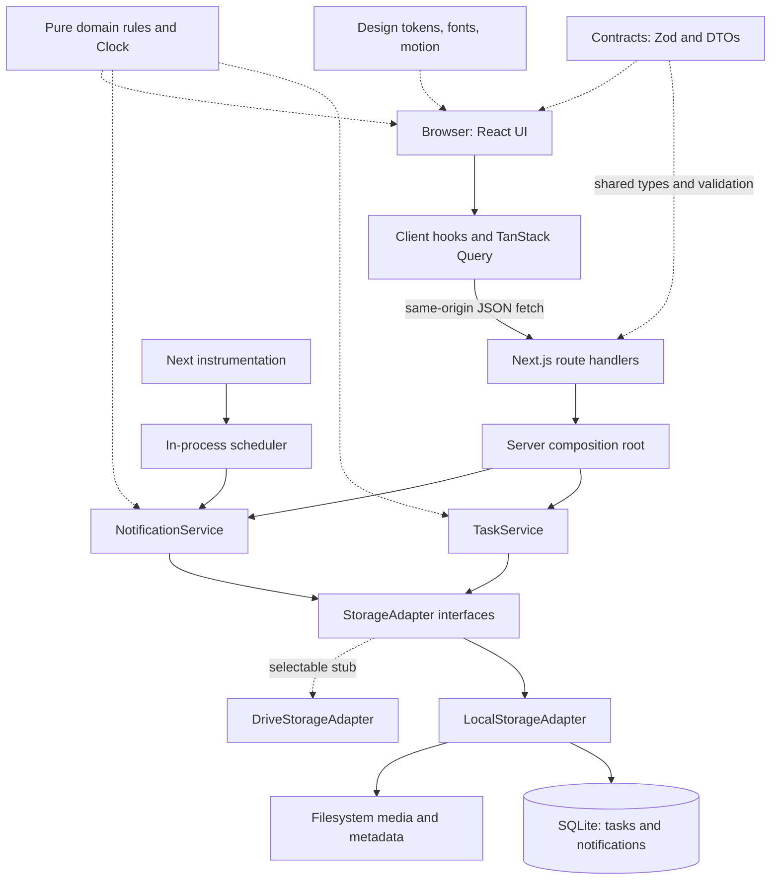
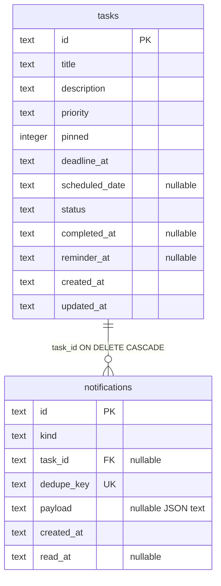
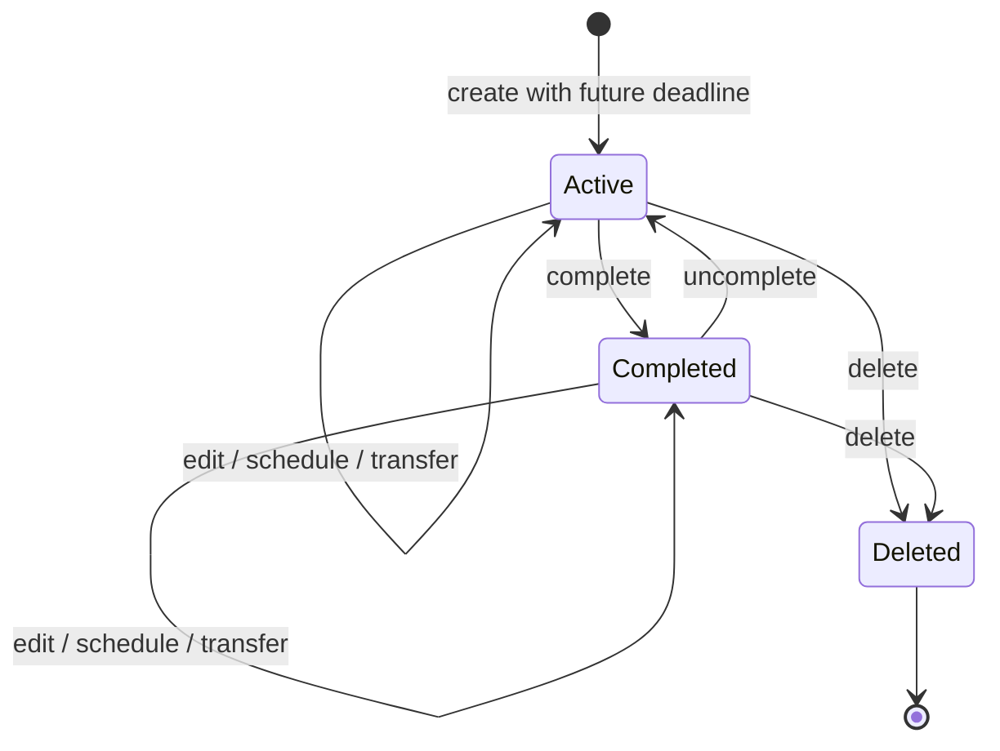
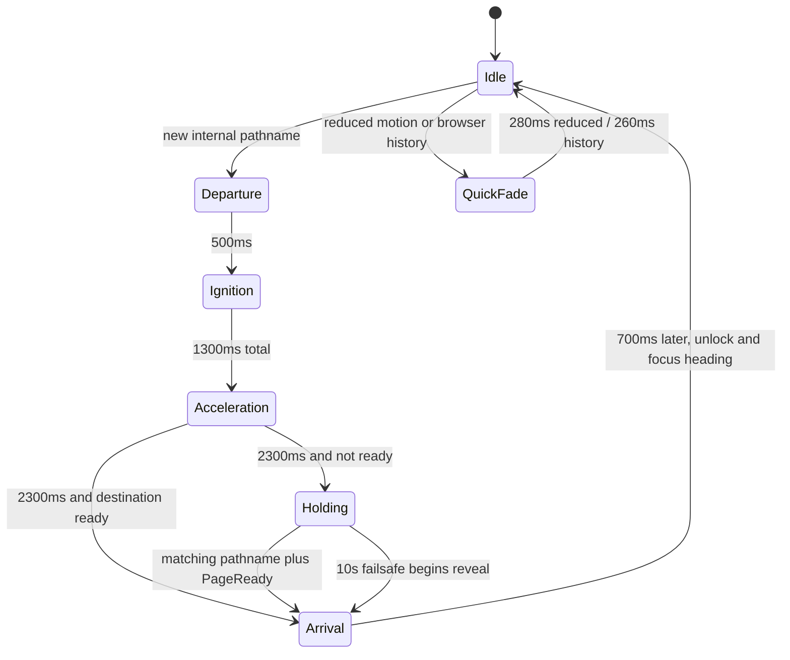

# Hiep Trong Space — Project Description and Engineering Reference

Updated **4 November 2026**. Package `hiep-trong-space` `0.1.0`. This reference includes the integrated Earth homepage and the three-day Daily Tasks carousel. The original audit remains as historical evidence. [Verification](#143-refactor-verification--3-november-2026)

**Choose your reading depth:** [Level 1 — Quick Project Understanding](#level-1--quick-project-understanding) · [Level 2 — Comprehensive Technical Reference](#level-2--comprehensive-technical-reference) · [Detailed contents](#level-2-contents).

## Level 1 — Quick Project Understanding

Read this level for the overall design; follow its links when a task requires implementation detail. Level 2 preserves the original technical reference, with corrections for current instructions and evidence.

### Purpose and scope

**Hiep Trong Space is a local-first personal life-management web app for one user.** It helps the owner organize tasks, deadlines, learning, projects, and ambitions while gaining experience building a modular application with AI assistance. Initial use is local on Windows, using free tools. The homepage is a dark, animated personal universe; working pages use a light lavender interface.

The working product contains Daily Task Management, a Tasks Hub, and in-app notifications. A homepage collection and searchable Universe menu navigate to thirteen spaces. Eleven destinations deliberately show blank-page shells; their learning, writing, event, tracking, entertainment, and achievement systems are ideas rather than implemented functionality. Daily statistics is also a placeholder. See [feature catalog](#3-route-and-feature-catalog) and [implementation status](#151-status-by-subsystem).

### Technology at a glance

| Area | Current stack and role |
| --- | --- |
| Application | Next.js 15 App Router, React 19, strict TypeScript; one Node process serves pages and JSON APIs. |
| Client data | TanStack Query 5 handles fetching, polling, cache invalidation and optimistic mutations. |
| Data and validation | SQLite through native `better-sqlite3` and Drizzle; Zod contracts shared across layers. |
| Time | date-fns and `@date-fns/tz`; task UI defaults to Asia/Saigon. |
| Presentation | Tailwind CSS 4, CSS tokens, Motion, lucide-react, Cormorant Garamond, Inter, and Forum. The homepage combines a Canvas 2D starfield with a Three.js Earth. |
| Engineering checks | ESLint layer boundaries, TypeScript, Vitest and Testing Library; real temporary SQLite in service/storage tests. |

Exact declared/locked versions, native Node requirements and configuration are in [development and operations](#13-development-and-operations).

### Architecture in one pass

**React UI → client query hooks → same-origin JSON routes → application services → StorageAdapter → SQLite/filesystem.**

Shared contracts define data shapes and validation; pure domain modules define time, sorting, urgency and reminder rules. The server container injects storage and a clock into services. A scheduler creates reminder records while the process runs; notification reads provide a fallback tick. Browser local storage holds two display preferences, not task data.

There is no separate backend service, authentication, multi-user model, cloud sync, offline write queue or external notification delivery. Google Drive is a throwing adapter stub. Media storage works internally but has no serving/upload API. See [architecture diagram and boundaries](#21-system-and-dependency-direction), [storage](#4-contracts-and-persistence) and [risks](#15-status-and-known-issues).

### Directory guide

| Repository path | Responsibility |
| --- | --- |
| `src/app/` | Root layout/home/error pages, workspace routes, and `api/` route handlers. |
| `src/features/`, `src/ui/`, `src/design/` | Feature screens/registry/transitions; shared controls/shell; tokens/fonts/motion. |
| `src/client/` | Typed fetch wrapper, query hooks, preferences and minute ticker. |
| `src/contracts/`, `src/domain/` | Shared Zod types; framework-free business/time rules. |
| `src/services/` | Task/notification orchestration and storage interfaces/adapters. |
| `src/server/`, `src/instrumentation.ts` | Configuration, composition, scheduler, logging and startup. |
| `drizzle/`, `tests/`, `md/`, `public/` | Migrations, automated checks, specifications, and public assets including the wordmark and Earth maps. |
| `data/` | Ignored default runtime SQLite/media directory; custom paths may differ. |

The [full directory map](#22-directory-map) and [feature-to-code map](#162-common-change-impact-map) locate individual files and functions.

### Features and relationships

- **Daily and Hub share one task record.** `scheduledDate` places a task on a Daily calendar day; `deadlineAt` controls urgency. Scheduling preserves the deadline; transfer changes both. Completion keeps the record, remains visible in Daily, and is hidden by default in Hub.
- **Notifications join live task data.** Reminder timing, deduplication, completion replacement, read state and retention are service rules. They are in-app records, not OS/email alerts.
- **Navigation has a shared readiness contract.** Real internal pathname changes use Cosmic Launch; query-only changes and local controls do not. New pages must signal `PageReady`.
- **Presentation is shared.** Daily/Hub/Overdue use one TaskCard and TaskForm; gallery/menu use one feature registry; home and launch reuse the starfield implementation.

### Starting work and finding detail

Preserve independent schedule/deadline semantics and storage boundaries. Inspect current source before editing; this is a dated reference. The previously supplied AGENTS.md instructions were explicitly revoked on 3 November and must not be revived from historical notes. Follow current user instructions.

| Task | Selective reading |
| --- | --- |
| Understand models or change business behavior | [Contracts](#4-contracts-and-persistence) → [domain](#5-domain-rules) → [services](#6-services-and-state-transitions). |
| Change HTTP or client state | [API](#7-http-api) → [client flow](#8-client-data-flow). |
| Modify screens, motion or controls | [Tasks/notifications](#9-task-and-notification-interfaces), [home](#10-homepage-and-visual-engine), [navigation](#11-navigation-and-cosmic-launch), [shared UI](#12-design-system-and-shared-ui). |
| Run, validate or deploy | [Setup/scripts](#134-setup-and-scripts), [operations](#135-build-deployment-backup-restore), [test inventory](#142-complete-test-inventory-and-limits). |
| Plan a safe change | [Known issues R1–R20](#152-concrete-correctness-and-interaction-concerns) and [agent impact map](#16-ai-agent-onboarding-and-knowledge-map). |

The latest carousel update passed lint, TypeScript, 62 tests, and the production build. Edge checks covered all three carousel states at four viewport sizes.

## Level 2 — Comprehensive Technical Reference

Use the contents below to load only the relevant subsystem. Sections 1–16 retain their stable numbering and existing anchors; exact repository-relative paths and function names remain in the body. Technical facts are separated from planned ideas, historical verification and unverified code-inspection risks.

### Level 2 contents

- [1. Identity and authority](#1-identity-and-authority)
  - [1.1 Product intent](#11-product-intent)
  - [1.2 Instructions and evidence hierarchy](#12-instructions-and-evidence-hierarchy)
- [2. Architecture](#2-architecture)
  - [2.1 System and dependency direction](#21-system-and-dependency-direction)
  - [2.2 Directory map](#22-directory-map)
  - [2.3 Server composition and lifecycle](#23-server-composition-and-lifecycle)
  - [2.4 React root and error boundaries](#24-react-root-and-error-boundaries)
- [3. Route and feature catalog](#3-route-and-feature-catalog)
- [4. Contracts and persistence](#4-contracts-and-persistence)
  - [4.1 Shared contracts](#41-shared-contracts)
  - [4.2 Storage abstraction and selection](#42-storage-abstraction-and-selection)
  - [4.3 SQLite lifecycle and schema](#43-sqlite-lifecycle-and-schema)
  - [4.4 Media and future adapter](#44-media-and-future-adapter)
- [5. Domain rules](#5-domain-rules)
  - [5.1 Calendar dates and instants](#51-calendar-dates-and-instants)
  - [5.2 Derived state and time labels](#52-derived-state-and-time-labels)
  - [5.3 Canonical sort and view-specific exceptions](#53-canonical-sort-and-view-specific-exceptions)
  - [5.4 Reminder scheduling and live notification content](#54-reminder-scheduling-and-live-notification-content)
- [6. Services and state transitions](#6-services-and-state-transitions)
  - [6.1 TaskService](#61-taskservice)
  - [6.2 NotificationService](#62-notificationservice)
  - [6.3 Error vocabulary](#63-error-vocabulary)
- [7. HTTP API](#7-http-api)
- [8. Client data flow](#8-client-data-flow)
  - [8.1 Fetch and server-state provider](#81-fetch-and-server-state-provider)
  - [8.2 Task hooks](#82-task-hooks)
  - [8.3 Notification hooks and timing](#83-notification-hooks-and-timing)
  - [8.4 Display preferences](#84-display-preferences)
- [9. Task and notification interfaces](#9-task-and-notification-interfaces)
  - [9.1 DailyBoard and views](#91-dailyboard-and-views)
  - [9.2 HubList](#92-hublist)
  - [9.3 TaskCard and TaskMenu](#93-taskcard-and-taskmenu)
  - [9.4 TaskForm and date dialogs](#94-taskform-and-date-dialogs)
  - [9.5 Notification Center](#95-notification-center)
- [10. Homepage and visual engine](#10-homepage-and-visual-engine)
  - [10.1 Composition and copy](#101-composition-and-copy)
  - [10.2 Feature Collection](#102-feature-collection)
  - [10.3 Thumbnails and assets](#103-thumbnails-and-assets)
  - [10.4 Starfield React wrapper](#104-starfield-react-wrapper)
  - [10.5 StarfieldEngine internals](#105-starfieldengine-internals)
- [11. Navigation and Cosmic Launch](#11-navigation-and-cosmic-launch)
  - [11.1 Eligibility and link semantics](#111-eligibility-and-link-semantics)
  - [11.2 Provider lifecycle and readiness contract](#112-provider-lifecycle-and-readiness-contract)
  - [11.3 Overlay rendering](#113-overlay-rendering)
- [12. Design system and shared UI](#12-design-system-and-shared-ui)
  - [12.1 Design foundations](#121-design-foundations)
  - [12.2 Shared control inventory](#122-shared-control-inventory)
  - [12.3 Dialogs, drawers, focus, and popovers](#123-dialogs-drawers-focus-and-popovers)
  - [12.4 Workspace and Universe navigation](#124-workspace-and-universe-navigation)
- [13. Development and operations](#13-development-and-operations)
  - [13.1 Technologies and exact dependency snapshot](#131-technologies-and-exact-dependency-snapshot)
  - [13.2 Configuration files and conventions](#132-configuration-files-and-conventions)
  - [13.3 Environment variables](#133-environment-variables)
  - [13.4 Setup and scripts](#134-setup-and-scripts)
  - [13.5 Build, deployment, backup, restore](#135-build-deployment-backup-restore)
- [14. Verification](#14-verification)
  - [14.1 Audit execution results](#141-audit-execution-results)
  - [14.2 Complete test inventory and limits](#142-complete-test-inventory-and-limits)
  - [14.3 Refactor verification — 3 November 2026](#143-refactor-verification--3-november-2026)
- [15. Status and known issues](#15-status-and-known-issues)
  - [15.1 Status by subsystem](#151-status-by-subsystem)
  - [15.2 Concrete correctness and interaction concerns](#152-concrete-correctness-and-interaction-concerns)
  - [15.3 Security and deployment scope](#153-security-and-deployment-scope)
  - [15.4 UI-spec and README qualifications](#154-ui-spec-and-readme-qualifications)
- [16. AI agent onboarding and knowledge map](#16-ai-agent-onboarding-and-knowledge-map)
  - [16.1 Safe starting procedure](#161-safe-starting-procedure)
  - [16.2 Common change impact map](#162-common-change-impact-map)
  - [16.3 Invariants future changes must address explicitly](#163-invariants-future-changes-must-address-explicitly)
  - [16.4 Scope and freshness checklist for the next reader](#164-scope-and-freshness-checklist-for-the-next-reader)

### 1. Identity and authority

[Reference contents](#level-2-contents) · [Quick overview](#level-1--quick-project-understanding)

#### 1.1 Product intent

The product name in package metadata, page metadata, accessible wordmark, and README is **Hiep Trong Space**. The package name is `hiep-trong-space`; it is private. `md/idea_readme.md` describes a personal project for the owner to organize life and gain experience building a substantial application with AI agents. The stated constraints include Windows, free tools, incremental approved epics, modularity, an independently replaceable UI, and eventual storage migration through an adapter. Initial deployment is local; no approved cloud rollout is recorded in the current files.

The homepage opens with a vector wordmark over a rotating night Earth and forward-moving stars. Native scrolling reveals the full globe and leads to the feature collection. Workspace pages use light lavender, serif display type, and subtle celestial details.

#### 1.2 Instructions and evidence hierarchy

This reference consolidates the actual implementation; it does **not** override user instructions or restore missing architectural policy.

| File | Current meaning and condition |
| --- | --- |
| `AGENTS.md` | Historical only: read during the 2 November audit, then deleted. On 3 November 2026 the user explicitly revoked the previously supplied AGENTS.md instructions. Its former required-reading sequence, architectural-authority designation, and approval rules are not current policy. Do not reinstate them from this document. |
| `md/agent_readme.md` | Currently contains only the owner's explanation that the previous complex instructions were removed and that future instructions should be synthesized from ideas/UI. It supplies no surviving detailed architecture sections. |
| `md/progress.md`, `md/human_readme.md` | Missing in the current working tree and recorded as pre-existing deletions in the original audit. Do not assume their former contents still apply or restore them as part of an unrelated task. |
| `md/ui_readme.md` | Detailed visual/interaction specification. Its text declares visual precedence over architectural documentation for visual matters; surface-specific rules override shared-component rules, then principles. That description does not revive revoked AGENTS.md policy. Implementation differences are documented in [section 15](#15-status-and-known-issues). |
| `md/idea_readme.md` | Raw owner intentions and future ideas, not proof of implemented functionality or an approved implementation schedule. |
| `README.md` | Existing quick start, broad architecture, built-surface claims, and backup guidance. Some claims need the qualifications in this document. |
| `md/current_task.md` | Owner's current task brief. Read it before starting work and check the source to determine what is already implemented. |
| `md/PROJECT_STATUS.md`, `md/how_to_run.md`, `md/human_instructions.md` | Also absent; the original audit recorded pre-existing Git deletions. Old section references in comments/tests are historical identifiers, not readable current policy. |
| `sources.txt` | A list of external design-inspiration URLs. No source imports, runtime integration, or requirements are derived from those websites. |

The original 2 November audit scope included all **118 `src/` files**, **18 `tests/` files** (17 discovered test files plus one reusable contract harness), top-level configuration, package declarations and lockfile records, migration SQL and metadata, the public SVG asset, and existing documentation. Third-party `node_modules/`, generated `.next/`, real user database/media contents, and `.env` secrets were not treated as project source or copied into this reference. The `sources/` directory had no files in the recursive inventory. The existing empty lowercase `md/project_description.md` was renamed to the requested uppercase filename on Windows.

### 2. Architecture

[Reference contents](#level-2-contents) · [Quick overview](#level-1--quick-project-understanding)

#### 2.1 System and dependency direction



Storage is **server-side local storage**, not `window.localStorage`. API routes do not query SQLite directly. Services depend on the `StorageAdapter` abstraction and `Clock`, not on concrete repository implementations. The server container selects the adapter, initializes it, and constructs services. React components access business data through client hooks over HTTP; shared domain functions may also run in the browser to keep time labels current.

`eslint.config.mjs` enforces the direction with `no-restricted-imports` and `no-restricted-properties`:

| Layer | Responsibility and restrictions |
| --- | --- |
| `src/contracts/` | Zod schemas and inferred DTO/input types. No React, Next, domain, services, server, client, UI, features, design, filesystem, or database imports. |
| `src/domain/` | Framework-free rules depending on contracts/date libraries. No storage, framework, UI, service, or server imports. |
| `src/services/` outside storage | Orchestration using domain/contracts and storage interfaces. No concrete local/Drive/factory imports, I/O, database, server, or presentation dependencies. |
| `src/services/storage/` | All actual file/database operations and adapter selection. No React/Next or browser presentation layers. |
| `src/server/` | Environment, container, scheduler, error mapping, logging. May compose storage through its factory but cannot directly import filesystem/database packages or UI/client/features/design. |
| `src/app/api/` | HTTP parsing, validation, service calls, response translation. No direct storage/I/O/database or client/UI dependencies. |
| `src/client/` | Fetch, server-state hooks, display preferences, clock hook. No service/server/storage/database or feature/UI imports. |
| `src/features/`, `src/ui/`, non-API `src/app/` | Presentation and interactions. No services/server/database/filesystem imports. Some `src/ui/` modules intentionally depend on feature navigation/notifications, so this directory is not entirely feature-agnostic. |
| `src/design/` TypeScript | Fonts and motion foundations. No application-layer imports. |

`process.env` belongs in `src/server/config.ts`; `src/instrumentation.ts` has an explicit exception for the compile-time `NEXT_RUNTIME` guard. Only `src/client/preferences.ts` accesses browser local storage. Direct `next/link` imports and `useRouter` calls belong under `src/features/transitions/`; other UI uses wrappers. These latter access rules are additionally checked by tests, not only ESLint.

#### 2.2 Directory map

```text
.
├── README.md, sources.txt      AGENTS.md read initially, absent at final scan
├── package.json, package-lock.json
├── .env.example, .gitignore, .gitattributes, .prettierrc
├── next.config.ts, tsconfig.json, eslint.config.mjs
├── postcss.config.mjs, vitest.config.ts, drizzle.config.ts
├── md/                       instructions, intentions, UI spec, this reference
├── public/                   favicon, vector wordmark, Earth textures and posters
├── drizzle/
│   ├── 0000_lush_gravity.sql  initial schema migration
│   └── meta/                 journal and generated schema snapshot
├── src/
│   ├── instrumentation.ts    Node startup hook
│   ├── app/                  root shell, home, errors, route groups and APIs
│   │   ├── (workspace)/      shell plus 13 feature routes
│   │   └── api/              health, tasks, notification operations
│   ├── contracts/            shared Zod schemas/types
│   ├── domain/               pure time/task/notification rules
│   ├── services/             TaskService, NotificationService, errors
│   │   └── storage/          interfaces, factory, local adapter, Drive stub
│   ├── server/               config, container, scheduler, API errors, logger
│   ├── client/               API client, Query provider/hooks, preferences, ticker
│   ├── design/               tokens.css, fonts.ts, motion.ts
│   ├── features/             registry, home, tasks, notifications, transitions, blank
│   └── ui/                   shared controls, overlays, shell, Universe menu
├── tests/                    domain, services/storage, server, features, guardrails
├── data/                     ignored runtime database/media; not source
├── node_modules/, .next/     ignored dependencies/build output
└── sources/                  currently empty
```

#### 2.3 Server composition and lifecycle

`src/server/config.ts` defines `AppConfig`, `parseAppConfig(rawEnv)`, cached `getAppConfig()`, and `isNodeRuntime()`. Configuration uses Zod defaults and resolves storage paths relative to the process working directory. `isNodeRuntime()` exists but instrumentation uses its own literal check so the Next compiler can eliminate Node-only code from other runtime bundles.

`src/server/container.ts` defines `AppContainer` and private `buildContainer()`. It reads configuration, calls `createStorageAdapter()`, awaits `storage.init()`, then constructs `TaskService({ storage, clock: systemClock })` and `NotificationService({ storage, clock: systemClock, timeZone: config.appTimezone })`. `getContainer()` caches a promise on `globalThis.__htsContainerPromise` to survive development module reloads and share in-flight initialization. A rejected initialization clears the cache so a later call can retry. `getHealth()` returns `{ ok: true, storage: config.storageDriver }` after initialization; it does not perform a new database probe on each request.

`src/instrumentation.ts::register()` dynamically imports and starts the scheduler only for `NEXT_RUNTIME === 'nodejs'`. `src/server/scheduler.ts::startScheduler()` guards with `globalThis.__htsSchedulerStarted`. It immediately runs purge then reminder catch-up, schedules reminder checks every `max(5000, schedulerTickSeconds * 1000)` milliseconds, and purges hourly. Timers call `unref()` where supported. `safeRunReminderTick()` and `safePurgeExpired()` log failures rather than rejecting interval callbacks. There is no exported scheduler stop/reset, durable queue, distributed lease, or automatic shutdown call to `storage.close()`.

`src/server/logger.ts` exposes `logger.info/warn/error` and `LogContext`. `formatLine()` produces `[LEVEL] message` plus JSON context; info writes to stdout, warnings/errors use the permitted console methods. There is no logging package, log persistence, request ID, or metrics pipeline.

#### 2.4 React root and error boundaries

| Path | Important export and behavior |
| --- | --- |
| `src/app/layout.tsx` | `RootLayout`: English document, font CSS variables, global stylesheet, metadata title default/template and `/icon.svg`, then `AppProviders`. |
| `src/app/providers.tsx` | `AppProviders`: `QueryProvider` → `ToastProvider` → `TransitionProvider` → application children. Order matters: navigation errors can toast, and all UI can query. |
| `src/app/page.tsx` | `HomePage`: cosmos wrapper, immediate `PageReady`, fixed ambient gradients and `Starfield`, then `Hero`, `FeatureCollection`, `HomeFooter`. |
| `src/app/(workspace)/layout.tsx` | `WorkspaceGroupLayout`: wraps every workspace page in `WorkspaceShell`; parentheses do not appear in URLs. |
| `src/app/error.tsx` | `GlobalErrorPage`: root-segment client error UI with message, retry via `reset`, home navigation, and `PageReady`. Despite its name this is `error.tsx`, not Next's separate `global-error.tsx` root-layout fallback. |
| `src/app/(workspace)/error.tsx` | `WorkspaceErrorPage`: workspace failure message and retry; signals readiness to release a transition. |
| `src/app/not-found.tsx` | `NotFoundPage`: “Uncharted coordinates,” home link, and readiness signal. |

### 3. Route and feature catalog

[Reference contents](#level-2-contents) · [Quick overview](#level-1--quick-project-understanding)

`src/features/registry.ts` is the one ordered source for homepage cards and the Universe menu. `FeatureEntry` contains `id`, `slug`, `title`, `label`, `href`, `status: 'built' | 'blank'`, and `thumbnail { preset, accent, imageUrl? }`. `FeatureThumbnailPreset` is a thirteen-value union. `getFeatureById()` and `getFeatureByHref()` use exact linear lookup; neither normalizes routes. `slug` and `status` are descriptive metadata and do not implement routing or disable blank cards.

All rows below map to the full route path **`src/app/(workspace)/<segment>/page.tsx`**. Titles are the registry titles; workspace task headers use sentence-case shorter labels.

| Order / ID | URL | Route file | Label; thumbnail preset / accent | Implementation |
| --- | --- | --- | --- | --- |
| 1 `daily-tasks` | `/tasks/daily` | `src/app/(workspace)/tasks/daily/page.tsx` | Tasks; `constellation-arc` / lavender | `DailyTasksPage` → `DailyBoard`; built. |
| 2 `tasks-hub` | `/tasks/hub` | `src/app/(workspace)/tasks/hub/page.tsx` | Tasks; `dual-orbit` / blue | `TasksHubPage` → Suspense → `HubList`; built. Suspense supports `useSearchParams`; skeleton fallback has no readiness signal until content mounts. |
| 3 `events` | `/events` | `src/app/(workspace)/events/page.tsx` | Schedule; `meridian-grid` / lavender | `EventsPage` → `BlankPage`, title Events. |
| 4 `ai-engineering` | `/ai-engineering` | `src/app/(workspace)/ai-engineering/page.tsx` | Learning; `neural-lattice` / blue | `AiEngineeringPage` → blank, title AI Engineering. |
| 5 `blogs` | `/blogs` | `src/app/(workspace)/blogs/page.tsx` | Writing; `manuscript-lines` / lavender | `BlogsPage` → blank, title Blogs Hub. |
| 6 `apcs` | `/apcs` | `src/app/(workspace)/apcs/page.tsx` | University; `academic-compass` / blue | `ApcsPage` → blank, title APCS Hub. |
| 7 `flashcards` | `/flashcards` | `src/app/(workspace)/flashcards/page.tsx` | Learning; `paired-cards` / lavender | `FlashcardsPage` → blank. |
| 8 `entertainment` | `/entertainment` | `src/app/(workspace)/entertainment/page.tsx` | Personal; `harmonic-waves` / blue | `EntertainmentPage` → blank, title Entertainment Hub. |
| 9 `tracking` | `/tracking` | `src/app/(workspace)/tracking/page.tsx` | Tracking; `pulse-timeline` / lavender | `TrackingPage` → blank. |
| 10 `projects` | `/projects` | `src/app/(workspace)/projects/page.tsx` | Projects; `blueprint-vectors` / blue | `ProjectsPage` → blank, title In Progress Projects. |
| 11 `milestones` | `/milestones` | `src/app/(workspace)/milestones/page.tsx` | Personal; `summit-trajectory` / lavender | `MilestonesPage` → blank, title Annual Milestones. |
| 12 `learning-room` | `/learning-room` | `src/app/(workspace)/learning-room/page.tsx` | Learning; `focus-aperture` / blue | `LearningRoomPage` → blank. |
| 13 `achievements` | `/achievements` | `src/app/(workspace)/achievements/page.tsx` | Personal; `zenith-crown` / lavender | `AchievementsPage` → blank, title Personal Achievements. |

Each route gets metadata from `getFeatureById()` with a literal fallback title. Blank routes are functional destinations, not missing routes. `src/features/blank/BlankPage.tsx::BlankPage({ title })` renders concentric 220/320px rings, a star, title, “This space is waiting to be built,” home link, and `PageReady`. There is no data fetching, feature-specific state, API, or model behind them.

The Notification Center is a popover on the homepage and workspace top bar, not a fourteenth feature card or a `/notifications` page. There is no email-hub route even though the raw ideas mention email classification.

### 4. Contracts and persistence

[Reference contents](#level-2-contents) · [Quick overview](#level-1--quick-project-understanding)

#### 4.1 Shared contracts

`src/contracts/index.ts` re-exports `task.ts`, `notification.ts`, and `api.ts`. These are the API/storage/UI type vocabulary; do not create divergent component-only task models.

`src/contracts/task.ts` exports `Priority`, `TaskStatus`, `TaskRecord`, `TaskDto`, `CreateTaskInput`, `UpdateTaskInput`, `TransferTaskInput`, `TaskQuery`, and their schemas. Dates have two distinct representations: calendar dates (`YYYY-MM-DD`, no time zone) and ISO instant strings (offset accepted by Zod). The UI generates UTC `Z` instants; server contracts also accept offset forms without normalizing them.

| `TaskRecord` field | Type / validation | Meaning |
| --- | --- | --- |
| `id` | UUID string | Stable identity shared by Daily, Hub, notifications. |
| `title` | Trimmed string, 1–120 characters | Required user title. |
| `description` | String, maximum 2000 characters | Plain text; empty string is valid; no rich text parser. |
| `priority` | `urgent`, `normal`, `optional` | Ordering and badge tone. |
| `pinned` | Boolean | Active-list pin ordering; not an independent priority. |
| `deadlineAt` | `isoInstantSchema`: `z.string().datetime({ offset: true })` | Actual deadline instant. |
| `scheduledDate` | Nullable `scheduledDateSchema` | Daily placement, independent of deadline. Regex checks shape only. |
| `status` | `active` or `completed` | Persisted lifecycle, not derived urgency. |
| `completedAt` | Nullable ISO instant | Current completion time; cleared on uncomplete. No completion-event history table. |
| `reminderAt` | Nullable ISO instant | Calculated when task is created, deadline changes, transferred, or reopened. |
| `createdAt`, `updatedAt` | ISO instants | Server clock timestamps. |

`TaskDto` extends the record with `isOverdue`, `isDueSoon`, and `timeLeftMs: number`. These are computed snapshots; they are not SQLite columns. The browser recalculates them for task rendering.

Input rules:

- `createTaskInputSchema`: required title and deadline; defaults description to `''`, priority to `normal`, pinned to false, scheduled date to null. `CreateTaskInput` uses `z.input` so callers may omit defaulted fields.
- `updateTaskInputSchema`: title/description/priority/pinned/deadline/scheduled date are optional, but at least one recognized field must remain after parsing. It cannot directly change status, reminder, IDs, timestamps, or completion time.
- `transferTaskInputSchema`: required non-null scheduled date and deadline. It does not require that the calendar date matches the deadline's local date.
- `taskQuerySchema`: optional status, priority, scheduled date (including null), scheduled/deadline inclusive from/to ranges, and trimmed search up to 200 characters. There is no pagination, sort parameter, range-order refinement, or query limit.
- Ordinary Zod object parsing strips unrecognized properties; these schemas are not `.strict()` objects. A date matching the scheduled-date regex can still be an impossible calendar date; client helpers validate more strictly.

`src/contracts/notification.ts` exports `NotificationKind`, `NotificationPayload`, `NotificationRecord`, `NotificationDto`, `NotificationListResponse`, `NotificationQuery`, `NotificationDeleteFilter`, and corresponding schemas.

| Model | Fields and invariants |
| --- | --- |
| `NotificationRecord` | UUID `id`; kind `due_soon`, `overdue`, `completed`, `general`, or `system`; nullable task UUID; non-empty `dedupeKey`; nullable payload with optional `title`/`message`; ISO `createdAt`; nullable ISO `readAt`. Schema does not enforce kind/task/payload combinations. |
| `NotificationDto` | UUID, kind, `tagLabel`, rendered title/message, `isRead`, creation instant, nullable time-left, nullable task ID and target URL. It intentionally omits dedupe key/payload/readAt. |
| `NotificationListResponse` | `items` plus nonnegative integer `unreadCount`. |
| `NotificationQuery` | Optional task ID, array of kinds, unread-only boolean. Used at repository level; list API does not expose query filters. |
| `NotificationDeleteFilter` | Optional task ID, kind list, creation cutoff. Empty filters intentionally delete nothing. |

`src/contracts/api.ts` contains `StorageDriver = 'local' | 'drive'`, `HealthResponse = { ok: true, storage }`, and `ApiErrorResponse = { error: { code, message, fields? } }`. Error codes are strings in the transport schema; application errors use a narrower union.

#### 4.2 Storage abstraction and selection

`src/services/storage/storage-adapter.ts` defines:

```ts
interface Repository<TRecord, TQuery = void> {
  saveItem(record: TRecord): Promise<TRecord>;
  getItem(id: string): Promise<TRecord | null>;
  listItems(query?: TQuery): Promise<TRecord[]>;
  deleteItem(id: string): Promise<void>;
}
// TaskRepository = Repository<TaskRecord, TaskQuery>
// NotificationRepository also has deleteWhere(filter): Promise<number>
// StorageAdapter has tasks, notifications, media, init(), close().
```

`MediaUploadInput` is `{ name, mimeType, data: Uint8Array }`, `MediaUploadResult` is `{ id, url }`, and `MediaObject` is `{ mimeType, data }`. `MediaStorage` provides upload/get/delete. Promise-based interfaces allow another backend even though SQLite statements execute synchronously.

`src/services/storage/factory.ts::createStorageAdapter(config)` selects `DriveStorageAdapter` for `drive`, otherwise `LocalStorageAdapter`. Configuration includes database path, media path, Drive folder ID, and optional migrations folder. The validated driver prevents accidental fallback from an arbitrary environment value.

#### 4.3 SQLite lifecycle and schema

`src/services/storage/local/local-storage-adapter.ts::LocalStorageAdapter` constructs the three repositories with a database getter. Calls before initialization throw. `init()` returns early if already initialized; it creates the database parent and media directory, opens `better-sqlite3`, sets WAL and foreign keys ON, builds the Drizzle connection, and runs migrations from `process.cwd()/drizzle` unless overridden. Only after successful migration are the handles assigned. `close()` closes the native handle and clears it and the Drizzle reference.

The default database is `data/hiep-trong-space.db`. SQLite may create `-wal` and `-shm` companion files. `src/services/storage/local/schema.ts` defines the schema; `drizzle/0000_lush_gravity.sql` implements it. `drizzle/meta/_journal.json` records one migration, `0000_lush_gravity`; `drizzle/meta/0000_snapshot.json` is the generated schema snapshot used for migration generation. The snapshot contains tables/indexes/foreign key metadata, not application data.



Indexes are `tasks_status_scheduled_date_idx(status, scheduled_date)`, `tasks_status_deadline_at_idx(status, deadline_at)`, `tasks_reminder_at_idx(reminder_at)`, unique `notifications_dedupe_key_uidx(dedupe_key)`, `notifications_task_id_idx(task_id)`, and `notifications_created_at_idx(created_at)`. Enum annotations in Drizzle supply types, not SQL CHECK constraints; the initial SQL also has no title length checks, boolean CHECK, or completion-state consistency constraint. Validation is chiefly at application write boundaries.

`src/services/storage/local/local-task-repository.ts::LocalTaskRepository`:

- `saveItem()` validates with `taskRecordSchema`, then inserts/upserts on ID, updating all fields including creation time supplied by the caller. Returns the validated record.
- `getItem()` selects by ID and maps with `rowToTaskRecord()`; missing records return null.
- `listItems()` ANDs supplied filters. Null scheduled date uses `IS NULL`; ranges use inclusive `gte/lte`. Base SQL ordering is created time then ID ascending, **not** the business sort. Search is performed after fetching rows with locale-lowercased literal substring matching in title or description, avoiding SQL wildcard behavior (`100%` is literal).
- `deleteItem()` deletes by ID; missing IDs are a no-op at repository level. Foreign key cascade removes linked notifications. Service deletion performs its own existence check and explicit cleanup for backend-independent semantics.

`src/services/storage/local/local-notification-repository.ts::LocalNotificationRepository` validates writes, serializes payload JSON, upserts on ID, and translates SQLite unique-dedupe constraint errors to `ConflictError`. Other database errors propagate. `parsePayload()` JSON-parses and Zod-validates payload on reads; record reads otherwise map columns without full schema revalidation. `listItems()` orders creation time and ID descending, optionally filters task/kinds/unread (`read_at IS NULL`), and returns `[]` for an explicit empty kind array. `deleteWhere()` ANDs populated filters, applies `created_at <= cutoff`, returns affected-row count, and refuses an empty filter or empty kinds list. `deleteItem()` removes a single ID.

#### 4.4 Media and future adapter

`src/services/storage/local/local-media-storage.ts::LocalMediaStorage` uses UUID-derived `<id>.bin` and `<id>.meta.json` paths. `resolvePaths()` rejects non-UUID IDs with `ValidationError`, so user filenames do not determine paths. `ensureDirectory()` creates the media directory. `uploadMedia()` requires a nonblank MIME type, writes bytes and JSON `{ name, mimeType }`, and returns `/api/media/<id>`. `getMedia()` reads both files concurrently, validates metadata, returns bytes as `Uint8Array`, and returns null on ENOENT. Other parse/I/O errors propagate. `deleteMedia()` force-removes both files concurrently, making missing-file deletion harmless.

**No `/api/media/[id]` or media-upload route exists.** This is a working storage capability tested directly, not an end-to-end user feature. Names are stored but not returned by `getMedia()`. There is no upload size limit, content inspection, atomic two-file commit, metadata repair, or media-to-task relationship.

`src/services/storage/drive/drive-storage-adapter.ts` contains `DriveTaskRepository`, `DriveNotificationRepository`, `DriveMediaStorage`, `DriveStorageAdapterOptions`, and exported `DriveStorageAdapter`. All repository/media operations and `init()` throw `NotImplementedError('Drive adapter not implemented')`; `close()` resolves without action. Comments sketch future Drive file/index mappings but implement no OAuth, SDK calls, conflict resolution, or migration. Selecting `STORAGE_DRIVER=drive` makes container initialization fail and APIs return 501; it does not enable cloud storage.

### 5. Domain rules

[Reference contents](#level-2-contents) · [Quick overview](#level-1--quick-project-understanding)

All domain files accept explicit values rather than reading environment variables or accessing storage. Services inject time via `src/domain/clock.ts::Clock { now(): Date }`; `systemClock.now()` returns `new Date()`. Tests use independently defined mutable clocks, enabling exact boundary assertions without waiting for wall-clock deadlines.

#### 5.1 Calendar dates and instants

`src/domain/time.ts` owns `DEFAULT_APP_TIMEZONE = 'Asia/Saigon'` and the following functions:

| Function | Algorithm / contract |
| --- | --- |
| private `toZonedDate(instant, timeZone)` | Parses an ISO string or uses the supplied `Date`, then constructs `TZDate` at the same timestamp in the selected zone. |
| `formatScheduledDate()` | Formats an instant as `yyyy-MM-dd` in the zone. UTC midnight is not the calendar-day boundary for UTC+7. |
| `formatDisplayDate(instant, referenceNow, zone)` | `dd/MM` if target and reference share a zoned calendar year, otherwise `dd/MM/yyyy`. |
| `formatDisplayDateTime()` | Display date plus zoned `HH:mm` using 24-hour time. |
| `buildZonedInstant(date, time, zone)` | Requires exact `YYYY-MM-DD` and `HH:mm`, checks numeric month/day/hour/minute ranges, constructs `TZDate`, rejects calendar rollover such as 30 February, returns canonical UTC `toISOString()`. Seconds/milliseconds are zeroed. Throws `RangeError` on invalid input. |
| `shiftScheduledDate(date, deltaDays, zone)` | Parses date shape, constructs a local-noon anchor, adds days with date-fns, formats ISO calendar date. Noon avoids midnight DST boundary issues; this helper is not a full arbitrary-input validator. |

Example: `buildZonedInstant('2026-10-30', '23:59', 'Asia/Saigon')` produces `2026-10-30T16:59:00.000Z`. Do not compare browser-host calendar dates or use `toISOString().slice(0, 10)` to place tasks in local-day columns.

`src/domain/date-input.ts` bridges human input and calendar views:

| Function / type | Detailed behavior |
| --- | --- |
| `ResolvedDateInput` | `{ scheduledDate, displayInput, humanLabel }`; despite the field name, the result can represent a deadline date, not necessarily Daily placement. |
| private `isValidCalendarDay()` | Validates calendar existence and limits years to 1970–2100, using a UTC-noon probe. |
| private `toHumanLabel()` | Produces English `EEEE, dd MMM yyyy` in the requested zone; falls back to raw string if its ISO shape is invalid. |
| `resolveDateInput(raw, referenceNow, zone)` | Trims; accepts ISO `YYYY-MM-DD`, `D/M` or `DD/MM`, and slash dates with four-digit year. Explicit years may be past. Without a year, searches current year through eight years ahead for the nearest valid day **on or after today**, including leap-day resolution. Returns null for invalid input. Display omits year if equal to current zoned year. |
| `isValidTimeHm(raw)` | Trimmed, exactly two-digit hours/minutes, 00:00–23:59. `9:00` is not valid; `09:00` is. |
| `extractZonedDateAndTime()` | Converts stored instant into `{ dateInput, scheduledDate, timeHm }`; same-year dateInput omits year. |
| `isFutureInstant(instant, now)` | Strict timestamp comparison `> 0`; exact equality is not future. |
| `buildDeadlineFromInputs({ dateInput, timeInput, referenceNow, timeZone? })` | Uses resolver/time validator, returns discriminated success `{ ok: true, scheduledDate, deadlineAt }` or field-specific failure `{ ok: false, field, message }`, where field is date or time. It does not itself require future time. |
| `getWeekDates(anchor, zone)` | Seven ISO dates Monday–Sunday for the anchor week; invalid shape gives `[]`. |
| `MonthCalendarCell` / `getMonthCalendarCells()` | Returns month label and Monday-aligned full-week grid covering the month, including preceding/following-month dates; each cell has date, day number, in-current-month flag. Invalid shape gives empty label/grid. |
| `formatDayColumnHeader()` | Returns English full weekday, short weekday, and `dd/MM`; invalid shape returns raw date strings and empty day/month. |

Omitted-year input is intentionally forward-resolving. It is not equivalent to preserving the year of an existing date. The edit-form implication is recorded in section 15.

#### 5.2 Derived state and time labels

`src/domain/task-status.ts::deriveTaskState(task, now)` computes:

```text
timeLeftMs = deadlineAt - now
isOverdue  = status == active AND timeLeftMs <= 0
isDueSoon  = status == active AND NOT isOverdue
             AND reminderAt != null AND reminderAt <= now
```

Completed tasks have neither urgency flag, even with a negative `timeLeftMs`. `toTaskDto()` spreads the record and these derived values. `formatTimeLeftLabel(ms, isOverdue)` emits “Overdue by …” if the flag is true **or** milliseconds are nonpositive; otherwise “… left.” Private `formatDurationCompact()` floors to minutes, emits `<1m`, minutes, hours/minutes, or days/hours, and omits smaller units at larger scales. At deadline equality the overdue label is “Overdue by <1m”. Task cards suppress time-left for completed tasks.

#### 5.3 Canonical sort and view-specific exceptions

`src/domain/task-sort.ts` defines private `PRIORITY_WEIGHT` (urgent 0, normal 1, optional 2), `compareTasks(a,b)`, and copying `sortTasks(tasks)`:

1. Active tasks before completed.
2. Between completed tasks, completion time ascending, so the latest completion lands last; null completion precedes non-null if mixed.
3. Pins first.
4. Priority urgent → normal → optional.
5. Deadline ascending.
6. Creation time ascending.
7. ID `localeCompare` as deterministic final tie-breaker.

Equal completion times continue through pin/priority/deadline tie-breaks. Never mutate an incoming array to apply canonical sort; `sortTasks()` creates a copy. Daily columns, Week, selected Month day, and API service lists use this ordering. **Hub default deadline sort** applies pin then deadline before canonical fallback; Hub priority mode uses canonical ordering. **Hub completed group** is newest-completed first. **Overdue lane** uses deadline ascending alone, ignoring pins/priority except input order for equal deadlines.

#### 5.4 Reminder scheduling and live notification content

`src/domain/reminder.ts::computeReminderAt(deadlineAt, referenceNow)` computes a persistent reminder instant from remaining duration `R`:

| Remaining at calculation | Reminder |
| --- | --- |
| `R <= 0` | null |
| `R >= 24h` | deadline minus 24 hours; exactly 24h gives the reference instant |
| `0 < R < 24h` | deadline minus `round(R / 4)` milliseconds |

The quarter rule means a task created with 12 hours remaining alerts **nine hours after creation, when three hours remain**. It does not alert after the first three hours. A two-minute deadline alerts at 90 seconds; overdue begins at 120 seconds. Short-deadline reminders may be missed between coarse scheduler ticks; catch-up emits overdue once the deadline has passed.

`src/domain/notification-rules.ts` exports:

- `NOTIFICATION_TAG_LABELS`: Due soon, Overdue, Completed, General, System.
- `ReminderCandidate` with task ID, alert kind, dedupe key.
- `evaluateTaskReminderCandidate(task, now)`: completed → null; active deadline at/before now → overdue; otherwise reminder reached → due soon; otherwise null. Overdue takes precedence during catch-up. Keys are `task:<id>:<kind>:<deadlineAt>` with the stored deadline string.
- `buildNotificationDto({ record, task, now, timeZone? })`: general/system use payload title/message (fallback tag/empty message) and no task link/countdown. Task kinds require the live task or return null. Due-soon message is `"<title>" is due <date time>.`; overdue is `"<title>" was due <date time>.`; completed title is “Nicely done” and message `"<title>" is complete.`. Active alert countdown is derived at read time; completed notifications have none. Every task-linked target is `/tasks/hub?task=<id>`. `isRead` comes from non-null `readAt`. Task titles/deadlines are joined live, not copied into alert payloads.
- `formatRelativeAgeLabel(createdAt, now)`: clamps future ages to zero; returns Just now under a minute, `N min ago` under an hour, singular/plural hours under a day, otherwise singular/plural days.

The builder does not filter a stored due-soon record merely because its task is now overdue, nor remove an old completed record when the task becomes active again. Cleanup decisions belong to services.

### 6. Services and state transitions

[Reference contents](#level-2-contents) · [Quick overview](#level-1--quick-project-understanding)

#### 6.1 TaskService

`src/services/task-service.ts::TaskService` accepts `{ storage: StorageAdapter, clock: Clock }`. It validates inputs even when routes already parsed them, keeping non-HTTP callers on the same rules. Every missing task produces `NotFoundError('Task not found.')`.

| Method | Persistence, rules, and side effects |
| --- | --- |
| `listTasks(rawQuery?)` | Parses optional query; repository list → canonical sort → DTOs using one clock reading. |
| `getTask(id)` | Gets record or 404; derives current DTO. |
| `createTask(rawInput)` | Parses defaults; rejects deadline at/before server now with field error; generates UUID; sets active status, null completion, computed reminder, identical created/updated times; saves and derives DTO. No immediate reminder tick is called. |
| `updateTask(id, rawInput)` | Loads existing first, then validates patch. Merges supplied editable fields, retaining omitted fields and respecting explicit `scheduledDate: null`. Updates timestamp. **Past deadline edits are permitted.** Compares deadline strings, not timestamp equivalence. If changed, recomputes reminder for active tasks (null for completed), saves, then deletes due-soon/overdue notifications. Title-only, pin, priority, description, and scheduling changes preserve reminder and alert records. |
| `completeTask(id)` | Already completed returns without further writes. Otherwise sets completedAt/updatedAt to now, status completed, reminder null; saves; deletes due-soon/overdue records. If deletion count is positive, creates one unread completed notification keyed by task/deadline. Deduplication conflict is ignored. No prior alert means silent completion. |
| `uncompleteTask(id)` | Already active returns unchanged. Otherwise sets active, clears completedAt, recomputes reminder from **current** remaining time, updates timestamp, saves. Does not remove an existing completed notification. An overdue reopened task gets null reminder but will emit overdue on a later tick. |
| `transferTask(id, rawInput)` | Validates input and future deadline; changes both scheduled date and deadline; preserves ID, original creation time, priority, description, pin, status/completion. Recomputes active reminder, saves, then deletes all due-soon/overdue records for the task even if the deadline string is unchanged. Service does not require the task to be overdue or active; UI normally offers this for overdue tasks. |
| `deleteTask(id)` | Verifies existence, deletes every linked notification through the abstract repository, then deletes the task. Permanent; no trash or undo. |

These multi-operation workflows are **not transactions**. A later failure can leave the task write committed while related notification work is incomplete. The storage interface exposes no transaction/unit-of-work abstraction or revision/concurrency check.



Normal/due-soon/overdue are clock-derived substates of Active, not database status values. Hub hiding completed tasks is a view filter, not removal from storage or Daily.

#### 6.2 NotificationService

`src/services/notification-service.ts::NotificationService` accepts `{ storage, clock, timeZone? }` and retains `lastTickAt` only in memory.

| Method | Behavior |
| --- | --- |
| `runReminderTick()` | Sets lastTickAt at entry; concurrently lists active tasks and all due-soon/overdue alerts; makes a Set of existing dedupe keys; evaluates each task; saves candidates sequentially; ignores `ConflictError` to tolerate concurrent duplicate attempts; returns created count. No alert payload copies are made. |
| `runReminderTickIfStale(maxAgeMs = 15000)` | Runs if no previous tick or age is **strictly greater** than max age. Used by GET notifications, independent of scheduler availability. Does not purge. |
| `purgeExpired()` | Uses date-fns `addDays(now, -7)` and deletes creation times at/before cutoff, regardless of read status/kind. Default host zone avoids DST locally; alternate host zones can make calendar-day subtraction differ from exactly 168 hours. |
| `listNotifications()` | Concurrently loads all notification records and all tasks; builds an ID Map; constructs live DTOs, discarding task alerts whose task is absent; preserves repository newest-first order; unreadCount is computed over resulting DTOs. Does not enforce retention on every read. |
| `markRead(id)` / `markUnread(id)` | Delegate to private `setReadState()`. Missing ID gives 404. Mark-read preserves an existing read timestamp, otherwise sets now; unread clears it. Saves then joins live task. A missing linked task produces 404 after the read-state write. |
| `markAllRead()` | Loads unread records; zero returns `{ updatedCount: 0 }`; otherwise saves each with one shared now timestamp and returns count. Sequential writes, no batch transaction. |

Due-soon and overdue are different keys; **both records may coexist** for a task after time passes. Completion replaces existing alerts; deadline edits/transfer remove stale alerts; deletion removes all linked notifications. Purge also removes dedupe history, so a still-overdue task can generate a fresh alert after its previous alert ages out. There is no permanent “already notified” ledger.

#### 6.3 Error vocabulary

`src/services/errors.ts` provides `AppErrorCode`, base `AppError({ code, message, httpStatus, fields? })`, and `ValidationError` (400), `NotFoundError` (404), `ConflictError` (409), `NotImplementedError` (501). `INTERNAL_ERROR` exists in the union but generic failures are mapped by the HTTP boundary. Errors carry optional field-to-message strings; avoid leaking database details via manually constructed public messages.

### 7. HTTP API

[Reference contents](#level-2-contents) · [Quick overview](#level-1--quick-project-understanding)

All existing endpoint handlers use Next `NextResponse.json`, catch unknown exceptions, and delegate to `handleApiError()`. Dynamic contexts declare `params: Promise<{ id: string }>` and await them. Task and notification ID routes parse UUIDs with Zod before service access. Mutation bodies use `await request.json()` and are independently validated by routes/services. No auth middleware, API version prefix, pagination, rate limit, request timeout, SSE, or WebSocket endpoint exists.

| Method / URL | Exact handler path | Success response / operation |
| --- | --- | --- |
| GET `/api/health` | `src/app/api/health/route.ts` | 200 `HealthResponse`, validated with health schema; initializes container first. |
| GET `/api/tasks` | `src/app/api/tasks/route.ts` | 200 `{ items: TaskDto[] }`; maps URL query to `taskQuerySchema`, calls listTasks. |
| POST `/api/tasks` | same file | 201 `{ item: TaskDto }`; create schema → createTask. |
| GET `/api/tasks/:id` | `src/app/api/tasks/[id]/route.ts` | 200 `{ item }`; getTask. |
| PATCH `/api/tasks/:id` | same file | 200 `{ item }`; update schema → updateTask. |
| DELETE `/api/tasks/:id` | same file | 200 `{ ok: true }`; deleteTask. |
| POST `/api/tasks/:id/complete` | `src/app/api/tasks/[id]/complete/route.ts` | 200 `{ item }`; completeTask; no body required. |
| POST `/api/tasks/:id/uncomplete` | `src/app/api/tasks/[id]/uncomplete/route.ts` | 200 `{ item }`; uncompleteTask. |
| POST `/api/tasks/:id/transfer` | `src/app/api/tasks/[id]/transfer/route.ts` | 200 `{ item }`; transfer schema → transferTask. |
| GET `/api/notifications` | `src/app/api/notifications/route.ts` | 200 `{ items: NotificationDto[], unreadCount }`; stale-check reminder tick first, then list. The GET can therefore create notification records. |
| POST `/api/notifications/:id/read` | `src/app/api/notifications/[id]/read/route.ts` | 200 `{ item: NotificationDto }`; markRead. |
| POST `/api/notifications/:id/unread` | `src/app/api/notifications/[id]/unread/route.ts` | 200 `{ item }`; markUnread. |
| POST `/api/notifications/read-all` | `src/app/api/notifications/read-all/route.ts` | 200 `{ ok: true, updatedCount }`. |

Task GET query names are `status`, `priority`, `scheduledDate`, `scheduledFrom`, `scheduledTo`, `deadlineFrom`, `deadlineTo`, `search`. Missing/empty values generally become undefined; `scheduledDate=null` (the literal string) becomes actual null to select unscheduled tasks. Ranges combine with all other filters. Notification GET ignores query parameters. There are no HTTP endpoints to create general/system notices, delete individual notifications, run a manual tick, expose configuration, or upload/serve media.

`src/server/api-response.ts::handleApiError(error)`:

- `AppError` → its status and `{ error: { code, message, fields? } }`.
- `ZodError` → 400 `VALIDATION_ERROR`, message “Invalid request input”; private `zodFieldsToMap()` joins paths with dots, uses `root` for an empty path, keeps the first issue per path.
- Anything else → logs “Unhandled API error” and a private error string, returns 500 `INTERNAL_ERROR` with “An unexpected error occurred”. Malformed JSON currently lands here as a syntax error, rather than a dedicated 400 malformed-JSON response.

Examples (illustrative future time; replace before executing):

POST `/api/tasks`:

```json
{
  "title": "Review notes",
  "deadlineAt": "2027-01-02T16:59:00.000Z",
  "scheduledDate": "2027-01-01"
}
```

PATCH `/api/tasks/<uuid>` to change Daily placement only:

```json
{ "scheduledDate": null }
```

Example error envelope:

```json
{
  "error": {
    "code": "VALIDATION_ERROR",
    "message": "Deadline must be in the future.",
    "fields": { "deadlineAt": "Choose a future date and time." }
  }
}
```

Each request body above is an independent JSON object; replace the placeholder UUID with an existing task ID.

### 8. Client data flow

[Reference contents](#level-2-contents) · [Quick overview](#level-1--quick-project-understanding)

#### 8.1 Fetch and server-state provider

`src/client/api-client.ts` exports `ClientApiError` (code/status/optional fields) and generic `apiRequest<TResponse>(path, init?)`. The wrapper serializes a supplied body as JSON, sets Content-Type, preserves other fetch options/headers, attempts JSON response parsing (null on parse failure), then either casts successful JSON to the requested TypeScript type or throws. Error envelopes are runtime-validated; unrecognized failed responses use `HTTP_ERROR` and status. **Successful responses are not Zod-validated.** Network failures propagate as native fetch errors; no offline queue or automatic client timeout is added.

`src/client/query-provider.tsx::QueryProvider` creates one `QueryClient` in `useState`, with query staleTime 15 seconds, retry 1, window-focus refetch enabled. There is no cache persistence, server hydration/dehydration, or cross-tab synchronization channel. Data is retrieved on client mount; Next route page components do not preload tasks on the server.

#### 8.2 Task hooks

`src/client/queries/tasks.ts` defines `taskKeys.all = ['tasks']`, `list(params) = ['tasks','list',params ?? {}]`, and `detail(id) = ['tasks','detail',id]`. The detail key exists but no exported detail-query hook currently uses it. Private `buildTasksQueryString()` matches the API's filters, including stringifying null scheduledDate.

| Hook | Mutation / cache behavior |
| --- | --- |
| `useTasks(params?)` | GET task list, returns `res.items`, refetches every 60 seconds and on window focus. Daily and Hub currently call it without filters and operate over all tasks. |
| `useCreateTask()` | POST create; no optimistic insertion; success invalidates all task and notification queries. Returns server item. |
| `useUpdateTask()` | PATCH; optimistic field merge and updatedAt timestamp; rederives DTO and sorts lists; rollback on error; invalidates tasks/notifications on settlement. |
| `useCompleteTask()` | POST complete; optimistic completed status/time, null reminder, updated timestamp and derived flags. Same rollback/invalidation strategy. |
| `useUncompleteTask()` | POST uncomplete; optimistic active/cleared completion and updated timestamp. It does not compute the server's new reminder instant before refetch. |
| `useTransferTask()` | POST transfer; optimistic scheduledDate/deadline/updatedAt. Old reminderAt remains briefly until server refetch. |
| `useDeleteTask()` | DELETE; optimistically removes ID from every cached array; rollback on failure. |

Private `snapshotAndUpdateTaskLists()` captures all queries prefixed `['tasks']`, updates array-valued data with an updater and canonical sort; `restoreTaskSnapshots()` restores captured data. Query cancellation happens before snapshots. Mutation success DTOs are returned to callers but not directly reconciled into all caches; invalidation supplies authoritative values. This assumes array-shaped task query data and does not reapply each filtered list's query predicate. Optimistic updates can temporarily leave a completed item in an active-only cached list; current pages avoid this by fetching all tasks.

Multiple overlapping mutations have independent whole-list snapshots; an older failure could restore over a newer optimistic result until refetch. There is no optimistic revision token. Error toasts are handled by pages, while form submissions catch errors into field/form messages.

```mermaid
sequenceDiagram
  participant UI as TaskCard / page
  participant Q as Task mutation hook
  participant API as Route handler
  participant S as TaskService
  participant DB as StorageAdapter
  UI->>Q: complete task ID
  Q->>Q: cancel queries, snapshot, optimistic reorder
  Q->>API: POST /api/tasks/id/complete
  API->>S: completeTask(id)
  S->>DB: load and save completed task
  S->>DB: remove alerts, conditionally create completion notice
  S-->>API: TaskDto
  API-->>Q: item or structured error
  Q->>Q: rollback on error; invalidate tasks and notifications
  Q-->>UI: cache refetch updates all mounted consumers
```

#### 8.3 Notification hooks and timing

`src/client/queries/notifications.ts` defines `notificationKeys.all = ['notifications']` and `.list() = ['notifications','list']`. `useNotifications()` GETs the list every 30 seconds and on focus. Both the bell and its always-mounted popover component subscribe to the same query even when the panel is closed; query-key sharing deduplicates server state.

`useSetNotificationRead()` POSTs read/unread based on `{ id, isRead }`, cancels list queries, snapshots, optimistically changes isRead and recomputes unreadCount via private `updateCachedList()`, restores on error, and invalidates on settlement. `useMarkAllNotificationsRead()` does the same with all items marked read, POSTing read-all. Neither hook updates task data.

`src/client/use-minute-ticker.ts::useMinuteTicker()` returns a local `Date` state; its first timeout fires just after the next minute boundary (`60000 - Date.now()%60000 + 50`), then repeats every minute; cleanup clears timeout/interval. “Shared page ticker” means pages pass one now value down to cards, **not a global singleton clock**. Each hook invocation owns timers; notification popover invokes its own ticker, even while closed. Task urgency/time labels rederive from absolute timestamps each minute. Notification age rederives each minute, but its `timeLeftMs` is the last server snapshot, refreshed by query polling, not decremented by the ticker.

#### 8.4 Display preferences

`src/client/preferences.ts` alone uses `window.localStorage` with SSR guards and try/catch for blocked/quota/private-mode access. `DailyViewMode` is day/week/month; `FeatureCollectionLayout` horizontal/vertical. Getters accept only valid stored values and otherwise default to day/horizontal; setters safely write:

| Preference | Functions | Key |
| --- | --- | --- |
| Daily view | `getDailyViewPreference`, `setDailyViewPreference` | `hts.daily.view` |
| Homepage layout | `getFeatureCollectionLayoutPreference`, `setFeatureCollectionLayoutPreference` | `hts.featureCollection.layout` |

Components render defaults then restore preference in an effect. Search/filter/sort, expanded cards, selected calendar day, open dialogs, and Universe search do not persist. No actual task or notification record is stored in the browser preferences.

### 9. Task and notification interfaces

[Reference contents](#level-2-contents) · [Quick overview](#level-1--quick-project-understanding)

#### 9.1 DailyBoard and views

`src/features/tasks/DailyBoard.tsx::DailyBoard()` owns one `useTasks()` result and all task mutation hooks. It obtains now from the minute ticker and **uses `DEFAULT_APP_TIMEZONE` directly**. Today/yesterday/tomorrow are calculated as zoned calendar dates, not deadline groupings.

Local state comprises view mode (restored/persisted), mobile day tab (default today), week/month anchor (initially today), statistics drawer, editor state `{ open, mode, task, defaultScheduledDate }`, transfer/scheduling/deletion target records, and recently-created ID. Week/month anchors do not automatically reset each day; their header labels reset to today when clicked.

- **Day:** `DayCarousel` keeps Yesterday, Today, and Tomorrow mounted as separate solid lavender boards. Today starts centered. On wider screens adjacent boards slide, scale to 58% of their active width, fade, and blur slightly. At widths up to 700px the active board fills the available space. Arrows stop at the first and last day, and inactive boards are inert. A shared grid footprint keeps Overdue stable while switching days. Reduced motion skips the animation.
- **Day task rules:** Yesterday has no Add Task button. Today and Tomorrow create with a fixed default `scheduledDate` and a deadline initially set to 23:59 that day. Editing the form deadline preserves the chosen schedule day. Each board filters by `scheduledDate`, applies canonical sorting, and counts currently completed records on that schedule day.
- **Week:** `src/features/tasks/WeekView.tsx::WeekView()` gets Monday–Sunday from `getWeekDates()`, filters and sorts each date, renders dense cards, today emphasis, and finished counters. Internal horizontal scroll contains a seven-column minimum 1120px grid. No Add controls.
- **Month:** `src/features/tasks/MonthView.tsx::MonthView()` uses `getMonthCalendarCells()`, builds a Map of scheduledDate to tasks, shows active and completed counts and an overdue dot, rings today, mutes adjacent-month cells. Clicking any cell opens a selected-day drawer containing sorted cards and counter. No Add control. Changing month is manual year/month arithmetic in `DailyBoard::shiftMonthAnchor()`; arrows set the first of the target month.
- **Overdue:** `src/features/tasks/OverdueList.tsx::OverdueList()` appears below all three modes. It derives urgency for **all active tasks**, including unscheduled tasks and tasks already visible in a Daily column; deadline ascending (oldest first), one/two-column grid, count chip, “Nothing overdue” empty state. Duplication between column and lane is intentional view overlap over the same record.
- Loading shows skeletons; query error shows message/retry; content is withheld until load resolves. `PageReady ready={!tasksQuery.isLoading}` releases transitions even for error state, because a visible error screen is ready.
- Statistics opens a drawer containing only an EmptyState. The copy claims completion history is recorded; actual persistence contains only current status and one completedAt value, not an event history or statistics engine.

Named local handlers connect the operations: `handleViewChange`, `markRecentlyCreated` (clears after 1500ms), `handleToggleComplete`, `handleScheduleDate` (PATCH schedule only), `handleCreateTask`, `handleUpdateTask`, `handleTransferSubmit`, `handleConfirmDelete`. Errors toast; successful writes toast except ordinary completion toggles. Delete closes its confirmation only after success.

#### 9.2 HubList

`src/features/tasks/HubList.tsx::HubList()` shares the same hooks, TaskCard, TaskForm, transfer/scheduling dialogs, and delete confirmation with Daily. It adds local search text, priority filter (all by default), sort mode (deadline default), showCompleted (false), highlighted task ID, and `useSearchParams()` targetTaskParam.

Search is immediate, trimmed, locale-lowercased substring match across title and description, combined with exact priority filtering. No debounce or server search is used by this page. Active tasks partition into **Overdue**, **Due soon**, **Later** using current derived state. Empty groups are omitted. Default private `sortByDeadlineThenPriority()` sorts pin first, then deadline, then canonical tie-breaks; toggling sort uses canonical priority-first behavior. Completed tasks form a separate muted final group, newest completed first, shown only when enabled. The show-completed count is from all records, while visible completed content is filtered by the current search/priority filter.

Creating in Hub sets `scheduledDate: null`, so it remains Hub-only until scheduled (but can still appear in Daily's global overdue lane). Editing preserves Daily placement. A no-active-tasks empty state can coexist with the visible completed group; with filters it offers reset-search/reset-priority. Loading/error states use skeleton/retry.

On `?task=<id>`, the effect finds the task in allTasks, auto-shows completed if necessary, sets a highlight for 2200ms, and TaskCard expands/scrolls itself. The query parameter remains in the URL. Unknown IDs silently do nothing. Existing search/priority filters are not cleared, so they can still hide a target. Refetched allTasks identity can retrigger the highlight while the URL parameter remains.

Local handlers mirror Daily (`handleToggleComplete`, `handleScheduleDate`, `handleCreateTask`, `handleUpdateTask`, `handleTransferSubmit`, `handleConfirmDelete`); `renderGroup()` builds labeled/count-badged responsive groups. This orchestration is duplicated between page controllers, but business logic and record persistence are shared.

#### 9.3 TaskCard and TaskMenu

`src/features/tasks/TaskCard.tsx::TaskCard` is the single card implementation. Props provide TaskDto, now, optional zone, `context: daily | overdue | hub`, dense/new/highlight flags, and callbacks for completion, edit, schedule, date pick, transfer, and delete. No service or API access occurs inside a card.

The `motion.article` has DOM ID `task-card-<id>`, position layout animation (280ms), insertion fade/rise, and exit fade/shrink. Completed opacity is .72. Body click toggles local expanded state; highlight forces expansion; new/highlight scrollIntoView uses smooth motion unless reduced. Checkbox/menu/action rows stop propagation. Title clamps to two lines until expanded; nonblank description appears at two lines (one in dense mode), otherwise the paragraph is omitted entirely. Metadata includes priority, optional pin, optional Hub schedule badge, deadline, time-left, and due-soon indicator. Completed title is italic/struck/darkened lavender, with no time-left. Overdue tint outranks pin/urgent border styling. There are no celestial ornaments on task cards.

Expanded Hub cards show Add to today, Add to tomorrow, Pick date, and Remove from daily when scheduled. Overdue-context cards always show direct Transfer and Delete buttons. `isNew` invokes a 1.2s CSS glow and `isHighlighted` a 2s glow; these classes are disabled under reduced motion. Card expansion itself lacks a keyboard trigger/aria-expanded; see risks.

`src/features/tasks/TaskMenu.tsx::TaskMenu` owns its popover state and anchor. `handleTriggerClick` toggles without expanding the card; `runAction()` closes the menu and invokes a callback. It always offers Edit and Delete; Transfer appears when derived overdue. Add/pick-date options appear for Hub context or unscheduled tasks, omitting Today/Tomorrow when already scheduled there. Scheduled tasks get Remove from today/daily. `MenuActionButton()` supplies consistent action rows and destructive styling. Scheduling via menu changes only scheduledDate; overdue transfer is a separate action.

Small files: `src/features/tasks/PriorityBadge.tsx::PriorityBadge` maps priority to labeled Badge (urgent includes dot); `src/features/tasks/DueSoonDot.tsx::DueSoonDot` displays amber dot plus text; `src/features/tasks/FinishedCounter.tsx::FinishedCounter` displays `<count> done`, accessible finished-task label, and brief opacity transitions on count change.

#### 9.4 TaskForm and date dialogs

`src/features/tasks/TaskForm.tsx::TaskForm` is the sole add/edit drawer, accepting mode, initial task, default scheduledDate, now/zone, pending flag, and async create/update callbacks. Its opening/reset effect initializes fields; defaults are blank title/description, normal priority, unpinned, 23:59 and today or supplied schedule date. Edit extracts the deadline's zoned date/time. There is no scheduling field inside the form.

Fields are Title (counter at 100 characters), deadline date/time (text, Today/Tomorrow presets, optional native date-picker button), Priority via SegmentedControl, Description (counter at 1800, resizable textarea), and pinned switch. Date resolution is shown in English below. `applyPresetDate()` converts calendar date to the resolver's display format. Hidden native `type=date` input uses optional `showPicker()`; typed date entry remains available.

`handleSubmit()` trims title, checks 1–120 / description ≤2000, builds deadline with domain helpers, and checks future time against a **fresh `new Date()` only in create mode**. Edit allows past time. Create payload carries the original `defaultScheduledDate` independent of chosen deadline; update payload omits scheduledDate, preserving placement. Success closes; `ClientApiError.fields` maps title/deadlineAt/description into local `FieldErrors`, also showing a form message. Other errors show one form message through private `InlineFieldError()` with alert role. Save/Cancel disable while pending, but drawer scrim/Escape/close remain active. No dirty-form warning or saved draft exists.

`src/features/tasks/TransferDialog.tsx` exports two components:

| Component | Behavior |
| --- | --- |
| `TransferDialog` | Requires task and open flag; title “Transfer overdue task”; defaults today 23:59 if future, otherwise tomorrow 23:59. Today/Tomorrow and typed/native calendar inputs plus time. Validates calendar/time and strictly future instant using fresh now; submits task ID plus scheduledDate and deadlineAt from the same chosen date. On success closes; on error stays open with message. |
| `ScheduleDateDialog` | Starts from task scheduledDate or today; Today/Tomorrow/typed/native date, no time. Accepts a valid explicit past date; forward-resolves yearless input. Submits only scheduledDate and preserves deadline. Description makes this separation explicit. |

Both own date/error state, use Dialog initial focus, and reset on dependencies including `now`. Their pending flags disable footer actions, not all closing mechanisms.

#### 9.5 Notification Center

`src/features/notifications/BellButton.tsx::BellButton` queries unread count, holds open state and anchor ref, creates an ID with `useId`, and renders IconButton with aria-expanded/controls/haspopup. One unread yields a dot; two or more yield count badge, capped visually at `9+` while accessible label keeps the real number. Cosmos/workspace tones affect icon/ring colors. `NotificationPopover` remains mounted as a component and owns its own query subscription/ticker even when its panel is closed.

`src/features/notifications/NotificationPopover.tsx::NotificationPopover` uses shared Popover at width 380px, mobile full-width minus 32px, max-height 70dvh and internal list scrolling. It explicitly sets workspace theme inside a cosmos parent. Header shows unread count and Mark all as read (disabled if none/pending). Loading skeletons, retry error, and “All caught up / Your universe is running smoothly” empty states are implemented.

`handleToggleRead()` and `handleMarkAllRead()` use optimistic hooks with error toasts. `handleNavigate()` marks unread items read and closes the panel; navigation is performed by the item's TransitionLink, so read failure does not block navigation. Checkbox actions do not navigate or close the panel. The body link uses a stretched CSS pseudo-element; general/system items have no link.

`src/features/notifications/NotificationItem.tsx::NotificationItem` maps kind to Badge tone, renders read checkbox above title/message, unread dot, two-line message, time-left footer and relative age. It recalculates age from `createdAt` but uses DTO `timeLeftMs` directly. Negative time-left uses overdue text even on an older due-soon item. The checkbox has a specific accessible mark-read/unread label and sits above the stretched link. The panel closes on outside mousedown, Escape, bell toggle, or linked navigation; local read actions never request Cosmic Launch.

### 10. Homepage and visual engine

[Reference contents](#level-2-contents) · [Quick overview](#level-1--quick-project-understanding)

#### 10.1 Composition and copy

The route at `/` renders `HomeJourney` and signals `PageReady`. A solid black base sits behind the Canvas 2D starfield. The development-only route `/preview/home-motion` uses the same journey with a placeholder collection.

| File | Responsibility |
| --- | --- |
| `src/features/home/HomeJourney.tsx` | Sticky introduction, damped scroll progress, animated wordmark and CTA, bell, ambient pause, and heading handoff. |
| `src/features/home/home-journey.ts` | Earth framing, scroll damping, easing, and rotation rate. |
| `src/features/home/earth-scene.ts` | Three.js globe, aligned surface and night-light maps, cloud and atmosphere layers, and renderer cleanup. The local poster covers loading and WebGL failure. |
| `public/brand/wordmark.svg` | Vector lettering with a custom open A. The same artwork scales into the compact top-left logo. |
| `src/features/home/HomeFooter.tsx` | Signature, year, and Earth imagery credits. |

Native scrolling moves from a large lower-screen Earth crop to a complete globe above the collection. Earth turns about once a minute. Horizontal dragging and arrow keys on the focused globe change its orientation. The pause control stops Earth and starfield animation together.

“Explore my space” uses Forum. The opening pill starts at 35% text, 10% fill, and 55% border opacity. The border fades early, while the text becomes fully opaque and the fill fades away. At arrival the real collection heading takes over in normal layout. Click or keyboard activation scrolls to the collection, with immediate travel under reduced motion. A shared clearance keeps scrolling content below the compact logo and bell.

#### 10.2 Feature Collection

All feature cards consume `FEATURE_REGISTRY`; neither layout has a separate content list.

- `src/features/home/feature-collection/FeatureCollection.tsx::FeatureCollection` owns section `#features`, layout state, and preference restoration. `handleLayoutChange()` ignores same selection, persists the new mode, switches component trees, and schedules an immediate scroll to the section start to avoid leaving the user below a shortened layout.
- `src/features/home/feature-collection/CollectionHeader.tsx::CollectionHeader` renders the Forum h2 “Explore my space” and the Horizontal/Vertical control. The journey measures this heading in the active layout.
- `src/features/home/feature-collection/FeatureCard.tsx::FeatureCard` is one TransitionLink around thumbnail, category, serif title, ArrowUpRight. It is identical in either mode; image brightness/very small scale and arrow movement respond to hover/focus, with reduced-motion scale suppression. Blank features remain navigable.
- `src/features/home/feature-collection/VerticalGrid.tsx::VerticalGrid` renders one column below 768px, two at `md`, with 24px horizontal and 48px vertical gaps. Cards reveal once as they enter view (700ms, alternating 0/100ms delay); reduced motion skips transforms. It has no pinning/spacer/scroll tracking.
- `src/features/home/feature-collection/HorizontalGallery.tsx::HorizontalGallery` tracks three live media queries: desktop min-width 1024px, fine pointer, reduced-motion preference. All must permit pinning; otherwise it uses native scrolling. It starts in fallback before effects evaluate.

Private `NativeSnapHorizontalGallery()` provides a focusable overflow-x region with proximity snapping: cards are 84% width on phones, 74% at `sm`, approximately half-width at `md`. Header stays in normal document flow. It uses browser scrolling, not wheel interception.

Private `PinnedHorizontalStage()` measures stage width/height, inner content width, header height and computes `StageMetrics` through `recalculate()`:

```text
gap = 24
maxByWidth = (innerContentWidth - gap) / 2
thumbnailHeight = max(180, stageHeight - headerHeight - 172)
cardWidth = max(280, floor(min(maxByWidth, thumbnailHeight * 1.6)))
pairWidth = 2 * cardWidth + gap
trackPadX = max(20, round((stageWidth - pairWidth) / 2))
trackWidth = 2 * trackPadX + N * cardWidth + (N - 1) * gap
travel = max(0, trackWidth - stageWidth)
outerHeight = stageHeight + travel
```

The outer element creates vertical travel; a sticky 100svh stage holds header, card track, and noninteractive 120px progress hairline. Motion `useScroll({ offset: ['start start','end end'] })` maps progress to `x: 0 → -travel` with `useTransform`, giving reversible continuous movement and normal release at each end. No scroll hijacking is implemented. `useLayoutEffect`, ResizeObserver (stage/header), window resize, and `document.fonts.ready` update dimensions. Cleanup removes observers/listener and cancels deferred font work. Very short viewports are constrained by minimum card/thumbnail values; physical fit requires browser verification.

#### 10.3 Thumbnails and assets

`src/features/home/feature-collection/FeatureThumbnail.tsx` exports `FeatureThumbnail` and privately implements `renderPresetArtwork()` / `FourPointStar()`. It renders a 16:10 clipped rounded composition with token-derived cosmos gradient, subtle radial accent, and crisp inset hairline. An optional `thumbnail.imageUrl` uses a decorative plain `` with object-cover; no current registry entry supplies one. The default is inline SVG viewBox 320×200 with one distinctive composition per preset:

| Preset | Artwork vocabulary |
| --- | --- |
| `constellation-arc` | Concentric off-center circles, dotted arc, constellation polyline. |
| `dual-orbit` | Two tilted ellipses, crossing line, nodes. |
| `meridian-grid` | Circle, meridian ellipse, cross axes. |
| `neural-lattice` | Connected network nodes and edge lines. |
| `manuscript-lines` | Horizontal manuscript strokes plus curved arc. |
| `academic-compass` | Circle, triangle, vertical dotted axis. |
| `paired-cards` | Offset outlined rectangles plus arc. |
| `harmonic-waves` | Two curving wave paths. |
| `pulse-timeline` | Horizontal axis and pulse polyline. |
| `blueprint-vectors` | Axes, path, small construction arc. |
| `summit-trajectory` | Ascending quadratic path with summit ring. |
| `focus-aperture` | Concentric focus rings and short axis marks. |
| `zenith-crown` | Wide arc plus crown-like rising/falling polyline. |

Each thumbnail uses soft lines, nodes, and one four-point star. The registry defines each preset and accent. Public assets also include the favicon, vector wordmark, 4K and 2K Earth maps, and transparent globe posters. [Earth imagery credits](public/earth/ATTRIBUTION.md)

#### 10.4 Starfield React wrapper

`src/features/home/starfield/Starfield.tsx::Starfield` is the client lifecycle wrapper around a framework-free `StarfieldEngine`. Props: fixed/absolute positioning, parallax enablement, initial quality, speed multiplier, trail strength, optional onEngineReady callback, CSS class. It creates the engine for a canvas ref, reads reduced-motion media state, starts, subscribes to motion changes, reports readiness, then destroys/unsubscribes on cleanup. Separate effects update speed/trails without reconstructing the engine. Canvas is aria-hidden, pointer-transparent, full parent size. Both home and transition overlay use this engine implementation, but create **separate instances**; there is no shared canvas or global engine singleton.

#### 10.5 StarfieldEngine internals

`src/features/home/starfield/starfield-engine.ts` exports `StarfieldQuality = low | medium | high`, `StarfieldEngineOptions`, `computeTargetStarCount()`, and class `StarfieldEngine`. Options include canvas, reduced motion, parallax, quality, deterministic seed (default `0x485453`), and max DPR (default 2). It requests an alpha-enabled Canvas 2D context; absence of context makes rendering return without drawing, allowing the background/text UI to remain.

Private helpers `createSeededRng()`, `clamp()`, and `readStarPaletteFromTokens()` supply deterministic pseudorandom variation, limits, and token colors read once from root computed styles. Palette order is white/pale/blue (white fallback if DOM/tokens unavailable). Seed is retained per instance; each spawn advances the same RNG rather than reseeding each frame.

Target capacity depends on viewport class (800 below 640px, 1500 below 1024px, 2500 desktop), area scaling clamped .7–1.25 against class reference sizes, and hardware concurrency (.6 at ≤2 cores, .85 at ≤4, otherwise 1). Count floors at 240. Active quality scales high 1, medium .65, low .4, with active count minimum 120 and maximum allocated capacity.

`measureAndAllocate(initial)` reads canvas bounds/client dimensions with window/default fallbacks, scales actual backing resolution by capped DPR, transforms drawing to CSS pixels, chooses focal length `max(260, min(width,height)*.85)`, and sizes the 3D spawn volume relative to far depth. It allocates/grows buffers when needed, but does not shrink allocated capacity on smaller viewports. `allocateBuffers(count)` creates structure-of-arrays Float32Arrays for x/y/z, prior projected x/y, size, brightness, speed, twinkle phase/speed; Uint8Arrays for palette index and trail flag. This avoids per-star object allocation in the frame loop.

`spawnStar(index, randomDepth)` creates distant/mid/near character layers in 62%/28%/10% proportions, randomized coordinates/depth, layer-specific size/brightness/speed, 1.6% brighter accents, rare mid trails and all near trails, 78% white/15% pale/7% blue colors, randomized sinusoidal twinkle. Initial depth spans 20–1000; recycled depth is near the far plane. Previous coordinates reset to NaN, preventing an artificial long trail after recycling.

`updateStars(dt)` eases vanishing-point offsets toward cursor target (maximum 12px), projects previous coordinates, reduces z by speed × multiplier × dt, then recycles stars crossing near depth 20 or leaving screen plus 36px margin. Perspective is `screenX = centerX + x * focal / z`, same for y. Z advancement produces outward travel without a flat snowfall effect.

`renderFrame()` clears canvas, projects active stars, computes near/far edge fades, depth-scaled size/brightness, and phase-shifted twinkle. Small stars use fillRect; larger use arcs. Eligible trails use prior projection with capped stretch and segment-length limits. Acceleration can force trails when speed >1.8 and strength >1.1. Colors remain token-derived; globalAlpha is restored after drawing.

Public API and loop behavior:

| Method | Purpose |
| --- | --- |
| `start()` / `stop()` | Start with an immediate frame; reduced-motion start draws one static frame and sets running false. Stop cancels RAF. |
| `setReducedMotion(reduced)` | Enabling pauses and zeros parallax, draws still frame. Disabling resumes only if running is true; initial reduced-motion start leaves running false (known edge case). |
| `setQuality()` / `getQuality()` / `getActiveStarCount()` | Adjust/report active rendering density without allocating new per-frame structures. |
| `setSpeedMultiplier()` / `getSpeedMultiplier()` | Clamp speed 0–8; transition overlay uses this. |
| `setTrailStrength()` | Clamp 0–4. |
| `stepFrame(dt)` | Deterministic test/manual stepping, clamps dt 0–.05 seconds, advances and renders. |
| `destroy()` | Idempotently stops, disconnects resize observer, removes visibility/mousemove listeners. |

Private `scheduleNextFrame()`, `pauseLoop()`, and `onAnimationFrame()` maintain one RAF per running instance. Delta time is capped at 50ms, preventing jumps on delayed frames. A slow-frame streak (45 qualifying frames above 28ms and below 250ms, reduced by fast frames ≤22ms) lowers high→medium→low quality; there is no automatic upward recovery. Visibilitychange pauses hidden tabs and resumes a running non-reduced instance with reset timing. `attachObservers()` observes canvas size and installs mousemove only on a fine pointer with parallax enabled. Render-loop computation is outside React state.

### 11. Navigation and Cosmic Launch

[Reference contents](#level-2-contents) · [Quick overview](#level-1--quick-project-understanding)

#### 11.1 Eligibility and link semantics

`src/features/transitions/transition-rules.ts` defines `ParsedInternalHref`, `normalizePathname()`, `parseInternalHref()`, and `shouldTriggerCosmicLaunch()`. Normalization trims and removes one trailing slash, preserving `/`. Parsing accepts root-relative paths starting `/`, rejects protocol-relative `//`, and uses a dummy URL origin to separate normalized pathname/search/hash. Launch requires an internal path **different from current pathname** and no active transition. Query/hash-only changes do not launch; same-path Hub notification links update directly.

`src/features/transitions/TransitionLink.tsx::TransitionLink` is a forwarded-ref `next/link` wrapper with href/prefetch and anchor props. It first invokes caller onClick, respects prevented default, non-self target, modified keys/non-left buttons, and non-root-relative hrefs. Ordinary root-relative clicks prevent default and call `useTransitionRouter().push()`. Next Link retains prefetch/link semantics. The internal parser rejects protocol-relative URLs for animation, but the wrapper's click gate only tests the first slash; callers should supply intended local routes, as all current callers do.

#### 11.2 Provider lifecycle and readiness contract

`src/features/transitions/TransitionProvider.tsx::TransitionProvider` owns context `TransitionContextValue { isTransitioning, navigate, signalPageReady }`, router/pathname, overlay state, and refs for target, readiness Set, arrival/gate flags, timers, and immediate duplicate-click guard. React state renders the overlay; refs enforce synchronization without waiting for render.

Full navigation starts the actual `router.push/replace` immediately inside React `startTransition`, locks root scroll (`documentElement.style.overflow = hidden`), sets aria-busy, clears destination readiness from prior visits, then overlays animation:



`evaluateArrivalReadiness()` requires gate passed, matching normalized target pathname, and readiness signal. `signalPageReady()` adds to the readiness Set and reevaluates. `beginArrivalPhase()` is idempotently guarded and schedules completion after 700ms. `finishTransition()` clears timers/refs/overlay, unlocks root, resets busy state, and schedules heading focus when requested. Private `focusDestinationHeading()` finds `main h1`, then h1, then main; it adds tabindex=-1 if absent and focuses without scrolling. It does not remove the newly added tabindex afterward.

The 10-second failsafe logs a warning and **begins** the 700ms arrival, so full removal may occur around 10.7s. Repeated/competing navigation is ignored while active. Synchronous navigation setup errors clear state, toast, and retry router navigation without overlay. Overlay runtime boundary failure calls finish without heading focus; navigation was already issued. These paths do not constitute comprehensive handling of every asynchronous router failure.

Reduced motion uses no craft/starfield, no readiness gate or root scroll lock, marks transition active, starts router navigation immediately, begins fade-out at 120ms, finishes at 280ms. Back/Forward popstate uses a plain overlay (fade-out at 60ms, removal at 260ms), without setting active transition/locking/focusing or waiting for page-ready. Popstate is ignored by this handler while a full transition is already active. These quick modes are time-based rather than data-ready transitions.

Exports `useTransitionRouter()` return push/replace/isTransitioning and fall back to Next router if no provider; `usePageReady(ready=true)` signals current path in an effect; `PageReady` is its renderless component wrapper. Every new navigable destination must signal readiness when its meaningful loading/error UI is available. Home and blank/error pages signal immediately; task pages signal after initial query loading ends.

#### 11.3 Overlay rendering

`src/features/transitions/CosmicLaunchOverlay.tsx` exports phase union (`departure`, `ignition`, `acceleration`, `holding`, `arrival`), overlay-mode union (`cosmic`, `quick-fade`), props and `CosmicLaunchOverlay`. Private `OverlayErrorBoundary` suppresses failed rendering and invokes onRuntimeError; `CosmicLaunchStage` sets entered on the next RAF.

`getStarfieldParams()` maps phase to speed/trail strength: departure 1/1, ignition 2.5/1.35, acceleration 7/2.35, holding 3/1.35, arrival 1.4/1. `getCraftTransformStyle()` moves a 46×20px geometric SVG diagonally from ~12vw/86vh to ~83vw/16vh, then ~90vw/9vh while shrinking/fading. `getExhaustStyle()` and `getEngineGlowStyle()` vary opacity/transform by phase, using token gradients, a 220px maximum exhaust element, and icy-blue/lavender glow. No percentages, spinner, or text is displayed. Quick fade is pointer-transparent; cosmic overlay captures pointer input. Both use `--z-transition`.

Implementation fades an opaque overlay over pages; it does not wrap destination children in a general blur/fade animation. Individual destinations supply their own entrance behavior.

### 12. Design system and shared UI

[Reference contents](#level-2-contents) · [Quick overview](#level-1--quick-project-understanding)

#### 12.1 Design foundations

`src/design/tokens.css` is the closed color palette and primary design variable source. `src/app/globals.css` imports Tailwind v4 and the tokens, exposes semantic `@theme inline` mappings for Tailwind utilities, sets box sizing/body defaults and horizontal clipping, defines instant focus rings, serif/UI classes, tabular numerals, new-task/highlight glow keyframes, and reduced-motion removal of those glows. There is no `tailwind.config.*`; theme values are CSS-defined.

| Token family | Current values / use |
| --- | --- |
| Cosmos background | `--cosmos-bg-0 #05080d`, `-1 #071321`, `-2 #09182a`; faint navy alternatives `#090d20` / `#10152b`. |
| Cosmos foreground | Text `#f4efff`, muted `#a5a5b8`, lavender `#a78bfa`; star white `#ffffff`, blue `#a9cfff`, pale `#cfe3ff`; engine blue, exhaust `#a99aef`. |
| Workspace | Background `#f0eff8`, white surface, text `#29263b`, muted `#777387`, accent `#a99aef`, accent-soft `#dcd5f1`, border `#e9e5f2`. |
| Status | Overdue `#d77f85`, completed `#9a8bcb`, due-soon `#d7a45d`, notification-completed sage `#8fb8a0`, system `#a5a5b8`. |
| Derived | Focus/scrim/tint/text/checkbox values use color-mix. Actual status text mixes are darker than some UI-spec examples; use code's tokens when describing current rendering. |
| Fonts | Display references next/font `--font-cormorant`; UI references `--font-inter`, with named/system fallbacks. |
| Type sizes | SPACE clamp 3.25–11rem / 14vw; signature 1.5–2.75rem; display 2.25–3.25rem; h1 1.75–2.25rem; h2 1.25–1.5rem; card title 1.5–2.125rem; body 1rem, UI .875rem, small .8125rem, micro .75rem. |
| Space/layout | Space scale .25/.5/.75/1/1.5/2/3/4/6/8rem; gutters 1.25rem and 2.5rem; max content 80rem, narrow 36rem; top bar 56px. |
| Shape | Pill 999px, card 16px, task 14px, item/button 12px, small 8px; some components also use literal geometric sizes. |
| Layers | Background 0, content 10, nav 30, popover 40, drawer 50, toast 60, transition 100. |
| Shadows | Task/hover, popover and drawer shadows derive from ink/background tokens; no extra raw palette values. |
| Motion | Durations 100/150/250/400/700/900ms plus legacy `--motion-*` aliases; smooth ease (.22,.61,.36,1), ease-in (.5,0,.9,.4); enter blur 4px / y 12px, zeroed in reduced motion. |

`src/design/fonts.ts` uses `next/font/google` to self-host Cormorant Garamond and Inter with Latin and Vietnamese subsets, and Forum 400 with the Latin subset. Forum is used for the homepage CTA and collection heading. Build and development compilation may need access to Google Fonts.

`src/design/motion.ts` exports `MOTION_EASE`, `MOTION_EASE_IN`, `MOTION_DURATION` in seconds (instant .1, fast .15, popover close .17, drawer close .18, popover open .22, base .25, layout .28, slow .4, reveal .7, hero .9), and `getBlurFadeVariants(reducedMotion)`. The helper provides either opacity-only or opacity/y/blur reveal; current surfaces often specify animations inline rather than using it. Some timings/geometry are literals in components; the entire UI is not generated solely from tokens.

Intended responsive breakpoints are base, sm640, md768, lg1024, xl1280, 2xl1536. Homepage is cosmos; workspace, notification content, drawers/dialogs are light. Intended rules include sentence-case UI, Cormorant for headings only, Inter for dense UI, no monospace, no card-inside-card styling, no generic glass/neon decoration, no stars on tasks, no `transition: all`/100vw, and reduced-motion support. Automated guardrails cover only a subset of these requirements.

#### 12.2 Shared control inventory

| Exact path / export | Implementation and safe-use notes |
| --- | --- |
| `src/ui/cn.ts::cn` | `twMerge(clsx(inputs))`; conditional class composition plus Tailwind conflict resolution. Later classes may override earlier ones. |
| `src/ui/Button.tsx::Button` | Forwarded native button props/ref, default type button, default secondary/md; variants primary, secondary, ghost, destructive outline, destructive-solid, cosmos-ghost; sizes 36/40px minimum; optional pill/icons; disabled plus aria-disabled. Set type submit explicitly in forms. |
| `src/ui/IconButton.tsx::IconButton` | Forwarded button/ref; required aria-label; workspace/cosmos tone, md 44px or sm 36px, disabled semantics. |
| `src/ui/Chip.tsx::Chip` | Compact 28px button with aria-pressed; active dark ink fill, inactive outline. No toggle state internally. |
| `src/ui/Badge.tsx::Badge` | Noninteractive span, tone map urgent/normal/optional/overdue/due-soon/completed/general/system/count, optional dot, 22px high; completed tone is notification sage. |
| `src/ui/Checkbox.tsx::Checkbox` | Button role checkbox, aria-checked, label, disabled, sm/md visual sizes, default click stopPropagation. Controlled onCheckedChange. Inner tick uses 200ms stroke-dashoffset CSS animation; no dedicated arrow-key handling is needed for the button's native activation. |
| `src/ui/SegmentedControl.tsx::SegmentedControl<T>` | Controlled radiogroup with `SegmentedOption<T>`, roving tabindex, radio semantics, wrapped arrow navigation plus Home/End, focus following choice. Unique useId-based Motion layout pill prevents collisions across controls; workspace/cosmos tones. |
| `src/ui/StarIcon.tsx::StarIcon` | Reusable four-point currentColor SVG, default 14px, aria-hidden; accepts SVG attributes. |
| `src/ui/Skeleton.tsx::Skeleton` | Aria-hidden token-tinted pulse block; reduced motion disables animation. |
| `src/ui/EmptyState.tsx::EmptyState` | Orbit/star illustration, title, optional description/action; compact 56px or normal 72px orbit. No fake statistics/content. |
| `src/ui/Toast.tsx::ToastProvider`, `useToast` | Context exposes pushToast/dismissToast, types ToastTone/ToastItem/ToastContextValue. Up to three latest toasts; info/success dismiss after 4s, errors persist until dismissed or displaced; timer Map cleaned on unmount. Polite live region bottom-center, error/success icons, manual dismiss. `useToast` throws outside provider. No action-button API. |

#### 12.3 Dialogs, drawers, focus, and popovers

`src/ui/use-focus-trap.ts::useFocusTrap({ open, containerRef, initialFocusRef?, onClose })` captures prior active element, waits 10ms to focus the chosen input or first focusable/container, handles Escape, wraps Tab/Shift-Tab at ends, and returns focus on cleanup if the old element remains in the document. Focusable selectors cover links/buttons/inputs/textarea/select/tabindex. The effect depends on onClose identity; inline callbacks can cause cleanup/refocus on rerender. It does not implement overlay-stack arbitration, inert background, or a full visibility-aware focusable-element query.

`src/ui/Dialog.tsx::Dialog` renders a centered maximum 400px motion panel, scrim click close, labeled modal-dialog semantics, optional description/content/footer, focus trap, reduced-motion fade. `ConfirmDialog` adds disabled pending actions, destructive-solid confirmation, and explicit initial focus on Cancel; Enter is therefore not initially destructive. Dialog itself does not lock body scrolling.

`src/ui/Drawer.tsx::Drawer` shares focus/labeling/scrim behavior; below md it is a rounded top bottom sheet, max 90dvh; at md it is a 420px full-height right drawer, 440px at lg. Header has close button, body scrolls, footer stays in flex layout outside scroll. Opening saves/sets body overflow hidden, cleanup restores previous value. Animations include x/y fade; no portal is used. Nested Month-day drawer plus task-edit drawer can coexist and need careful focus/scroll testing.

`src/ui/Popover.tsx::Popover` is a controlled, nonmodal role-dialog panel rendered inline, not through a portal. Props include anchor, label, alignment, width, mobileFullWidth, optional autofocus and ID. `updatePosition()` uses viewport-relative anchor bounds, 16px margins, default 240px width (notification 380px / menu 220px), flips above when below-space is inadequate, and clamps horizontally. Mobile-full-width below 640px uses left/right 16px and a top clamp. Repositions on open/layout, window resize, and capture-phase scroll; no content ResizeObserver. Outside **mousedown** ignores anchor/panel; Escape closes and focuses anchor. Autofocus waits 15ms and focuses panel. It neither traps focus nor universally returns focus for every close cause. Motion open and exit both currently use popoverOpen .22s duration despite a separate close constant existing.

Focus rings in globals are immediate: workspace 2px / 2px offset, cosmos 2px / 3px; nested workspace content within cosmos restores workspace ring. Current controls have useful accessible names and semantic roles, but 44px targets, keyboard card expansion, complete tab semantics, stacking behavior, forced colors, and contrast across every composed state are **not fully established by automated tests**.

#### 12.4 Workspace and Universe navigation

`src/ui/WorkspaceShell.tsx::WorkspaceShell({ children, bellSlot? })` paints lavender background/ambient wash, sticky 56px translucent top bar, max-width centered content, home signature, Universe trigger and BellButton (or supplied bellSlot), and `UniverseMenu`. Scroll state adds bottom border after scrollY>4. Window Ctrl+K or Meta+K toggles Universe, including from input focus; no exclusion for text fields exists. The keyboard hint is hidden below md based on width, not actual pointer capabilities.

`WorkspacePageHeader({ title, description?, actions? })` renders the h1/star, optional description and responsive action row; callers supply actual controls.

`src/ui/UniverseMenu.tsx::UniverseMenu` renders a scrim and centered 480px modal under the top bar, uses the focus trap, resets query/index on open, searches title/category/href case-insensitively, and uses `useTransitionRouter` on selection. Input has combobox/active-descendant wiring to listbox options. ArrowUp/Down wrap, Enter selects, mouse hover updates active index, Escape/scrim closes. `selectFeature()` closes before navigation. The list scrolls to max 60dvh; active-index movement does not explicitly scroll an offscreen option into view. No separate menu data source, icons per result, or search ranking is implemented.

### 13. Development and operations

[Reference contents](#level-2-contents) · [Quick overview](#level-1--quick-project-understanding)

#### 13.1 Technologies and exact dependency snapshot

Project source is strict TypeScript/TSX, CSS, inline SVG, SQL, and JSON metadata. Node APIs and native SQLite require a Node server. These versions come from **this repository's `package.json` / `package-lock.json`**, not a claim about the latest public releases or security support. The lockfile uses lockfileVersion 3. Declared caret ranges and resolved versions differ substantially; use the lock when reproducing the application.

| Runtime dependency | Declared → locked | Role |
| --- | --- | --- |
| `next` | `^15.2.0` → `15.5.28` | App Router, page metadata, JSON routes, fonts, instrumentation, build/server. |
| `react` / `react-dom` | `^19.0.0` → `19.3.1` each | Rendering, hooks/context, Suspense and React transitions. |
| `@tanstack/react-query` | `^5.66.0` → `5.105.0` | Server-state query cache, polling, optimistic mutations. |
| `better-sqlite3` | `^13.0.3` → `13.0.3` | Native synchronous SQLite; locked package engine requires Node≥22. |
| `drizzle-orm` | `^0.39.3` → `0.39.3` | SQLite schema, queries, migrations. |
| `zod` | `^3.24.2` → `3.25.76` | Contracts, validation, environment parsing. |
| `date-fns` | `^4.1.0` → `4.4.0` | Date/time arithmetic and formatting. |
| `@date-fns/tz` | `^1.2.0` → `1.5.0` | Explicit zoned Date representation. |
| `motion` | `^12.4.7` → `12.43.0` | React animations, layout changes, scroll transforms, reduced-motion detection. |
| `three` | `0.187.0` → `0.187.0` | WebGL Earth rendering. Matching `@types/three` is a development dependency. |
| `lucide-react` | `^0.475.0` → `0.475.0` | Shared icon vocabulary (normally 1.5 stroke). |
| `clsx` | `^2.1.1` → `2.1.1` | Conditional class strings. |
| `tailwind-merge` | `^3.0.1` → `3.7.0` | Merge conflicting Tailwind utility classes. |

| Development dependency | Declared → locked | Role |
| --- | --- | --- |
| `typescript` | `^5.7.3` → `5.9.3` | Strict type checking. |
| `@types/node` | `^22.13.5` → `22.20.5` | Node type definitions; not the installed Node runtime. |
| `@types/react` / `@types/react-dom` | `^19.0.10` / `^19.0.4` → `19.3.0` each | React/DOM typing. |
| `@types/better-sqlite3` | `^7.6.12` → `7.6.13` | Native SQLite type definitions. |
| `tailwindcss` / `@tailwindcss/postcss` | `^4.0.8` → `4.3.3` each | CSS utility generation via PostCSS. |
| `postcss` | `^8.5.3` → `8.5.32` | Stylesheet processing. |
| `drizzle-kit` | `^0.30.4` → `0.30.6` | Migration generation and CLI application. |
| `eslint` | `^9.21.0` → `9.39.5` | Linting and import boundaries. |
| `eslint-config-next` | `^15.2.0` → `15.5.28` | Next core-web-vitals and TypeScript lint rules. |
| `@eslint/eslintrc` | `^3.3.0` → `3.3.7` | FlatCompat bridge for configuration. |
| `vitest` | `^3.0.6` → `3.2.7` | Test runner; default Node environment. |
| `jsdom` | `^26.0.0` → `26.1.0` | Browser-like environment for UI tests. |
| `@testing-library/react` | `^16.2.0` → `16.3.3` | Render/event/interaction tests. |
| `@testing-library/jest-dom` | `^6.6.3` → `6.9.1` | DOM assertion matchers. |
| `prettier` | `^3.5.2` → `3.9.10` | Source formatting. |

No installed backend auth, Google Drive SDK, email SDK, charting package, Playwright/Cypress suite, UI-kit framework, state store such as Redux/Zustand, or service-worker implementation is part of the declared stack. No new dependencies were installed for this documentation audit.

#### 13.2 Configuration files and conventions

| File | Exact responsibility |
| --- | --- |
| `package.json` | Name/version/private flag, scripts, direct dependencies. No root engines constraint or packageManager field. |
| `package-lock.json` | Reproducible npm resolution, package integrity/platform/engine/transitive metadata. Generated; avoid manual dependency surgery. |
| `tsconfig.json` | ES2022 target, DOM/esnext libs, strict + noUncheckedIndexedAccess, no JS, noEmit, ESNext module/bundler resolution, isolatedModules, JSX preserve, incremental, Next plugin, `@/*` → `./src/*`. Includes src/tests, next-env and `.next/types`; skips library checks. |
| `next.config.ts` | Keeps native SQLite external to server bundling. Set `HOME_PREVIEW_BUILD=1` for build and start to use the separate ignored `build/` output directory. The default is `.next/`. |
| `postcss.config.mjs` | Enables `@tailwindcss/postcss`. |
| `eslint.config.mjs` | Next core-web-vitals/typescript baseline, no explicit any, no console except warn/error, environment/property and layer-import restrictions described above. Lints source/tests; top-level configs are outside the package lint command's explicit paths. |
| `vitest.config.ts` | Automatic JSX transform, Node test environment, globals, include `tests/**/*.test.ts` / `.test.tsx`, `@` alias via path.resolve. UI tests opt into jsdom via file comments; no common setup file or coverage script. |
| `drizzle.config.ts` | Schema `./src/services/storage/local/schema.ts`, output `./drizzle`, SQLite dialect, **hardcoded CLI URL `./data/hiep-trong-space.db`**; does not read runtime storage environment overrides. |
| `.prettierrc` | Semicolons, single quotes, trailing commas all, printWidth100, tabWidth2. |
| `.gitattributes` | `* text=auto`; no explicit universal LF policy. |
| `.gitignore` | Ignores node_modules, `.next`/out/build, all `.env*` except example, data/backups, tsbuildinfo/next-env/coverage, OS artifacts. |
| `.env.example` | Non-secret defaults and comments including Drive stub designation. Copy to local `.env`; never commit real settings/data. |
| `next-env.d.ts` | Ignored generated Next type references, including `.next/types/routes.d.ts` in the current local copy. Do not hand-edit. |

Naming is PascalCase for React component files/exports, kebab-case for most domain/service modules, camelCase for fields and functions, uppercase snake-case for constants; persisted column names are snake_case. UI modules use `'use client'` when hooks/events/browser behavior are needed; pure/server route wrappers omit it. Interfaces and discriminated unions describe props/state/results. Unknown errors use `unknown` and type narrowing; no-explicit-any is enforced. This is a layered modular application, not a monorepo or plugin system.

#### 13.3 Environment variables

`parseAppConfig()` uses defaults for empty/missing string values (Drive folder is separately allowed empty), trims strings and validates positive integer tick seconds / driver enum. It **does not validate IANA timezone existence or constrain path values to a sandbox**.

| Variable | Default | Resolution and caveats |
| --- | --- | --- |
| `APP_TIMEZONE` | `Asia/Saigon` | Passed to NotificationService message formatting. UI task pages still use the constant; this is not an end-to-end timezone setting. |
| `STORAGE_DRIVER` | `local` | `local` or `drive`; Drive fails initialization as documented. |
| `DATA_DIR` | `./data` | `path.resolve` relative to server cwd. |
| `DATABASE_FILE` | `hiep-trong-space.db` | `path.join(dataDir, databaseFile)`; trusted operator input, not an upload filename. |
| `MEDIA_DIR` | `./data/media` | Independently resolved. Changing DATA_DIR does not automatically relocate media. |
| `GOOGLE_DRIVE_FOLDER_ID` | Empty | Retained for the stub; no credentials/OAuth variables or implementation. |
| `SCHEDULER_TICK_SECONDS` | `30` | Positive integer; runtime minimum interval 5s. Does not configure browser polling. |

`getAppConfig()` caches the first parse; changing the environment requires process restart. Default media lives inside default data, but custom paths may be separate and must be backed up separately. Source contains no UI timezone/configuration editor.

#### 13.4 Setup and scripts

Run from the repository root so migration and relative storage paths resolve correctly. The original 2 November audit used **Windows PowerShell, Node `v26.13.0`, npm `11.20.0`**; these are historical test-environment values, not a runtime pin. For a new machine use a Node release satisfying all locked engine constraints; native `better-sqlite3` requires at least22 in this lock. There is no `.nvmrc`, version manager pin, or guarantee every OS/Node ABI has a prebuilt binary. If native installation fails, diagnose compatible Node/native tooling rather than silently replacing the database package.

Example fresh-checkout setup (operational instructions, not commands executed during this audit):

```powershell
# In the repository root; create .env only if absent.
if (-not (Test-Path -LiteralPath '.env')) {
  Copy-Item -LiteralPath '.env.example' -Destination '.env'
}
npm ci
npm run dev
```

`npm ci` installs locked dependencies; README uses `npm install`, which can resolve allowed updates and change the lock. The former AGENTS.md approval rules were revoked; follow the current task scope and any current user instructions for intentional package additions/upgrades. App startup initializes directories and applies migrations automatically through the container. README also lists `npm run db:migrate`; on a new checkout ensure `data/` exists before relying on the CLI, and understand that its hardcoded database path ignores custom runtime settings. Do not run migration commands against an assumed database without checking paths.

Open `http://localhost:3000`; use `npm run dev -- -p 3001` if needed. For an explicitly local binding, Next CLI arguments can be passed through the script, e.g. `npm run dev -- --hostname 127.0.0.1`. The repository script itself is simply `next dev` and has no explicit bind-host setting. Production is build then start, not dev server.

| Command | Exact script / effect |
| --- | --- |
| `npm run dev` | `next dev` |
| `npm run build` | `next build` |
| `npm start` | `next start` after successful production build |
| `npm run lint` | `eslint src tests` |
| `npm run typecheck` | `tsc --noEmit`; may update ignored incremental build info |
| `npm test` | `vitest run` |
| `npm run test:watch` | `vitest` |
| `npm run check` | lint, typecheck, tests sequentially via `&&`; does not include build, browser review, or formatting |
| `npm run format` | Prettier write over `src/**/*.{ts,tsx,css}` and `tests/**/*.{ts,tsx}`; does not format this Markdown or all config files |
| `npm run db:generate` | `drizzle-kit generate` from schema/snapshot; inspect generated SQL before applying |
| `npm run db:migrate` | `drizzle-kit migrate` using CLI config, separate from auto migration on startup |

The API is same-origin; no frontend backend URL variable is necessary. Task creation requires future time relative to server now, so adjust old example deadlines. For debugging, inspect request payload/structured field errors, native server logs, and the layers in order. Mutation success with stale display suggests query invalidation/polling or client derivation; incorrect persisted state belongs in service/repository inspection. Notification timing requires comparing stored reminderAt, server clock, scheduler state, and GET fallback, not only card labels.

#### 13.5 Build, deployment, backup, restore

No Dockerfile, CI workflow, cloud manifest, deployment script, SSL setup, process manager, or production hosting configuration is present. The supported shape visible in code is a persistent **Node process with writable disk**, native SQLite, and the `drizzle/` migration directory available relative to cwd. A static export cannot implement these APIs. Ephemeral/serverless filesystems and multiple scheduler instances require additional design; the current global guards apply within one process only. Do not infer that a green typecheck proves production bundling or native deployment compatibility.

`next/font/google` may require network during compilation. Use `npm run build` followed by `npm start` for a local production run. Use separate output directories when development and a local production preview run concurrently.

For a default-path backup, stop the server and ensure no other process is writing. Preserve the whole configured data directory including SQLite companions, plus media if configured elsewhere. README's intended workflow is a timestamped folder copy; an explicit Windows example is:

```powershell
# Run after stopping the application. Uses default paths only.
$backupStamp = Get-Date -Format 'yyyy-MM-dd_HHmmss'
New-Item -ItemType Directory -Path '.\backups' -Force | Out-Null
Copy-Item -LiteralPath '.\data' -Destination (Join-Path '.\backups' ('data_' + $backupStamp)) -Recurse
```

For restore, keep the application stopped, preserve a separate copy of current data, place the chosen database/media backup at the **actual configured paths**, and restart with a compatible schema/code version. Do not restore only a live main database file while omitting required WAL contents. No automated online-backup, restore validation, rollback migrations, export/import UI, or retention policy for backups is implemented. This documentation does not perform any backup or restore operation.

### 14. Verification

[Reference contents](#level-2-contents) · [Quick overview](#level-1--quick-project-understanding)

#### 14.1 Audit execution results

The following historical results were obtained against the installed dependencies during the original documentation audit on **2 November 2026**. They were **not rerun on 3 November** for this structure-only refactor; the source/test/configuration comparison below establishes unchanged files, not fresh runtime results:

| Check | Result |
| --- | --- |
| `npm test` | Exit0; **17 files passed, 60 tests passed**; reported suite duration36.05s. |
| `npm run lint` | Exit0; no lint diagnostics. |
| `npx tsc --noEmit --incremental false` | Exit0; no type diagnostics. Equivalent compile checking with incremental writes disabled. |
| Production build | Not run. |
| Live UI / visual / real-browser keyboard checks | Not run. |
| Real user database/media inspection | Not performed. Tests use temporary databases and files. |

Transition testing printed jsdom's “HTMLCanvasElement.prototype.getContext ... not implemented” warning because that test does not supply a canvas rendering implementation. The test still passed; the engine tolerates a missing 2D context. This warning is not evidence that browsers lack canvas or that visual rendering was verified. Existing tests were not modified or supplemented for this documentation-only task.

#### 14.2 Complete test inventory and limits

| Exact file | Cases | What is actually asserted |
| --- | --- | --- |
| `tests/domain/time.test.ts` | 5 | UTC+7 day boundary, same/different-year display, zoned UTC construction, leap/invalid calendar/time rejection, date shifts across month/year/leap boundaries. |
| `tests/domain/task-domain.test.ts` | 12 | Seven reminder timing boundary examples; task urgency/labels; canonical ordering; yearless/leap date resolution; HH:mm deadline construction; Monday-based week/month grids. |
| `tests/services/task-service.test.ts` | 5 | Temporary real SQLite and mutable clock; future-create validation, trimming/reminder, past deadline edits plus stale cleanup, silent/alerted completion and reopen, future transfer validation, deletion/missing task. |
| `tests/services/notification-service.test.ts` | 5 | Exact two-minute quarter-rule/deduplication, offline overdue catch-up, live-title join/read toggles/complete/delete, inclusive seven-day purge, stale fallback threshold. |
| `tests/services/storage/local-storage-adapter.test.ts` | 5 via harness | Creates temporary adapter and invokes the reusable contract. |
| `tests/services/storage/storage-adapter.contract.ts` | Reusable helper, no `.test` discovery | `StorageTestHarness`, `runStorageAdapterContractTests`, private makeTask/makeNotification: task upsert/filter/search, notification newest-first/unique dedupe/cascade, unread and deleteWhere/retention, binary media roundtrip/delete. Individual fixtures cover selected filters, not every possible filter combination. |
| `tests/services/storage/drive-storage-adapter.test.ts` | 1 | Stub init/representative operations reject with NotImplementedError; close resolves. Does not test a working cloud backend. |
| `tests/server/config.test.ts` | 2 | Defaults/path resolution, selected environment overrides, invalid driver rejection. Does not establish timezone validity or path containment. |
| `tests/server/api-response.test.ts` | 2 | AppError status/envelope and Zod field mapping. No endpoint HTTP integration test. |
| `tests/features/registry.test.ts` | 2 | Exactly thirteen ordered titles/unique hrefs, corresponding route file existence. |
| `tests/features/tasks/task-components.test.tsx` | 3 | Empty-description omission/checkbox callback, urgent-pin-due-soon/overdue labels, inline title/invalid-time form errors. No full TaskForm successful edit roundtrip or DailyBoard integration. |
| `tests/features/tasks/hub-list.test.tsx` | 2 | One TaskCard/TaskForm filename each; expanded Hub-context card scheduling callback/badge. Despite filename, does not render/test HubList's full grouping/filter/controller. |
| `tests/features/notifications/notification-popover.test.tsx` | 2 | Mocked fetch bell/unread panel, checkbox no-navigation, Escape close, empty state. First test title mentions mark-all, but the test body does not click that button. Service mark-all behavior is covered separately. |
| `tests/features/home/starfield-and-home.test.tsx` | 2 | Starfield density, reduced motion, quality, speed limits and cleanup. |
| `tests/features/home/home-journey.test.ts` | 4 | Earth framing, rotation rate and scroll damping. |
| `tests/features/tasks/day-carousel.test.tsx` | 1 | Stable boards, navigation boundaries, focus and inactive controls. |
| `tests/features/home/feature-collection.test.tsx` | 2 | All thirteen links/order, native-to-vertical switch and persisted remount, desktop media-query pin selection. Does not measure real card fit/scroll travel in a browser. |
| `tests/features/transitions/cosmic-launch.test.tsx` | 4 | Eligibility; fake-timer phases/repeated-click guard/holding/readiness/scroll unlock; reduced-motion ≤300ms; same-path query direct navigation. Test title mentions focus restoration but body chiefly asserts overlay/scroll state; no exhaustive history/failsafe/focus/runtime-error test. |
| `tests/design/tokens-guardrail.test.ts` | 1 | Recursively forbids raw hex/rgb/rgba/hsl/hsla in source TS/TSX/CSS outside tokens.css. Not a contrast calculator or asset scan. |
| `tests/design/craft-and-architecture-guardrails.test.ts` | 2 | Text scans forbid 100vw, transition-all/all, monospace, uppercase class except Wordmark; restrict localStorage/process.env/next-link/useRouter placement. Does not prove all runtime layer/accessibility properties. |

UI tests use Testing Library, jsdom per-file directive and matcher imports, mocked Next navigation/fetch/media APIs as needed, and cleanup. Service/storage tests close adapters and remove temporary directories. No E2E browser suite, endpoint-level request tests, coverage threshold, concurrency/load suite, migration-upgrade matrix, or automated screenshot baseline exists in the repository.

Recommended validation after future changes: choose tests for the modified behavior and run the existing lint/typecheck/tests gate; add a meaningful regression for a bug not covered above. Browser-review responsive/motion/focus changes at 320/360/768/1024/1280/1440px, fine/coarse pointers, and reduced motion. Run production build when bundling/routes/fonts/native deployment change. Do not blanket-format or install packages merely to document the repository.


#### 14.3 Refactor verification — 3 November 2026

The 3 November audit below describes the earlier source baseline. On 4 November 2026, the carousel update passed `npm run check` with 19 test files and 62 tests, and passed the production build. Edge verified all three states at 1440, 820, 390, and 320px widths, including rapid navigation, stable Overdue placement, Add Task access, and reduced motion. The homepage integration had separate Edge checks for both collection modes, keyboard arrival, notifications, navigation, WebGL cleanup, and poster fallback. Phone checks used browser emulation.

Read-only comparison against HEAD `6fb648884017f543408e493655a8511fff41c192` verified **151 tracked files** covering all source/tests, migrations, public assets, package manifests/lockfile, configuration, and relevant dotfiles. Contents match after CRLF/LF normalization. All **118 source files and 18 test files** remain present; this refactor additionally reread the contracts, task service, scheduler, configuration, adapter initialization, preferences, registry, and timing/reset paths. These checks support retaining the technical reference without claiming a fresh test run. The document's detailed known-issue findings remain code-inspection findings with their stated reproduction limits.

The repository moved from `D:\Vibe Coding\Task Management` to `D:\Vibe Coding\HiepTrong's Space`. `git status`/work-tree diff failed with “this operation must be run in a work tree”; read-only `git ls-tree`, `git show`, and `git rev-parse` worked. No Git metadata was repaired or changed. Before/after file hashes, document parsing, source-path coverage, heading links, table structure, examples, diagrams, and preservation checks are used to validate this documentation-only refactor.

### 15. Status and known issues

[Reference contents](#level-2-contents) · [Quick overview](#level-1--quick-project-understanding)

#### 15.1 Status by subsystem

“Implemented” here means present in source, with the verification limits above; it does not claim every UI-spec checkbox was manually approved. No reliable completed-epic ledger remains in this working tree.

| State | Evidence-based scope |
| --- | --- |
| Implemented | Earth homepage and starfield, thirteen-card registry and gallery layouts, workspace shell and Universe menu, task CRUD and lifecycle actions, Daily three-day carousel and week/month/overdue views, Hub filters and sorting, in-app notifications, local SQLite/media abstraction, navigation readiness, shared UI and tests. |
| Deliberate placeholders | Eleven BlankPage destinations; Daily statistics drawer. Their visual shells exist; their promised domain features do not. |
| Partial infrastructure | Media read/write abstraction without HTTP/UI integration; driver switch and Drive adapter without working cloud storage; configurable server zone without matching browser configuration; current completedAt without durable completion history. |
| Planned ideas only | Events for school/meetings/exams; AI study roadmap/Notion import; blog drafts; APCS subjects/notes/uploads; English flashcard groups/Ctrl+S; music/YouTube/game/book hub; habits/sleep/screen-time analysis/charts; project tracking; annual milestones; learning-room task import/warmup/Pomodoro; achievement contest/results/gallery/stages; ML/NLP email classification. These are from `md/idea_readme.md`, not an approved build order or implemented integration. |
| Explicitly nonfunctional choice | Drive initialization and operations intentionally throw 501 application errors. Returned media URL has no corresponding serving route. |
| Historical references | Old numbered architecture/epic references in comments/tests and deleted docs. No source subsystem is formally marked deprecated; do not label functioning code deprecated based on those references alone. |

#### 15.2 Concrete correctness and interaction concerns

The following are **source-inspection findings**, not fixes made by this audit. Distinguish mechanisms visible in code from browser reproduction still needed. IDs allow future work to reference a precise issue without rereading this entire file.

| ID | Finding, evidence, and consequence | Validation / change boundary |
| --- | --- | --- |
| R1 | **Open forms can reset on the minute tick.** TaskForm and both date dialogs include `now` in initialization-effect dependencies. Pages provide a new Date every minute; while open, the effect rewrites user-entered state. TaskForm also depends on initialTask identity. | Reproduce by typing unsaved fields across a minute boundary. Change initialization lifecycle carefully across `TaskForm.tsx`, `TransferDialog.tsx`, and ticker callers; preserve explicit opening/task-change reset behavior. |
| R2 | **Editing a same-year past deadline can roll it into next year.** `extractZonedDateAndTime()` emits DD/MM for the current year; submission reuses forward-only `resolveDateInput()`. A task due yesterday, edited only for title today, may submit next year's date. Explicit same-year past dates chosen by picker are also shortened back to DD/MM. | Example: now30/10/2026, existing29/10/2026. Inspect form initialization, applyPresetDate, resolver and submission together. Existing tests do not cover this edit roundtrip. |
| R3 | **Timezone setting is split.** Container passes APP_TIMEZONE to notifications; Daily/Hub instantiate DEFAULT_APP_TIMEZONE, and no config endpoint/provider passes another zone to the browser. | Keep Asia/Saigon unless implementing an end-to-end configuration design; test midnight/year boundaries and notification text together. |
| R4 | **Accepted instant strings need canonicalization for SQL ordering.** Zod permits offsets, while deadline query/order/purge use text comparisons. UI-generated UTC strings are consistent; external API offset strings can have different lexical and chronological order. String comparison also treats equivalent deadline instants as changed. | Test offsets and precision at API/service/storage boundaries. Normalize instants consistently before relying on lexicographic SQLite ranges/dedupe. |
| R5 | **Server scheduled dates validate shape only.** Impossible dates can pass API/repository schemas; schedule/deadline consistency is not required. UI date helpers validate calendars more strictly. | Strengthening contract requires intentional compatibility decisions. Do not accidentally make independent scheduledDate/deadline equality mandatory. |
| R6 | **Uncomplete leaves completed notices.** Service restores active task but does not delete its completed record; the live DTO can still say the now-active task “is complete.” Same-deadline completion dedupe can retain the original completion notice on repeated cycles. | Exercise alerted complete → uncomplete → alert → complete. Coordinate TaskService lifecycle and notification semantics rather than hiding only in UI. |
| R7 | **Multi-step writes and ticking can race.** Task save/alert cleanup/completion notice creation are separate awaits; scheduler can read active state before a simultaneous completion/delete/edit. No transaction, revision lock, or in-flight tick guard exists. Unique dedupe prevents identical alerts, not stale or lost task writes. | Use deterministic interleaving tests before introducing concurrency mechanisms; an adapter-wide transaction design affects future Drive compatibility. |
| R8 | **Optimistic data is approximate.** Transfer/reopen retain stale reminderAt until refetch, generic list updates do not re-filter query membership, and concurrent whole-cache rollback can overwrite newer optimistic results. | Inspect all mutation hooks/cache helpers when changing server task derivation or introducing filtered queries. |
| R9 | **Retention is eventual and can re-alert.** Purge runs startup/hourly, not list reads, so ≥7-day items can remain visible until purge. Removing records also removes dedupe keys, allowing an unchanged overdue task to generate a fresh notification. | Decide intended retention/deduplication semantics explicitly; do not claim strict list-time exclusion or lifetime exactly-once reminders. |
| R10 | **Notification time-left is a snapshot.** Item age uses minute now but countdown does not subtract elapsed time; it changes at 30s refetch, possibly later if polling pauses/fails. | Derive countdown from absolute deadline or capture-time metadata if accuracy requirements change; avoid silently treating DTO duration as an instant. |
| R11 | **Initial reduced-motion engine may stay stopped after preference changes.** `start()` sets running false for reduced motion; disabling it resumes only if running true. | Test initial reduce→no-preference, alongside ordinary visibility and stop/start cleanup. |
| R12 | **Card expansion lacks keyboard semantics.** Clickable motion.article has no tabindex/keyboard activation/aria-expanded. Daily mobile tabs have tablist/tab labels but sections lack tabpanel roles and roving/arrow handling. Several buttons/checks/chips are smaller than the intended 44px target. | Browser keyboard/touch audit is needed; shared controls and TaskCard/DailyBoard are affected. Existing component assertions are insufficient. |
| R13 | **Overlay focus/scroll stacking is limited.** useFocusTrap is keyed to changing callbacks and has no topmost-stack manager; nested drawers/dialogs can install competing document handlers. Inline Popover has no portal/focus trap and returns anchor focus only on Escape. Dialog does not lock body. | Test Month day drawer → Edit/Transfer/Delete, Escape, Shift+Tab and focus return. Preserve background scroll intentionally when redesigning layers. |
| R14 | **Popover geometry can go stale or interact with containing blocks.** It measures on open/resize/scroll, not asynchronous content size changes, and renders inside potentially transformed/backdrop-filtered ancestors. Vertical viewport fit is heuristic, not a full collision solver. | Real browser test with bell in animated Hero/workspace header and task menu in animated cards; do not assert a reproduced positioning bug from jsdom geometry. |
| R15 | **Highlight is not a guaranteed reveal.** Hub filters may hide target; persistent ?task and data changes can retrigger highlight. Duplicate task-card IDs can appear simultaneously in Daily column and Overdue lane because both render `task-card-<id>`. | Verify intended focus/anchor behavior before relying on global ID selectors; coordinate filtered groups and shared card identity. |
| R16 | **Startup failure cleanup is incomplete.** Local adapter opens sqlite before migration but assigns handles only after success; a migration throw lacks a finally-close. Concurrent direct init calls are not serialized internally (normal container serializes by promise). | Exercise failed migrations only on isolated test databases. Do not test against user data. |
| R17 | **CLI/runtime storage paths differ.** drizzle.config uses default hardcoded DB, runtime honors environment. MEDIA_DIR is independent of DATA_DIR. README's “all data in data” is true only for defaults. | Confirm resolved paths before migration/backup/deployment; changing config conventions affects documentation/tests/operations. |
| R18 | **Media capability is incomplete and writes are non-atomic.** URL has no route; two-file writes may leave orphan/incomplete data. No size/MIME-content validation exists beyond nonempty MIME label. | Future media work needs route/service/UI contracts plus failure/size tests, not just a link to returned URL. |
| R19 | **Error/success API parsing has gaps.** Invalid JSON becomes500, and successful API responses are trusted casts. No request/response size or query pagination exists. | Change API wrapper/handlers/contracts together, add real endpoint tests where relevant. |
| R20 | **Readiness and navigation edge cases are only partly tested.** Full failsafe removal is10.7s; quick fades do not await ready, popstate does not guard as active, document overflow is cleared rather than preserving prior root value, and runtime render boundary is not every async failure. | Test history during transition, error/404 destinations, repeated input, keyboard focus and reduced-motion slow destinations. |

Additional limitations: server reminder work exists only while the Node process runs; it is not an OS alarm. Default 30s tick plus 30s browser polling can delay display; short deadline due-soon windows can be skipped. Scheduler safe wrappers log failures but expose no health indicator; lastTickAt is set before successful work, so fallback may briefly skip after failure. Active list/notification scans are whole-dataset operations and SQLite calls block the Node thread; fine for current personal scope but not established for large data/multiple users. Completion currently records one timestamp per task and deletion removes it, so future statistics cannot reconstruct full historical activity without new persistence.

#### 15.3 Security and deployment scope

The design assumes a trusted local single user. There is no identity, authorization check, tenant filter, session boundary, API authentication, explicit origin/CSRF policy, application-level encryption, or access audit log. Exposing the server to another network changes the threat model; the repository contains no approved public-hosting hardening. Paths/environment values are trusted operator configuration. UUID-only media paths and parameterized Drizzle predicates reduce common filename/SQL-input hazards, but do not create a complete security boundary. Plain task text is rendered through React text nodes rather than a Markdown/HTML execution feature.

No secret values or real task records were read into this document. `.env`, SQLite, media, backups and generated files are ignored by Git. Backups can still contain personal data outside version control. Package versions were read locally; no CVE/advisory scan or external support-lifecycle assessment was performed, so this document makes no assertion that dependencies are vulnerability-free.

#### 15.4 UI-spec and README qualifications

Preserve these distinctions when extending the project:

- The UI spec describes comprehensive token-only geometry/motion; current code uses palette tokens consistently but also component literals for dimensions/timings. Guardrails enforce raw color syntax and a few style prohibitions, not every token requirement.
- UI-spec popover closing 170ms differs from current Popover's 220ms exit. Drawer/dialog content exits use base 250ms even though separate close constants exist. The TaskForm textarea is user-resizable with height limits, not automatic six-line growth.
- UI-spec overdue transfer wording mentions a small popover; actual implementation uses Dialog. Some intended blur-fade entrances are opacity/translate-only or absent. Workspace topbar uses backdrop blur/transparency. Specific implementation should be inspected before claiming pixel-equivalent specification compliance.
- README describes self-hosted fonts/offline-friendly use; font delivery is bundled by Next, but compilation uses `next/font/google` and may need network. README's seven-day purge claim has hourly/list-time qualifications above.
- README says one shared ticker; implementation shares a page-level Date through props, not a global timer across all hooks. The statement about statistics-ready completion history is stronger than stored data supports.
- UI-spec quality checklists remain unchecked text and historical epic references cannot supply missing approval/status evidence. Source/test presence is not proof of the owner's visual sign-off.

### 16. AI agent onboarding and knowledge map

[Reference contents](#level-2-contents) · [Quick overview](#level-1--quick-project-understanding)

#### 16.1 Safe starting procedure

1. Read [Level 1](#level-1--quick-project-understanding), then the relevant Level 2 sections and current source. The previously supplied AGENTS.md instructions were explicitly revoked; do not treat this reference's historical account as current policy. Follow current user instructions and any applicable new instructions. Do not invent missing documents or reconstruct an obsolete architecture mandate from comments.
2. Inspect repository changes before editing. The original audit started with user documentation deletions/edits and untracked idea/task/empty-description files. The project is now at `D:\Vibe Coding\HiepTrong's Space`; normal Git work-tree status commands failed during this refactor even though HEAD/blob reads worked. Preserve unrelated work and use read-only file hashes/object comparisons if Git status is unavailable; do not reset/clean or repair Git configuration as part of an unrelated task.
3. Establish the user's actual scope. This task authorizes documentation only. Raw planned ideas describe product intent, not authorization to implement unrelated features, install packages, or rewrite other documents. Apply only current approval requirements; do not carry forward the revoked AGENTS.md rules.
4. Locate the feature in the map below, read its current source and tests, and follow imports to the affected contract/service/storage/UI edges. This document is a dated reference and cannot replace source verification before editing.
5. Preserve domain invariants: one record per task; scheduledDate independent of deadline; explicit future create/transfer versus permissive edit; clock-derived urgency; canonical sort and intentional view exceptions; dedupe key semantics; notification live joins; repository abstraction; explicit timezones.
6. Implement changes in the right layer. UI formatting should not access repositories; services should not import local SQLite; contracts/domain must remain framework-free. Use the transition wrappers and PageReady on new routes. Put browser preferences and environment reads only in their existing boundaries.
7. Validate changed behavior with appropriate existing/regression tests, lint and typecheck; browser-review UI/animation/accessibility changes and build when relevant. Verify no unrelated data/source/docs/package changes were introduced. Report exact outcomes and remaining limitations rather than claiming complete production readiness.

#### 16.2 Common change impact map

| Intended change | Start here: files → symbols | Connected contracts / dependencies | Validation focus |
| --- | --- | --- | --- |
| Add/alter a task field | `src/contracts/task.ts` schemas/types → `src/services/task-service.ts::createTask/updateTask` → `src/services/storage/local/schema.ts` and `local-task-repository.ts` → `src/features/tasks/TaskForm.tsx` / `TaskCard.tsx` | Migration SQL + metadata, DTO derivation, optimistic hooks `src/client/queries/tasks.ts`, query/filter implications, Drive stub interface types | Contract/storage roundtrip + service + form/card; migration on disposable existing DB. |
| Change urgency/time-left | `src/domain/task-status.ts::deriveTaskState/formatTimeLeftLabel`, `src/domain/reminder.ts::computeReminderAt` | Notification candidate rules/service, TaskService reminder recalculation, TaskCard, HubList, MonthView, OverdueList, minute ticker | Exact reminder/deadline equality, completion, short deadlines, stale client data. |
| Change day/date handling | `src/domain/time.ts`, `src/domain/date-input.ts` functions in section5 | Form/dialog extraction and reconstruction, Daily/Week/Month anchors, APP_TIMEZONE split | UTC+7 midnight/year/leap/past-edit roundtrips; avoid relying on host Date zone. |
| Change Daily layout/workflow | `src/features/tasks/DailyBoard.tsx` handlers/state | `WeekView.tsx`, `MonthView.tsx`, `OverdueList.tsx`, shared TaskCard/Form, client hooks | Add only Today/Tomorrow, completed counts, overlapping overdue lane, mobile tabs, nested drawer focus. |
| Change Hub grouping/search/sort | `src/features/tasks/HubList.tsx::sortByDeadlineThenPriority/renderGroup` and memoized groups | `compareTasks`, derived state, useTasks, query param behavior, TaskCard context | Pins/priority/deadline ordering, completed newest-first, filters and notification target visibility. |
| Change task editing | `src/features/tasks/TaskForm.tsx::handleSubmit/applyPresetDate` | Input schemas, date resolver, Drawer/focus trap, create/update hooks/services | R1/R2 reset/past-date risks; scheduledDate unchanged by edit; inline errors and pending close behavior. |
| Schedule versus transfer | `TaskMenu.tsx`, `TransferDialog.tsx::ScheduleDateDialog/TransferDialog`, page handlers | PATCH scheduledDate versus transfer POST; TaskService cleanup/recompute rules | Same task ID in all views, schedule keeps deadline, transfer enforces future and changes both. |
| Change completion/reminder notification lifecycle | `TaskService::completeTask/uncompleteTask/updateTask`, `NotificationService::runReminderTick` | `notification-rules.ts`, local unique dedupe index, no-transaction constraint | Silent completion, alerted completion, reopen/repeat deadline, races, deletion/cascade. |
| Change notification appearance/read actions | `src/features/notifications/NotificationItem.tsx`, `NotificationPopover.tsx`, `BellButton.tsx` | `src/client/queries/notifications.ts`, `src/contracts/notification.ts`, Popover/Checkbox/Badge, transition links | Read toggles never navigate, unread counts/rollback, task navigation, correct snapshot/age labels. |
| Add notification kind | Notification contract enum and DTO builder/tag map | SQLite schema/migration, service producers, item badge mapping, tests | Exhaustive enum switches/maps, payload/link rules, retention and read semantics. |
| Add API operation | Appropriate `src/app/api/**/route.ts` → service method | Shared input/output schema, error mapping, client API/hooks; no direct repository import in route | Endpoint parse/status/error behavior plus service/domain tests; malformed JSON if relevant. |
| Add feature destination | `src/features/registry.ts::FEATURE_REGISTRY`, new workspace `page.tsx` | Metadata, shared BlankPage or real feature, Universe/gallery/thumbnail preset type, PageReady | Registry currently asserts exactly13 titles/order/routes; change that test intentionally with approved product scope. |
| Change homepage introduction | `HomeJourney.tsx`, `home-journey.ts`, `earth-scene.ts`, and `public/brand/wordmark.svg` | Collection heading, BellButton, Starfield, poster assets | Opening crop, globe reveal, reversible heading handoff, keyboard arrival, reduced motion and fallback. |
| Change gallery travel/layout | `HorizontalGallery.tsx::recalculate`, `FeatureCollection.tsx::handleLayoutChange`, `VerticalGrid.tsx` | Registry count, FeatureCard/Thumbnail, preference keys, Motion scroll/media APIs | First/last cards, reverse scroll, short viewport, resize/font load, mode-switch position, native fallback. |
| Change canvas behavior | `starfield-engine.ts::StarfieldEngine/computeTargetStarCount`, `Starfield.tsx` | CSS palette, overlay speed/trails, observer/RAF lifecycle | Deterministic step tests, destroy/visibility/reduced changes, density/performance on actual devices. |
| Change navigation timing | `TransitionProvider.tsx::navigate/evaluateArrivalReadiness`, `transition-rules.ts`, `CosmicLaunchOverlay.tsx` | TransitionLink, every PageReady consumer, Next router, scroll/focus/toast | Fake timer tests plus browser Back/Forward/query/hash/modified links/slow/error destination. |
| Replace storage backend | `storage-adapter.ts`, `factory.ts`, `drive/drive-storage-adapter.ts` | Runtime config/container, contract semantics, cascade/dedupe/order/search/deleteWhere/media | Run `runStorageAdapterContractTests` on working adapter; preserve no-empty-filter deletion and conflict translation. |
| Change environment/deployment | `src/server/config.ts`, container/scheduler, `.env.example`, `drizzle.config.ts`, `next.config.ts` | Paths, native module, font compilation, persistent storage, single-process assumptions | Config tests, init/health/build on intended platform; ensure CLI/runtime paths agree. |
| Change shared overlays/controls | `src/ui/Dialog.tsx`, `Drawer.tsx`, `Popover.tsx`, `use-focus-trap.ts`, other UI primitives | All task/notification/menu consumers, theme/layer tokens, inline callbacks | Nested overlays, keyboard return/trap, async-size viewport fit, pending actions, reduced motion. |

Unqualified task-component filenames in this map are under `src/features/tasks/`; gallery filenames are under `src/features/home/feature-collection/`; starfield filenames are under `src/features/home/starfield/`; service/storage relative filenames use the fully inventoried paths in sections4–6. Exact full paths for every implementation file appear in its subsystem section.

#### 16.3 Invariants future changes must address explicitly

- **Persisted status versus derived urgency:** do not add database “overdue” status or infer completion from deadline expiry. Explicit user action completes tasks.
- **Data ownership:** task title/deadline remain authoritative in the task row; notification messages join them live. Copying display text into alerts would change live-edit behavior.
- **Storage portability:** missing get returns null; save upserts; notification dedupe conflicts are typed; task deletion cascades semantically; list order/filter behavior and empty deletion guards must survive a new adapter.
- **Client consistency:** Daily and Hub share query-key namespace and invalidate notifications on task mutations. A second independent task store/table/card/form would break the synchronization/reuse model.
- **Time determinism:** service logic uses injected Clock, UI rendering accepts now, display uses explicit zone, and yearless parsing is forward-only. Fixing past edits must preserve the intended forward resolution for new dates.
- **Navigation consistency:** internal destinations use wrappers, real pathname changes launch, and destinations signal PageReady. Notification read checkboxes and Explore CTA scrolling stay on the current route.
- **Visual consistency:** palette comes from tokens, status includes words, reduced motion remains usable, blank pages stay honest about missing features. Read the relevant visual specification before redesigning shared components.

#### 16.4 Scope and freshness checklist for the next reader

This reference is self-contained for orientation, not a substitute for checking current source. Before relying on a detail, reverify package lock versions after installation/upgrades; active environment and CLI database paths before data operations; migration compatibility before restore; route/registry/readiness consistency after navigation changes; form reset/year resolution before editing dates; notification retention/reopen/concurrency semantics before promising exactly-once delivery; and actual browser geometry/focus/performance before declaring UI quality complete.

When refreshing this description, separate current source behavior from historical audit results. Verify affected routes, components, and tests before updating claims.
