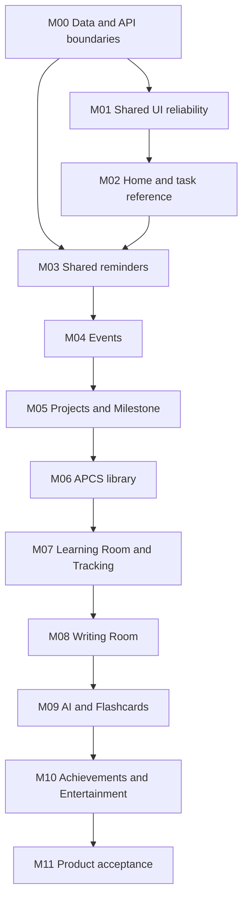

# Hiep Trong Space — remediation plan and progress ledger

Prepared 10 November 2026. Initial audit/planning is complete. **Critical engineering remediation has been implemented by Codex under the subsequent owner assignment; full visual milestones remain open.** This plan is a handoff to Gemini 3.8 Flash High, with Codex directing and reviewing. No model/provider implementation run was initiated by the audit.

Read [WEBSITE_QUALITY_AUDIT.md](WEBSITE_QUALITY_AUDIT.md) for evidence and finding acceptance criteria, [DESIGN_SYSTEM_GUIDE.md](DESIGN_SYSTEM_GUIDE.md) for the visual contract, and [FLASH_IMPLEMENTATION_PROMPTS.md](FLASH_IMPLEMENTATION_PROMPTS.md) for assignments.

## Priority and dependencies

Contain critical data loss before changing user-facing workflows. Repair shared rendering/interaction foundations next so later screenshots reflect intentional design. Then follow the blueprint's primary sequence where possible: homepage/Daily/Hub → Notifications → Events → Projects/Milestone → APCS → Learning Room; Writing follows, then secondary features. Tracking is paired with focus-time accuracy because they share date/window/statistics problems, but its visual polish can wait until after primary pages.

Arrows after M04 indicate the recommended review sequence, not a requirement for a coupled code change. M03's reminder interface is a technical dependency of dated items in Events/Projects/Milestone/Achievements. M00 path protection is a technical dependency of APCS work. M01 and M02 establish the theme primitives/reference before broad restyling. Work one milestone at a time unless the owner explicitly requests parallel agents.

## Milestones

| ID / priority | Objective and scope | Reference components/assets | Required outcome and verification |
|---|---|---|---|
| **M00 / P0 first** | Contain F01–F03/F13/F24: JSON loss, file boundary, API validation/guards, silent seed claims | `json-store.ts`, existing SQLite adapter transaction conventions, `config.ts`, `api-response.ts`, `apcs-storage.ts`, all new contracts/services | Corrupt bytes preserved; 20/20 concurrent saves survive fresh reload; failed writes preserve cache; configured paths honored; sibling/junction escapes denied; cross-origin/plaintext writes denied; invalid dates rejected; past task deadlines return 400 in dev/production; fresh personal stores empty. Synthetic fixtures only; no destructive migration. `npm run check`, route integration probes; data-path/setup changes also build |
| **M01 / P1** | Restore shared interaction and styling foundations F04–F07/F17/F23 | `tokens.css`, `globals.css`, `Button`, `Dialog`, `Drawer`, `use-focus-trap`, `SegmentedControl`, `PageReady`; Daily/Hub reference captures | Resolve actual missing variables/utilities; restore readiness; consistent pending/error/empty states; accessible modal stack and labels; keyboard cards; skip link; narrow filters reachable. Ordinary/reduced-motion navigation and nested overlays recorded. Capture 1440/390 plus 320; computed styles/contrast and fault injection. Check + build |
| **M02 / P1–P2** | Finish home, preserve/refine Daily and Hub, F14–F16 | `HomeJourney`, Earth/starfield, gallery; `DailySky`, `DailyDashboard`, task cards/carousel; `public/earth`, `public/visuals/daily-v2`; local img10–14/vid8 if present | Closing line visible with fallback; phase continuity, soft nebula and both gallery modes; truthful forecast; named removed art stays removed; Hub keeps planning clarity. Establish finished visual reference for all subsequent themes. Task identity/transfer regression evidence, desktop/phone screenshots, normal/reduced motion and fallback. Check + build |
| **M03 / P1** | Connect all timed sources to the existing Notification Center, F09 | Task reminder rules, scheduler, notification repository/DTO/item; timed event/project/milestone/achievement contracts | Minimal source/occurrence contract, stable target links, edit/completion/cancellation/mute lifecycle, catch-up/dedupe/7-day expiry. Preserve task notifications. Fake clock tests and each timed-source fixture; screenshots of read/unread/empty/error; no external delivery. Check + build if schema/routing changes |
| **M04 / P1–P2** | Correct and finish Events, then establish the forest theme, F08/F16 | Daily Week/Month patterns (not copied task rules), shared form/dialog/buttons, Events domain/contracts | Correct day/week/month assignment, navigation, recurring series/occurrence edits, exam priority, deadlines distinguished, preparation links, reliable reminders. Pale sage/forest scene with unobstructed calendar. Calendar boundary and recurrence tests; keyboard/details/form/save-failure; desktop/phone calendar and agenda evidence. Check + build |
| **M05 / P2 with reminder dependencies** | Complete Projects and Milestone context/editing, F18/F16 | Existing manual progress/landmarks, shared task picker/links, project/milestone domain, Daily panel language | Dates/time-left, editable core fields, identity-preserving links, arbitrary milestone timeframe, manual progress retained. Computing and horizon compositions share controls/typography. Create/edit/reload/link/reminder checks, no delete/recreate editing; capture empty/populated/detail/mobile. Check; build for new routes |
| **M06 / P1 boundary already contained; P2 UX** | Make APCS an honest, responsive ocean library, F19/F17 | `ApcsStorage`, APCS hooks/view, shared controls; real folder hierarchy; blue/sky palette guide | Missing/empty/inaccessible states, root context, search/category/breadcrumb/open/download flows; measure scanning before optimizing; accurate metadata. Synthetic large/missing/symlink trees; real originals read-only; 320 filters reachable. Ocean illustration with readable file table; keyboard and supported file opening evidence. Check + build |
| **M07 / P1 accuracy, P2 visual** | Make Learning Room/Tracking records and insights trustworthy, F10/F11 | Existing clock/time helpers, learning/tracking contracts/services, shared modal/forms; cozy and Japanese directions | Timestamp-driven timer, real focus/pause/break duration, logging without notes, explicit recovery behavior; local-day habits, real streaks and 7-day windows; useful planning calculator and charts. Fake-clock/boundary/empty/failure/reload tests; focus/paused/break/reflection screenshots and quiet mode. Check + build if persisted state contract changes |
| **M08 / P1 completeness, P2 editorial design** | Finish a local writing workflow, F12/F16 | Blog model and current reader/category/authorship structure; shared primitives; inspected external article reference | Durable drafts, edit/resume, basic rich text, safe rendering, attribution and source capture, separate commentary, optional music. Warm editorial reading surface within shared design family. Reload/unsaved/failure tests; desktop/phone compose/read and long content; no public publishing. Check + build if editor/asset dependencies change |
| **M09 / P2** | Make AI notes and flashcard learning coherent and honest, F20/F21 | Current roadmap/card flows; source provenance model; shared dialog/inputs; subtle network/parchment SVG motifs | Manual reading-copy import/refresh or explicitly honest unavailable state; stage/topic consistency; accessible reader. Card Ctrl+S retained; pending/duplicate guards, empty deck/end-of-review state, truthful review claims. Source/mock refresh failure, shortcut/review tests and screenshots. No two-way sync or speculative full SRS. Check + build for integration changes |
| **M10 / P2** | Complete portfolio/leisure maintenance and theme finish, F22/F16 | Existing era records/book progress; shared forms; gallery/lounge motif directions | Edit existing achievements including elementary era; real reminders; correctly scaled icons. Editable local book/game/music records, optional ratings; reliable sliders. CRUD/reload/failure and reminder tests; keyboard and desktop/phone evidence. No public portfolio or embedded streaming platform. Check |
| **M11 / final gate** | Cross-product acceptance, F23/F24 and regression closure | Audit evidence, all accepted milestone artifacts, source hashes, documentation ownership map | Run full check/build, production-mode validation for F24, route/state/keyboard/320–1440/reduced-motion sweep, shared-data and reminder regression matrix. Update observed-implementation docs and disposition ledger. No milestone accepted on tests alone |

## Scope and creative boundaries

Flash may adjust layout, illustration composition, spacing and per-feature tonal palettes within the guide. It may repair shared primitives and extract a small common component where repeated behavior actually warrants it. It must not replace the app architecture, change task/deadline semantics, silently migrate/delete personal data, add multi-user auth/public publishing/two-way sync, install unnecessary providers, or redesign unaffected features as incidental cleanup.

Confirmed blueprint requirements are acceptance targets. Proposed concepts (Milestone horizon, full confidence scheduling, exact music integration) remain proposals: implement the minimum useful approved flow, or record the specific decision needed. The audit authorizes investigation/planning; implementation begins only when the owner assigns the milestone prompt.

## Quality-control loop

1. **Freeze the milestone baseline.** Record branch/HEAD, dirty paths, changed-file hashes, environment, data fixture, viewport/timezone and current relevant evidence. Preserve all unrelated work and protected user-file hashes. If code changed since this audit, inspect only the relevant diff and recheck affected evidence.
2. **Flash implements one coherent milestone.** Reproduce named defects, make surgical changes, add meaningful regressions. Do not update the acceptance ledger to accepted.
3. **Run local deterministic checks.** Focused tests first, then repository-required `npm run check`; build when required by root rules or the milestone. Use an isolated data directory; JSON storage must honor it after M00. Save actual command exits/logs.
4. **Capture the real application.** Match baseline viewport/data, plus changed edge states. Include desktop/phone, keyboard, errors and reduced motion. Normal motion needs a recording or measured sequence. Capture network/console failures and expected versus actual persisted data.
5. **Codex reviews.** Inspect the diff, functionality, architecture, and screenshots at readable resolution. Compare with Daily and this guide. Separate subjective visual judgments from objective defects. Audit notes are a baseline, not independent validation of a future implementation by the same author.
6. **Issue precise corrections.** Cite finding/criterion, screenshot or code location, observed result, expected result and smallest corrective action. Recheck only changed/affected surfaces after correction.
7. **Accept explicitly.** Every named gate passes, evidence is complete, no P0/P1 regression, and reviewer records a reasoned visual assessment. Then advance to the next milestone.

Use local test scripts, fixtures, screenshots and this ledger; do not repeat the full audit or spend provider calls to restate unchanged context. If a required external integration is unavailable, record it and complete independent work; never fabricate success or let elapsed time count as approval.

## Required evidence bundle per milestone

Store under ignored `review/quality-remediation/Mxx/` (do not change `.gitignore`):

- `RESULT.md`: objective, files changed, requirements covered, unresolved decisions, test results, limitations and exact reproduction commands.
- `manifest.json`: revision/diff hash, runtime and package versions, timezone, fixture identifiers, viewport/motion state, capture timestamps and filenames.
- Before/after screenshots for representative desktop/phone states, plus 320px if layout changed; readable crops may supplement full views.
- Interaction evidence: actions, expected/actual outcomes, keyboard focus sequence, request/status/persisted-record checks; video/timing when motion changes.
- Check/build logs and focused test output. Never include credentials, `.env`, real databases, or personal documents in a shareable bundle.

## Progress ledger

Use states: pending → implementing → review → corrections requested → accepted. “Blocked” must name an actual dependency; it is not a synonym for unfinished. The owner subsequently authorized direct engineering fixes and separate baseline/fixes commits. The engineering disposition below supersedes the original pending states; it does not constitute independent visual acceptance.

| Milestone | State | Implementer | Reviewer | Evidence / acceptance / outstanding action |
|---|---|---|---|---|
| Initial audit/design/plan | Complete | Codex | Initial diagnostic review only | `review/quality-audit-2026-11-10`; implementation remains open |
| M00 | Engineering verified | Codex | Self-verification | F01/F02/F03/F13/F24; preservation, containment, guarded APIs and production validation. See engineering evidence below |
| M01 | Engineering verified; visual review open | Codex | Self-verification | Readiness, tokens, dialogs, failures, keyboard access and narrow layouts repaired; full contrast/motion matrix remains |
| M02 | Partial | Codex / Flash next | Self-verification | Closing emphasis tokens repaired; Home/Daily/Hub design and truthful forecast remain |
| M03 | Partial | Codex / Flash next | Self-verification | Four dated source types connected; dedupe/read/reschedule/delete/completion/mute covered; recurrence and reminder preferences remain |
| M04 | Partial | Codex / Flash next | Self-verification | Correct local weekday/week statistics and narrow agenda; month/navigation/recurrence/editing and forest design remain |
| M05 | Pending UI completion | Flash next | Pending | Safe atomic edits and shared reminders available; dates/links/editor and horizon/computing themes remain |
| M06 | Partial | Codex / Flash next | Self-verification | Boundary containment and honest failure states verified; library UX, scan performance and ocean theme remain |
| M07 | Partial | Codex / Flash next | Self-verification | Actual timer phases and local-day statistics fixed; active-session recovery, calculator/charts and theme work remain |
| M08 | Partial | Codex / Flash next | Self-verification | Save/reload/resume/edit/publish drafts and original source capture verified; rich text/music/editorial theme remain |
| M09 | Partial | Codex / Flash next | Self-verification | Finite review and duplicate guards, honest local-note claims; import and stage consistency remain |
| M10 | Pending UI completion | Flash next | Pending | Mutation safety and achievement reminders available; record editing/ratings/theme remain |
| M11 | Engineering checkpoint verified; full acceptance pending | Codex | Self-verification | Check/build and targeted production/browser evidence; all visual milestones still require review |

For each review append: date, finding IDs addressed, revision/diff hash, tested states, evidence links, visual judgment, acceptance or exact correction, and any residual P2/P3 item explicitly deferred. Never mark a failed criterion resolved by renaming it an enhancement.

## Decisions and limitations carried forward

- Keep OD-01/OD-02 (Observatory scope/forecast behavior) unresolved until an implementation needs a product choice. Truthful copy is independently fixable.
- The current objective resolves design authority in favor of actual Daily plus blueprint themes; update old observed facts rather than asking the user to approve the same direction again.
- Writing's warm/cosmic wording is reconciled provisionally by shared atmosphere and warm editorial treatment; seek a decision only for a materially different direction.
- Use occurrence-scoped recurrence editing and existing task reminder semantics as starting constraints. Document timing/mute defaults before M03/M04; ask only if the choice changes behavior beyond the blueprint.
- No live Notion credentials or real import was used for this audit. Do not infer source access from hardcoded URLs.
- Treat source drift as scoped revalidation, not permission to discard user changes. Current source may include another agent's uncommitted work.

## Engineering checkpoint — 10 November 2026

The owner authorized implementation before broad visual redesign and a separate baseline/fixes commit. Baseline: `a1485fd`. Exact technical disposition, recovery procedure and verification are in [ENGINEERING_REMEDIATION.md](ENGINEERING_REMEDIATION.md). This is implementer verification, not an independent acceptance review.

Closed engineering findings: **F01, F02, F03, F04, F05, F07, F13, F17, F24**. Compound findings **F06, F08–F12, F15, F19–F21** received the specific repairs listed in that report and remain open for their unmet criteria. Do not treat the remaining scheduling/recovery/import requirements as completed visual polish.

Verification: `npm run check` passed ESLint, TypeScript and **130 tests in 33 files**; `npm run build` passed. Production probes and screenshots are stored locally under `review/quality-remediation/engineering-2026-11-10/`. No personal data migration or cleanup was run. Existing mixed demo/user records remain intact.

Flash may proceed with M02 reference refinement and the visual portions of M04–M10 using the repaired primitives. Preserve these regression tests, start from this checkpoint, and complete the explicitly open functional criteria alongside each affected milestone. M11 remains the final cross-product gate.
