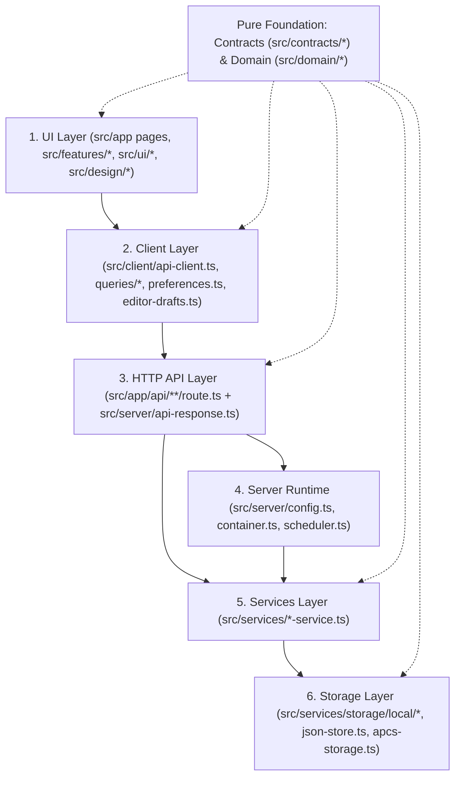

# CẨM NANG TOÀN DIỆN DỰ ÁN HIEP TRONG SPACE (`desc.md`)
**Mô tả chi tiết hệ thống • Tổng hợp kinh nghiệm, sai lầm & bài học xương máu • Hệ thống Rules của Owner • Toàn bộ Context bàn giao cho Agent mới**

> **Mục đích của tài liệu này:**
> `desc.md` là tài liệu trung tâm ("Master Onboarding & Engineering Bible") đúc kết toàn bộ quá trình xây dựng **Hiep Trong Space** từ những dòng code đầu tiên (`2955b45` — `first commit`) qua các đợt kiểm toán kiến trúc (Forensic Architecture & Detox Audits), tái cấu trúc tài liệu, chương trình nâng cấp giao diện 17 Epics, cho tới phiên bản hoàn thiện hiện tại (`f06de6b` — `v2.1`).
> Mọi Agent mới khi bắt đầu làm việc với dự án này cần đọc kỹ file này cùng với [`AGENTS.md`](AGENTS.md) và [`.agents/AGENTS.md`](.agents/AGENTS.md) để nắm trọn vẹn kiến trúc, quy tắc bất khả xâm phạm, các bài học quá khứ và ngữ cảnh hiện hành mà không mắc lại bất kỳ sai lầm nào trước đây.

---

## MỤC LỤC

1. [PHẦN I — MÔ TẢ CHI TIẾT DỰ ÁN & KIẾN TRÚC KỸ THUẬT (DETAILED PROJECT DESCRIPTION)](#phần-i--mô-tả-chi-tiết-dự-án--kiến-trúc-kỹ-thuật-detailed-project-description)
   - [1.1. Tầm nhìn, Triết lý & Ba Thế giới Thị giác](#11-tầm-nhìn-triết-lý--ba-thế-giới-thị-giác)
   - [1.2. Công nghệ & Toolchain Thực tế (Observed Tech Stack)](#12-công-nghệ--toolchain-thực-tế-observed-tech-stack)
   - [1.3. Kiến trúc Phân tầng Nghiêm ngặt (Strict 6-Layer Architecture)](#13-kiến-trúc-phân-tầng-nghiêm-ngặt-strict-6-layer-architecture)
   - [1.4. Kiến trúc Lưu trữ Kép (SQLite WAL + Atomic JSON File Stores + Local Archive)](#14-kiến-trúc-lưu-trữ-kép-sqlite-wal--atomic-json-file-stores--local-archive)
   - [1.5. Danh mục Chi tiết Toàn bộ 14 Điểm đến (Routes & Features Catalog)](#15-danh-mục-chi-tiết-toàn-bộ-14-điểm-đến-routes--features-catalog)
   - [1.6. Các Quy tắc Nghiệp vụ & Mô hình Dữ liệu Cốt lõi (Core Domain Invariants)](#16-các-quy-tắc-nghiệp-vụ--mô-hình-dữ-liệu-cốt-lõi-core-domain-invariants)
   - [1.7. Hệ thống UI Primitives, Motion & Chuyển cảnh (`src/ui/`, `src/design/`, `src/features/transitions/`)](#17-hệ-thống-ui-primitives-motion--chuyển-cảnh-srcui-srcdesign-srcfeaturestransitions)
2. [PHẦN II — HỆ THỐNG QUY TẮC BẮT BUỘC CỦA OWNER (COMPLETE USER & REPOSITORY RULES)](#phần-ii--hệ-thống-quy-tắc-bắt-buộc-của-owner-complete-user--repository-rules)
   - [2.1. Quy tắc Tư duy & Hành vi Kỹ thuật (`.agents/AGENTS.md`)](#21-quy-tắc-tư-duy--hành-vi-kỹ-thuật-agentsagentsmd)
   - [2.2. Quy tắc Kích hoạt Task, Quyền Sở hữu & Bảo vệ File (`AGENTS.md` & `md/readme.md`)](#22-quy-tắc-kích-hoạt-task-quyền-sở-hữu--bảo-vệ-file-agentsmd--mdreadmemd)
   - [2.3. Quy tắc Kiến trúc, Code Style & Guardrails Tự động](#23-quy-tắc-kiến-trúc-code-style--guardrails-tự-động)
   - [2.4. Quy tắc Thiết kế UI/UX & Chống "AI Slop" (`md/agents/shared/uiux.md`)](#24-quy-tắc-thiết-kế-uiux--chống-ai-slop-mdagentsshareduiuxmd)
   - [2.5. Quy tắc Giao tiếp, Kiểm chứng (Verification) & Chính sách Git](#25-quy-tắc-giao-tiếp-kiểm-chứng-verification--chính-sách-git)
3. [PHẦN III — TOÀN BỘ KINH NGHIỆM, SAI LẦM & BÀI HỌC XƯƠNG MÁU TỪ ĐẦU ĐẾN CUỐI](#phần-iii--toàn-bộ-kinh-nghiệm-sai-lầm--bài-học-xương-máu-từ-đầu-đến-cuối)
   - [3.1. Tóm tắt Lịch sử Tiến hóa của Dự án qua 6 Giai đoạn](#31-tóm-tắt-lịch-sử-tiến-hóa-của-dự-án-qua-6-giai-đoạn)
   - [3.2. Nhóm Bài học 1: Vòng đời Form, Đồng hồ Thời gian thực & Danh tính Bản nháp (`C01`, `C02`, `E01`)](#32-nhóm-bài-học-1-vòng-đời-form-đồng-hồ-thời-gian-thực--danh-tính-bản-nháp-c01-c02-e01)
   - [3.3. Nhóm Bài học 2: Concurrency, Transaction & Tính Nguyên tử trong SQLite (`C03`, `C04`, `E03`, `E04`)](#33-nhóm-bài-học-2-concurrency-transaction--tính-nguyên-tử-trong-sqlite-c03-c04-e03-e04)
   - [3.4. Nhóm Bài học 3: Chuẩn hóa Thời gian, Múi giờ, Lịch & Vòng đời Thông báo (`C05`–`C07`, `C09`, `C10`, `C14`)](#34-nhóm-bài-học-3-chuẩn-hóa-thời-gian-múi-giờ-lịch--vòng-đời-thông-báo-c05c07-c09-c10-c14)
   - [3.5. Nhóm Bài học 4: Bảo mật Local-First & Ranh giới HTTP API (`R01`, `C08`, `E02`)](#35-nhóm-bài-học-4-bảo-mật-local-first--ranh-giới-http-api-r01-c08-e02)
   - [3.6. Nhóm Bài học 5: Độ mượt 60–120 FPS, Scroll Choreography, Focus Trap & Tinh chỉnh UI/UX (`C11`–`C13`, Epics 01–17, HTS v2.0/v2.1)](#36-nhóm-bài-học-5-độ-mượt-60120-fps-scroll-choreography-focus-trap--tinh-chỉnh-uiux-c11c13-epics-0117-hts-v20v21)
   - [3.7. Nhóm Bài học 6: Quản trị Tài liệu, Chống "Doc Drift" & Vận hành Windows Sandbox](#37-nhóm-bài-học-6-quản-trị-tài-liệu-chống-doc-drift--vận-hành-windows-sandbox)
4. [PHẦN IV — TOÀN BỘ CONTEXT BÀN GIAO CHO AGENT MỚI (COMPLETE HANDOFF CONTEXT)](#phần-iv--toàn-bộ-context-bàn-giao-cho-agent-mới-complete-handoff-context)
   - [4.1. Trạng thái Hiện tại của Dự án (Current Baseline — `v2.1`)](#41-trạng-thái-hiện-tại-của-dự-án-current-baseline--v21)
   - [4.2. Các "Cạm bẫy" (Gotchas) Quan trọng Nhất Cần Biết Ngay](#42-các-cạm-bẫy-gotchas-quan-trọng-nhất-cần-biết-ngay)
   - [4.3. Sổ đăng ký Quyết định Mở & Lưu ý Kiến trúc (`OD-01` đến `OD-05` + Mở rộng)](#43-sổ-đăng-ký-quyết-định-mở--lưu-ý-kiến-trúc-od-01-đến-od-05--mở-rộng)
   - [4.4. Bản đồ Điều hướng Toàn bộ Codebase (`src/`, `tests/`, `public/`, `md/`)](#44-bản-đồ-điều-hướng-toàn-bộ-codebase-src-tests-public-md)
   - [4.5. Quy trình Chuẩn 5 Bước Khi Agent Mới Thực hiện Nhiệm vụ](#45-quy-trình-chuẩn-5-bước-khi-agent-mới-thực-hiện-nhiệm-vụ)

---

## PHẦN I — MÔ TẢ CHI TIẾT DỰ ÁN & KIẾN TRÚC KỸ THUẬT (DETAILED PROJECT DESCRIPTION)

### 1.1. Tầm nhìn, Triết lý & Ba Thế giới Thị giác

**Hiep Trong Space** là một ứng dụng web quản lý cuộc sống cá nhân toàn diện, hoạt động theo triết lý **local-first, single-user** (ưu tiên chạy cục bộ trên máy cá nhân Windows tại `127.0.0.1`, phản hồi tức thì, bảo mật dữ liệu riêng tư tuyệt đối, không phụ thuộc dịch vụ đám mây bên thứ ba). Ứng dụng quy tụ mọi khía cạnh trong cuộc sống của Owner vào một "vũ trụ cá nhân" duy nhất: công việc hằng ngày, kho backlog công việc, lịch sự kiện & kỳ thi, thông báo nhắc hẹn, lộ trình học AI Engineering, kho tài liệu đại học APCS, phòng viết blog, hệ thống học Flashcards, phòng tập trung Pomodoro (Learning Room), theo dõi thói quen/giấc ngủ/screen time (Tracking), quản lý dự án đang làm (Projects), cột mốc hằng năm (Annual Milestones), thành tựu cá nhân (Personal Achievements), và góc giải trí (Entertainment).

Về mặt thẩm mỹ và trải nghiệm, dự án được xây dựng xung quanh **3 thế giới thị giác (Visual Worlds)** thống nhất trong một hệ thống Design Tokens (`src/design/tokens.css`):

1. **The Cosmos (`/` & Cosmic Launch Transition):**
   - Không gian vũ trụ sâu thẳm (`--cosmos-*`, `--journey-*`, nền `#0B0A14` → `#050508`, chữ `#F4F2FA`, điểm nhấn tím `#9B8CFF` và vàng ánh sao `#FFD27A`).
   - Trang chủ (`/`) mở ra với bầu trời sao chuyển động (`Starfield.tsx`), chữ ký thương hiệu vector `HIEP TRONG` (`public/brand/wordmark.svg`), và quả địa cầu 3D ban đêm (`earth-scene.ts` sử dụng Three.js + Fresnel atmospheric shader + 2K WebP textures từ NASA/Solar System Scope).
   - Khi cuộn chuột, quả địa cầu thu về vị trí nghỉ, lời giới thiệu cá nhân không viền (`HOME_INTRO_COPY` bằng font `Cormorant Garamond` + `Inter`) hiện ra mượt mà, rồi chuyển tiếp qua hiệu ứng **Midnight Galaxy Circular Reveal** (mở rộng vòng tròn từ góc dưới bên trái `(0px, 100vh)`) sang khu vực **My *collection*** (`#features`) gồm 12 thẻ điểm đến kèm hiệu ứng **Zodiac Constellation Illumination** (`src/features/zodiac/`).
2. **The Workspace (`--ws-*` Light Lavender Default & 12 Full-Page Feature Themes):**
   - Toàn bộ các trang làm việc bên trong được bọc bởi `WorkspaceShell` (`src/ui/WorkspaceShell.tsx`).
   - Nền tảng gốc là **Light Lavender** (`--ws-bg: #f0eff8`, `--ws-surface: #ffffff`, `--ws-text: #29263b`, `--ws-accent: #a99aef`), mang lại độ tương phản cao, dịu mắt khi làm việc cả ngày. Side-by-side với `/tasks/hub`, 12 tính năng chuyên biệt sử dụng cơ chế **Full-Page Feature Theme** (`[data-theme='workspace'][data-fullpage-theme='true'][data-feature-theme=...]`) với bảng màu pastel dịu nhẹ riêng biệt và **5 bức minh họa SVG tĩnh** được tuyển chọn kỹ lưỡng cho mỗi trang trong `public/visuals/<feature>/`.
   - Đặc biệt, chuông thông báo (`NotificationPopover`) luôn giữ bảng màu **Sakura (`notification`)** cô lập dù được mở từ bất kỳ trang nào (kể cả trên nền tối của Homepage).
3. **Daily Observatory (`/tasks/daily` — Scoped Celestial V2 Exception):**
   - Trang **Daily Task Management** có ngoại lệ thị giác riêng (`--daily-*` tokens, `DailySky.tsx`, `daily-foundation.module.css`, `daily-task-card.module.css`) mang phong cách đài thiên văn với bầu trời sao tĩnh kết hợp 8 ngôi sao lấp lánh HTML (`.twinkle`), vòng cung mặt trời `Day arc`, bánh xe hoàng đạo (`zodiac-wheel.svg`), các thẻ công việc kính mờ (`backdrop-filter: blur(16px)`), và băng chuyền 3 ngày (`DayCarousel.tsx`).
   - *Lưu ý quan trọng:* Trong code thực tế hiện tại (`src/design/tokens.css`), các token `--daily-*` đã được tinh chỉnh sang tông **Soft Lavender Celestial** (`--daily-sky-start: #f1ebfc`, `--daily-sky-end: #f8f4ff`, `--daily-accent: #8065e9`) theo đúng đợt phê duyệt UI/UX tháng 11/2026 của Owner.

---

### 1.2. Công nghệ & Toolchain Thực tế (Observed Tech Stack)

| Thành phần | Công nghệ & Phiên bản (Lockfile / `package.json`) | Vai trò trong dự án |
| :--- | :--- | :--- |
| **Framework & Routing** | Next.js `15.5.28` (`^15.2.0` App Router), React `19.3.1` (`^19.0.0`) | Routing, Server/Client Components, JSON API Route Handlers (`src/app/api/**`), `instrumentation.ts`. |
| **Ngôn ngữ & Kiểu** | TypeScript `5.9.3` (`strict: true`, `noUncheckedIndexedAccess: true`) | Kiểm tra kiểu tĩnh toàn diện trên cả `src/` và `tests/`. |
| **Styling & Tokens** | Tailwind CSS `4.3.3` (`@tailwindcss/postcss`), CSS Modules, `src/design/tokens.css` | Hệ thống token đóng (`--cosmos-*`, `--ws-*`, `--daily-*`, `--status-*`), cấm tuyệt đối mã màu thô ngoài `tokens.css`. |
| **3D & Canvas** | Three.js `0.187.0`, HTML5 2D `<canvas>` | Quả địa cầu 3D (`earth-scene.ts`), bầu trời sao (`starfield-engine.ts`), hiệu ứng chuyển trang `CosmicLaunchOverlay.tsx`, và chòm sao hoàng đạo (`ZodiacIllumination.tsx`). |
| **Animation & Motion** | `motion` (`12.43.0` / Framer Motion), CSS Compositor (`translate3d`, `scale`, `opacity`) | Hoạt ảnh chuyển tab, drawer, dialog, popover, progress bar, tôn trọng `prefers-reduced-motion: reduce`. |
| **State & Data Fetching** | TanStack Query v5 (`@tanstack/react-query`) | Quản lý server-state cache, polling (`tasks` 60s, `notifications` 30s), optimistic updates & per-item rollback. |
| **Rich Text & Controls** | `@tiptap/react` + `@tiptap/core` (`3.34.0`), `react-aria-components` (`1.22.1`), `@internationalized/date` (`3.12.4`) | Trình soạn thảo ghi chú trực quan (`RichNoteEditor.tsx` hỗ trợ Bold + Bullet list) và bộ điều khiển ngày/giờ 24h/select theo theme (`DatePickerField.tsx`, `TimeFieldControl.tsx`, `SelectField.tsx`). |
| **Validation & Timezone** | Zod (`3.25.76`), `date-fns` (`4.4.0`), `@date-fns/tz` (`1.5.0`) | Validate dữ liệu đầu vào/đầu ra ở ranh giới contract/API/service; xử lý múi giờ chuẩn `Asia/Saigon` (`UTC+07:00`). |
| **Database & Storage** | `better-sqlite3` (`13.0.3`), Drizzle ORM (`0.39.3`), `drizzle-kit` (`0.30.6`), `JsonFileStore` | SQLite ở chế độ WAL cho `tasks` & `notifications`; Atomic JSON file stores cho các tính năng còn lại. |
| **Kiểm thử & Linting** | Vitest (`3.2.7`), Testing Library + `jsdom` (`26.1.0`), ESLint 9 (`eslint.config.mjs`), Prettier | Hơn 65 bộ test (`300+` bài test) bao phủ unit, domain, service, route, UI, accessibility và kiến trúc. |

---

### 1.3. Kiến trúc Phân tầng Nghiêm ngặt (Strict 6-Layer Architecture)

Dự án áp dụng kiến trúc phân tầng một chiều được cưỡng chế trực tiếp bằng cả **ESLint (`eslint.config.mjs`)** lẫn **Automated Test (`tests/design/craft-and-architecture-guardrails.test.ts`)**:



**Quy tắc ranh giới từng tầng (không bao giờ được vi phạm):**

1. **`src/contracts/` (Zod Schemas & DTO Types):**
   - Thuần túy 100%. **Cấm** import React, Next.js, `fs`, `better-sqlite3`, `drizzle-orm`, hay bất kỳ tầng nào khác (`domain`, `services`, `server`, `client`, `features`, `ui`, `design`).
2. **`src/domain/` (Pure Business Logic & Math):**
   - Chỉ được import từ `src/contracts/` và các thư viện tính toán thuần (`date-fns`, `@date-fns/tz`). **Cấm** import React, Next.js, I/O, DB, `services`, `server`, `client`, `features`, `ui`, `design`.
   - Mọi hàm phụ thuộc thời gian trong `src/domain/` đều nhận tham số `now: Date` hoặc `Clock` (`src/domain/clock.ts`) để test tất định 100%.
3. **`src/services/storage/` (Persistence Adapters & Repositories):**
   - Là **nơi duy nhất** trong toàn bộ dự án được phép chạm vào `fs`, `node:fs`, `better-sqlite3`, và `drizzle-orm`.
4. **`src/services/` (Application Services):**
   - Điều phối nghiệp vụ (`TaskService`, `NotificationService`, `EventService`, `EventDraftService`, `ProjectService`, `MilestoneService`, `AchievementService`, `BlogService`, `FlashcardsService`, `LearningRoomService`, `TrackingService`, `AiEngineeringService`, `EntertainmentService`, `ApcsService`).
   - Không được import trực tiếp `fs`, `better-sqlite3`, `drizzle-orm`, hay các file cài đặt cụ thể trong `src/services/storage/local/*` (mà phải đi qua interface `StorageAdapter` hoặc `JsonFileStore` / `apcs-storage`).
5. **`src/server/` & `src/app/api/` (Server Config, DI Container, Scheduler & HTTP Route Handlers):**
   - Chỉ duy nhất `src/server/config.ts` được đọc `process.env` (cùng với kiểm tra `NEXT_RUNTIME` trong `src/instrumentation.ts`).
   - Các route trong `src/app/api/**` nhận `NextRequest`, kiểm tra bảo mật same-origin qua `assertSameOriginMutation(request)`, parse dữ liệu qua `parseJsonBody(request)` + Zod schema, gọi `Services`, và trả về JSON chuẩn qua `okJson` / `createdJson` / `handleRouteError` (`src/server/api-response.ts`). **Cấm** route handler gọi thẳng vào `src/services/storage/*`.
6. **`src/client/`, `src/features/`, `src/ui/`, `src/design/` (Frontend & Presentation):**
   - `src/client/` chứa `api-client.ts`, các hooks TanStack Query (`src/client/queries/*`), `preferences.ts` và `editor-drafts.ts` (hai nơi duy nhất quản lý `window.localStorage`).
   - `src/features/*` và `src/ui/*` **cấm tuyệt đối** import từ `src/services/*`, `src/server/*`, `fs`, hay `better-sqlite3`.

---

### 1.4. Kiến trúc Lưu trữ Kép (SQLite WAL + Atomic JSON File Stores + Local Archive)

Dự án sử dụng 3 cơ chế lưu trữ cục bộ tùy theo đặc thù dữ liệu, tất cả đều nằm gọn trong tầng `src/services/storage/`:

1. **SQLite Database (`data/hiep-trong-space.db` qua `LocalStorageAdapter`):**
   - Quản lý 2 bảng có tính liên kết và truy vấn theo chỉ mục cao nhất: `tasks` và `notifications` (định nghĩa tại `src/services/storage/local/schema.ts`, migration tại `drizzle/0000_lush_gravity.sql`).
   - Bật sẵn `PRAGMA journal_mode = WAL` và `PRAGMA foreign_keys = ON`.
   - Hỗ trợ **Savepoint Transactions** tuần tự hóa qua hàng đợi (`runInTransaction` trong `src/services/storage/local/local-storage-adapter.ts`) và **Atomic Partial Patch** (`patchItem` trong `local-task-repository.ts`) để chống mất dữ liệu khi cập nhật đồng thời.
2. **Atomic JSON File Stores (`data/*.json` qua `src/services/storage/json-store.ts`):**
   - Phục vụ các không gian tính năng có cấu trúc tài liệu lồng nhau: `events.json`, `event-drafts.json`, `projects.json`, `milestones.json`, `achievements.json`, `blogs.json`, `flashcards.json`, `learning-room.json`, `tracking.json`, `ai-engineering.json`, `entertainment.json`.
   - Cơ chế an toàn dữ liệu của `JsonFileStore`:
     - Khi ghi (`transact`), tạo khóa độc quyền `<file>.lock` (`flag: 'wx'`, tự động thử lại tối đa 5 giây).
     - Đọc lại dữ liệu mới nhất dưới khóa, kiểm tra tính toàn vẹn của mảng và tính duy nhất của `id`.
     - Ghi ra file tạm `<file>.tmp`, gọi `fsync` để ép xuống đĩa cứng, sao lưu bản cũ sang `<file>.bak`, rồi mới thực hiện `rename` nguyên tử sang `<file>`.
3. **Read-Only Local University Archive (`src/services/storage/apcs-storage.ts`):**
   - Phục vụ riêng cho `/apcs` (APCS Hub), quét và đọc tài liệu học tập đại học với cơ chế kiểm tra đường dẫn thực (`realpath`) chống leo thang thư mục (path/symlink traversal), được bảo vệ bởi bài test `tests/services/apcs-boundary.test.ts`.

---

### 1.5. Danh mục Chi tiết Toàn bộ 14 Điểm đến (Routes & Features Catalog)

Ứng dụng có **13 điểm đến trong `FEATURE_REGISTRY` (`src/features/registry.ts`)** cùng với **Trung tâm Thông báo (`/notifications`)** và trang chủ **The Cosmos (`/`)**:

| # | Route | Tên hiển thị & Chủ đề (Theme) | Mã Theme (`data-feature-theme`) | Bộ 5 SVG Trang trí (`public/visuals/<theme>/`) | Tính năng & Thành phần Chính |
| :-: | :--- | :--- | :--- | :--- | :--- |
| **0** | `/` | **The Cosmos (Homepage)** — Deep Space & 3D Night Earth | `cosmos` (`data-theme="cosmos"`) | `public/brand/wordmark.svg`, `public/earth/*`, `public/visuals/zodiac/*` (12 cung hoàng đạo) | Quả địa cầu 3D tương tác (`earth-scene.ts`), bầu trời sao (`Starfield.tsx`), lời giới thiệu không viền, hiệu ứng mở màn Midnight Galaxy, bộ sưu tập **My *collection*** (12 thẻ, ẩn `tasks-hub`), chuyển đổi `Horizontal`/`Vertical` mượt mà, **Return Guard** chống cuộn lố về đầu trang, nút **Earth credits**, và hiệu ứng chiếu sáng chòm sao Hoàng đạo (`ZodiacIllumination.tsx`). |
| **1** | `/tasks/daily` | **Daily Task Management** — Celestial Luxury V2 Observatory | Scoped `.workspace` (`--daily-*` tokens) | `public/visuals/daily-v2/` (`card-celestial-corner`, `celestial-scroll-thumb`, `constellation-sprinkles`, `day-arc-decoration`, `moon-phase-divider`, `nebula-clouds`, `night-bloom-corner`, `orbiting-moon`, `ringed-planet`, `starlit-thread-divider`, `zodiac-wheel`) | 3 thẻ Observatory (`Cosmic forecast` chỉ giữ huy hiệu sao, `Progress`, `Day arc` hiển thị `HH:mm`), chế độ `Day` (băng chuyền `DayCarousel` 3 bảng Yesterday/Today/Tomorrow, đo tự động `3.5` thẻ với thanh cuộn chòm sao), `Week` (7 thẻ tiến độ + drawer), `Month` (lưới 42 ô + drawer, mũi tên `<` `>` cố định vị trí), làn `Overdue` + `TransferDialog`, và `TaskInspector` (rộng 75% màn hình). |
| **2** | `/tasks/hub` | **Tasks Hub** — Celestial Sticky Notes Backlog | `tasks-hub` (Framed) | `starlight-hourglass.svg`, `quiet-telescope.svg` | Kho quản lý toàn bộ công việc dạng thẻ giấy ghi chú dọc (portrait sticky notes cao `240px`, tự động xoay vòng 6 tông màu pastel), tiêu đề 1 dòng, preview mô tả sạch tối đa 2 dòng, định dạng hạn chót `HH:mm · ddd · d MMM`, chia 3 nhóm gọn (`Overdue`, `On-going`, và `Completed` dạng collapsible luôn hiện tiêu đề), ô tìm kiếm 1 nút xóa, bộ lọc Priority/Schedule/Sort, và dùng chung `TaskInspector` + `TaskForm`. |
| **3** | `/notifications` | **Sakura Notification Center** — Sakura Inbox | `notification` (Full-page & Isolated Popover) | `sakura-branch.svg`, `fairy-glass-chime.svg`, `blossom-thread.svg`, `blossom-vine-edge.svg`, `sakura-petal-current.svg` | Chuông thông báo `BellButton` + `NotificationPopover` (luôn giữ màu hồng Sakura trên mọi trang, có nút `Expand`) và trung tâm `/notifications` gom nhóm theo ngày (`Today`, `Yesterday`, ngày cụ thể), tìm kiếm từ khóa, lọc `All/Unread/Read` & loại thông báo (`Due soon`, `Overdue`, `Completed`, `General`, `System`), nút `Mark full inbox read`. |
| **4** | `/events` | **Events & Exams** — Aquatic Agenda | `events` (Full-page) | `manta-in-the-current.svg`, `hermit-shell-haven.svg`, `coral-garden.svg`, `kelp-ribbon-edge.svg`, `tidal-lace.svg` | Quản lý sự kiện & kỳ thi ưu tiên cao (`Exam sanctuary`), đồng hồ 24h, lịch `Week`/`Month`/`Agenda`, chế độ **Drafts** lưu cấp ứng dụng (`/api/event-drafts/**`) hỗ trợ nhiều bản nháp mới, bản nháp sửa sự kiện, nhập một lần từ trình duyệt (one-time browser draft import), và vùng cuộn `Past events` giới hạn `3.5` thẻ. |
| **5** | `/tracking` | **Tracking Sanctuary** — Herbal Tea Sanctuary | `tracking` (Full-page) | `herbal-tea-ritual.svg`, `garden-watering-can.svg`, `climbing-thyme-edge.svg`, `mint-herbarium.svg`, `tea-steam-rule.svg` | Theo dõi thói quen hằng ngày (Daily Habits checklist + streak), tính toán & ghi chép giấc ngủ (Sleep Tracking), và cân bằng thời gian sử dụng thiết bị (Screen Time balance) với hộp thoại `<Dialog>` nhỏ gọn và ghi chú định dạng `RichNoteEditor`. |
| **6** | `/ai-engineering` | **AI Engineering** — Mist Trail | `ai-engineering` (Full-page) | `mist-layered-ridges.svg`, `trail-cairn.svg`, `misty-footbridge.svg`, `ridge-trail-edge.svg`, `valley-river-contours.svg` | Không gian học tập sự nghiệp AI Engineer: mục tiêu trọng tâm (Trailhead Priority folio), lộ trình học tập theo giai đoạn (Engineering roadmap stages), kệ ghi chú nghiên cứu đồng bộ Notion, và trình đọc ghi chú `<Dialog>` chuẩn `<= 64ch`. |
| **7** | `/apcs` | **APCS Hub** — Winter Library | `apcs-hub` (Full-page) | `glacier-shelf.svg`, `snow-fox-rest.svg`, `aurora-silk.svg`, `frost-fern.svg`, `ice-window-frame.svg` | Thư viện lưu trữ tài liệu đại học (APCS): lưới môn học, dải tài liệu mở gần đây (`recentFiles`), trình duyệt thư mục/tài liệu (`Study materials explorer`), và cửa sổ xem trước tài liệu `<Dialog>` an toàn. |
| **8** | `/flashcards` | **Flashcards** — Vintage Reading Room | `flashcards` (Full-page) | `library-arched-window.svg`, `reading-corner.svg`, `bookmark-ribbon-edge.svg`, `quill-and-bookmark.svg`, `shelf-of-stories.svg` | Hệ thống học từ vựng & kiến thức chủ động (Active Recall): quản lý bộ thẻ (`New deck` trong `<Dialog>`), soạn thẻ hai cột (`Add card` trong `LargeEditorDialog` + lưu nháp tự động + `Ctrl+S`), và chế độ luyện tập lật thẻ đánh giá mức độ thuộc bài (`1..5`). |
| **9** | `/learning-room` | **Learning Room** — Bonsai Timer Sanctuary | `learning-room` (Full-page) | `bonsai-on-a-stone.svg`, `meditation-cushion.svg`, `bamboo-interval.svg`, `bamboo-screen-edge.svg`, `enso-and-pebble.svg` | Phòng tập trung Pomodoro/Deep Work: đồng hồ đếm ngược tròn với vòng hào quang Enso (hoạt động ngay cả khi offline), chế độ `Quiet view` ẩn trang trí, pha nghỉ 5 phút, hộp thoại ghi nhận cảm nghĩ sau phiên học (`Session reflection`), và thống kê thời gian học theo múi giờ `Asia/Saigon`. |
| **10** | `/blogs` | **Blogs Hub (The Writing Room)** — Editorial Woodland Reading Room | `blogs-hub` (Full-page) | `woodland-cabin.svg`, `cabin-lantern.svg`, `falling-maple-pair.svg`, `timber-grain-rule.svg`, `woodland-typewriter.svg` | Phòng viết lách & lưu trữ bài viết: phân loại bài tự viết và bài sưu tầm (có tên tác giả & nguồn tham khảo), chế độ đọc `68ch` (`Reader Mode`), và bàn viết hai cột `LargeEditorDialog` hỗ trợ cả lưu nháp lên server (`status: 'draft'`) lẫn khôi phục nháp cục bộ khi mất điện/tắt tab. |
| **11** | `/entertainment` | **Entertainment Lounge** — Continue Strip & Shelves | `entertainment-hub` (Full-page) | `dream-city-horizon.svg`, `dream-console.svg`, `floating-headphones.svg`, `pixel-waterfall-edge.svg`, `ribbon-signal.svg` | Không gian giải trí pastel-cyber: dải `Continue enjoying` cho sách đang đọc & game đang chơi, 3 kệ phân loại (`Books`, `Games`, `Music` điều hướng bằng phím mũi tên roving tabindex), và hộp thoại thêm sách/game/nhạc có kiểm tra link `https?://` an toàn. |
| **12** | `/projects` | **In Progress Projects** — Eastern Strategy Workspace | `project` (Full-page) | `dragon-over-the-ridge.svg`, `wooden-training-dummy.svg`, `auspicious-cloud-pillar.svg`, `auspicious-cloud-scroll.svg`, `jade-knot-talisman.svg` | Quản lý các dự án lớn (như Go Game, Hiep Trong Space): dải 4 chỉ số KPI, bộ lọc trạng thái, thanh tiến độ GPU `scaleX` kèm nút tăng/giảm nhanh `-5%`/`+5%`, trình soạn thảo `LargeEditorDialog` bảo toàn liên kết `linkedTaskIds`/`linkedMilestoneIds`, và xác nhận xóa `ConfirmDialog`. |
| **13** | `/milestones` | **Annual Milestones** — Yearbook of Ambitions | `annual-milestones` (Full-page) | `hall-of-golden-years.svg`, `champions-cup.svg`, `celebration-streamer.svg`, `honor-ribbon.svg`, `victory-pennant-edge.svg` | Kỷ yếu các mục tiêu lớn trong năm: dải `Yearbook trajectory`, bộ lọc `Status`/`Category`, thẻ folio có danh sách các cột mốc con (`Landmarks`) tích chọn trực tiếp bằng `<Checkbox>` hoặc đổi trạng thái nhanh bằng `<SelectField>`, và trình biên tập `LargeEditorDialog`. |
| **14** | `/achievements` | **Personal Achievements** — Roman Marble Gallery | `personal-achievements` (Full-page) | `marble-arcade.svg`, `ceremonial-marble-plinth.svg`, `acanthus-column-edge.svg`, `laurel-spray.svg`, `roman-mosaic-band.svg` | Phòng trưng bày thành tựu & cuộc thi qua 6 thời kỳ (`All eras`, `University`, `High school`, `Secondary`, `Elementary`, `Upcoming contests`), chuyển đổi `View mode` / `Edit mode`, đánh dấu nổi bật (`featured`), bài học rút ra sau mỗi cuộc thi, và trình biên tập `LargeEditorDialog`. |

---

### 1.6. Các Quy tắc Nghiệp vụ & Mô hình Dữ liệu Cốt lõi (Core Domain Invariants)

Mọi Agent làm việc trên dự án phải nắm vững 5 quy tắc nghiệp vụ cốt lõi sau (được kiểm tra nghiêm ngặt trong `tests/domain/` và `tests/services/`):

1. **Danh tính Task Thống nhất (Single Shared Task Identity):**
   - `/tasks/daily` và `/tasks/hub` **không phải là hai danh sách tách biệt** mà chỉ là hai góc nhìn (views) trên cùng một bảng SQLite `tasks` (`TaskRecord` / `TaskDTO`).
   - Trường `scheduledDate` (`'YYYY-MM-DD' | null`) quyết định việc task xuất hiện trên bảng ngày nào của `/tasks/daily`. Khi `scheduledDate === null`, task nằm ở kho backlog chưa xếp lịch trong `/tasks/hub`.
   - Trường `deadlineAt` (chuỗi ISO UTC chuẩn `.toISOString()`) là hạn chót bắt buộc của mọi task.
2. **Phân biệt Tuyệt đối giữa "Schedule" và "Transfer":**
   - **Schedule (`PATCH /api/tasks/:id` với `{ scheduledDate }`):** Chỉ thay đổi ngày dự kiến làm trên lịch (`scheduledDate`), **giữ nguyên hoàn toàn `deadlineAt`**. Một task dù đã quá hạn (`isOverdue`) hay chưa đều có thể được đổi lịch làm việc.
   - **Transfer (`POST /api/tasks/:id/transfer` với `{ scheduledDate, deadlineAt }`):** Dành riêng cho việc phục hồi task quá hạn trong làn `Overdue`. Thao tác này **cập nhật nguyên tử cả `scheduledDate` (`>= today`) lẫn `deadlineAt` (`> now`)**, giúp task thoát khỏi trạng thái quá hạn và tính toán lại mốc nhắc hẹn `reminderAt`.
   - **Chỉnh sửa thông thường (`TaskForm` Edit):** Cho phép sửa tiêu đề, mô tả, mức độ ưu tiên của một task có `deadlineAt` trong quá khứ mà **không bắt buộc** người dùng phải dời `deadlineAt` sang tương lai (miễn là người dùng không sửa trường ngày/giờ hạn chót).
3. **Thứ tự Sắp xếp Chuẩn (`sortTasksCanonical` trong `src/domain/task-sort.ts`):**
   - Mặc định, các task luôn được sắp xếp theo thứ tự ưu tiên từ cao xuống thấp:
     1. Trạng thái: `active` đứng trước `completed`.
     2. Quá hạn (`isOverdue === true`) đứng trước chưa quá hạn.
     3. Đã ghim (`pinned === true`) đứng trước chưa ghim.
     4. Sắp đến hạn (`isDueSoon === true`) đứng trước bình thường.
     5. Mức độ ưu tiên: `urgent` → `normal` → `optional`.
     6. Hạn chót `deadlineAt` sớm hơn đứng trước.
     7. Thời điểm tạo `createdAt` sớm hơn đứng trước, cuối cùng phân định bằng `id`.
4. **Quy tắc Tính Mốc Nhắc hẹn & Thông báo (`src/domain/reminder.ts` & `src/domain/notification-rules.ts`):**
   - Nếu khoảng thời gian từ lúc tạo/cập nhật hạn chót đến `deadlineAt` **từ 24 giờ trở lên (`>= 24h`)**: mốc nhắc `reminderAt` là **24 giờ trước `deadlineAt`**.
   - Nếu khoảng thời gian còn lại **nhỏ hơn 24 giờ (`< 24h`)**: mốc nhắc `reminderAt` rơi vào **1/4 (25%) cuối cùng** của khoảng thời gian đó (`deadlineAt - duration * 0.25`).
   - Khi `now >= deadlineAt` mà task vẫn `active`: hệ thống sinh thông báo `overdue`.
   - Khi task được đánh dấu hoàn thành (`completeTask`): xóa toàn bộ thông báo `due_soon` / `overdue` cũ của task đó và tạo một thông báo `completed`.
   - Khi task được mở lại (`uncompleteTask`): **phải xóa thông báo `completed` cũ** và tính lại `reminderAt` để không hiển thị thông báo sai sự thật.
   - Mọi thông báo có tuổi đời **từ 7 ngày trở lên (`>= 7 days`)** đều bị ẩn ngay tại tầng truy vấn (`listNotifications`) và được dọn dẹp định kỳ mỗi giờ bởi `scheduler.ts`.
5. **Codec Ghi chú Giới hạn & Trích xuất Plain-Text (`src/domain/note-format.ts`):**
   - Để hỗ trợ tính năng **Bold** (`**text**`) và **Bullet list** (`- item`) trên toàn bộ các ô ghi chú/mô tả mà không cần thay đổi kiểu dữ liệu chuỗi (`string`) trong DB/JSON hay gây rủi ro XSS, dự án dùng `RichNoteEditor.tsx` (Tiptap chỉ bật `Document`, `Paragraph`, `Text`, `Bold`, `BulletList`, `ListItem`, `HardBreak`, `History`) kết hợp với bộ chuyển đổi `serializeRichNoteHtmlToMarkdown` / `parseNoteMarkdownToHtml` (`src/domain/note-format.ts`).
   - Trên các thẻ tóm tắt (như sticky notes 2 dòng ở Tasks Hub), văn bản được trích xuất qua `extractNotePreviewText()` để hiển thị văn bản thuần sạch sẽ, không lộ ký tự `**` hay `- `, trong khi mở `TaskInspector` hoặc màn hình chi tiết sẽ render đầy đủ chữ đậm và danh sách qua `<FormattedNoteContent />`.

---

### 1.7. Hệ thống UI Primitives, Motion & Chuyển cảnh (`src/ui/`, `src/design/`, `src/features/transitions/`)

Các thành phần dùng chung trong `src/ui/` là nền móng đảm bảo tính nhất quán về giao diện và khả năng truy cập bàn phím (Accessibility):

- **`Dialog.tsx` & `LargeEditorDialog.tsx`:**
  - `Dialog`: Hộp thoại modal chuẩn (`max-w-[440px]` cho các form ngắn hoặc trình đọc ghi chú), render qua Portal, tự động thừa kế `data-feature-theme` từ `FeatureThemeProvider`.
  - `LargeEditorDialog`: Bàn làm việc modal lớn (`min(75vw, 1140px)` trên desktop với bố cục 2 cột `LargeEditorTwoColumn`, `100dvh` trên mobile) tích hợp sẵn bảo vệ đóng nhầm khi có thay đổi chưa lưu (`beforeunload` + `useNavigationGuard`), hiển thị hộp thoại 3 lựa chọn ngang hàng bằng nhau (`Discard changes`, `Continue editing`, `Save draft and close` — hỗ trợ cả callback đồng bộ lẫn bất đồng bộ `Promise<boolean | void>`), và hệ thống khôi phục bản nháp cục bộ (`src/client/editor-drafts.ts`).
- **`TaskInspector.tsx` (`src/features/tasks/TaskInspector.tsx`):**
  - Hộp thoại kiểm tra chi tiết công việc dùng chung cho cả `/tasks/daily` (Day/Week/Month/Overdue) và `/tasks/hub`, rộng khoảng `75vw` (`max-w-[920px]`), hiển thị đầy đủ tiêu đề tự xuống dòng tự nhiên, mô tả định dạng `FormattedNoteContent`, các huy hiệu metadata thẳng hàng bên trái, và tách bạch rõ nhóm nút **Calendar placement** (`Schedule for today / tomorrow / choose day` — giữ nguyên deadline) với nhóm **Overdue recovery** (`Reschedule overdue task` — đổi cả ngày làm và deadline) cùng nhóm quản lý (`Edit`, `Delete`, `Close`).
- **`RichNoteEditor.tsx`, `DatePickerField.tsx`, `TimeFieldControl.tsx`, `SelectField.tsx`, `Checkbox.tsx`:**
  - Bộ điều khiển biểu mẫu được thiết kế theo theme của từng trang (`--control-*` tokens).
  - Các popup lịch (`DatePickerField`) và danh sách chọn (`SelectField`) được gắn thuộc tính `data-overlay-dropdown="true"` và quản lý bởi `src/ui/overlay-theme.ts` + `src/ui/use-focus-trap.ts` để khi mở bên trong một `Dialog` hoặc `LargeEditorDialog`:
    1. Popup nhận đúng `data-feature-theme` của trang hiện tại.
    2. Focus trap của Dialog cha không chặn thao tác click/bàn phím vào popup con.
    3. Nhấn phím `Escape` chỉ đóng popup lịch/select đang mở trước, nhấn `Escape` lần nữa mới đóng Dialog cha!
- **`TransitionProvider.tsx` & `CosmicLaunchOverlay.tsx` (`src/features/transitions/`):**
  - Điều phối hiệu ứng chuyển trang vũ trụ 4 pha (`gather` → `flare` → `warp` → `reveal`, tổng `~3000ms`, hoặc rút gọn `<= 300ms` khi bật `prefers-reduced-motion: reduce`, và bỏ qua warp khi bấm nút Back/Forward của trình duyệt `popstate`).
  - Cung cấp hook `useIsTransitioning()` để các trang đích (như `DailySky.tsx`) trì hoãn các hiệu ứng lấp lánh không cần thiết cho đến khi lớp phủ chuyển cảnh biến mất hoàn toàn, giữ tốc độ khung hình mượt mà.

---

## PHẦN II — HỆ THỐNG QUY TẮC BẮT BUỘC CỦA OWNER (COMPLETE USER & REPOSITORY RULES)

Đây là toàn bộ các quy tắc được Owner thiết lập trong [`AGENTS.md`](AGENTS.md), [`.agents/AGENTS.md`](.agents/AGENTS.md), [`md/readme.md`](md/readme.md), và [`md/agents/shared/uiux.md`](md/agents/shared/uiux.md). **Các quy tắc này có độ ưu tiên cao nhất và không có ngoại lệ.**

### 2.1. Quy tắc Tư duy & Hành vi Kỹ thuật (`.agents/AGENTS.md`)

1. **Think Before Coding (Suy nghĩ trước khi viết code):**
   - Không bao giờ tự ý giả định âm thầm hoặc che giấu sự bối rối.
   - Nếu một yêu cầu có nhiều cách hiểu hoặc có sự đánh đổi (tradeoffs), hãy trình bày rõ các phương án kèm khuyến nghị và **hỏi Owner trước khi code**.
   - Nếu có một cách tiếp cận đơn giản hơn, hãy chủ động đề xuất.
2. **Simplicity First (Ưu tiên sự đơn giản tối đa):**
   - Chỉ viết lượng code tối thiểu giải quyết đúng bài toán được giao. Không viết tính năng dự phòng ("speculative features"), không tạo lớp trừu tượng (abstraction) cho đoạn code chỉ dùng một lần, không thêm cấu hình không được yêu cầu.
3. **Surgical Changes (Thay đổi chính xác như phẫu thuật):**
   - Chỉ chạm vào đúng những dòng code phục vụ trực tiếp cho yêu cầu của Owner.
   - Không tự ý "cải tiến", format lại, hay refactor các đoạn code lân cận đang hoạt động ổn định.
   - Nếu thay đổi của bạn tạo ra biến/import dư thừa (orphans), hãy dọn sạch chúng; nhưng nếu phát hiện dead code có sẵn từ trước mà không liên quan, chỉ nêu ra chứ **không tự ý xóa**.
4. **Goal-Driven Execution (Thực thi hướng mục tiêu kiểm chứng được):**
   - Chuyển hóa mọi nhiệm vụ thành tiêu chí kiểm chứng cụ thể:
     - *"Sửa lỗi X"* → Viết bài test tái hiện chính xác lỗi X trước → sửa code → chạy test chứng minh lỗi đã hết và không làm hỏng tính năng cũ.
     - Với nhiệm vụ nhiều bước, luôn lập kế hoạch ngắn gọn: `[Bước] → verify: [Cách kiểm tra]`.

---

### 2.2. Quy tắc Kích hoạt Task, Quyền Sở hữu & Bảo vệ File (`AGENTS.md` & `md/readme.md`)

1. **Kích hoạt Task Tường minh (`md/task.md`):**
   - Sự tồn tại của nội dung trong [`md/task.md`](md/task.md) **KHÔNG** tự động cho phép Agent tự ý thực thi. Agent chỉ được phép thực thi `md/task.md` khi Owner ra lệnh rõ ràng trong cuộc hội thoại.
2. **Tài liệu Lịch sử & Kiểm toán Không Cấp quyền Thực thi:**
   - Mọi file trong [`md/archive/pre-reorganization/`](md/archive/pre-reorganization/README.md), [`docs/audit/`](docs/audit/ARCHITECTURE_AUDIT.md), [`reports/codebase-detox/`](reports/codebase-detox/CODEBASE_AUDIT.md), và [`review/`](review/redesign/README.md) là hồ sơ lịch sử hoặc đề xuất kiểm toán. Không bao giờ tự ý lấy một mục trong các file đó ra để sửa code nếu Owner chưa yêu cầu.
3. **Bảo vệ Tuyệt đối File của Owner (`Read-Only User Files`):**
   - **TUYỆT ĐỐI KHÔNG** chỉnh sửa, di chuyển, xóa, hay format lại [`md/user/user_desc.md`](md/user/user_desc.md) và [`md/user/user_notes.md`](md/user/user_notes.md) dưới bất kỳ hình thức nào.
   - Coi `md/user/user_notes.md` là sổ tay ý tưởng cá nhân của Owner; luôn hỏi xác nhận trước khi biến một ghi chú chưa xác nhận thành yêu cầu sản phẩm chính thức.
4. **Phân biệt 3 Nhãn Thẩm quyền & Giao thức Xử lý Mâu thuẫn:**
   - Luôn phân biệt rõ:
     - **Confirmed requirement:** Yêu cầu sản phẩm/giao diện đã được Owner phê duyệt rõ ràng.
     - **Observed implementation:** Hành vi thực tế đang có trong mã nguồn `src/`.
     - **Open decision:** Quyết định còn bỏ ngỏ chờ Owner chọn (`OD-01`..`OD-05`).
   - Khi phát hiện mâu thuẫn giữa các tài liệu hoặc giữa tài liệu và code: **Không bao giờ âm thầm chọn đại một bên.** Hãy trích dẫn nguồn + dòng của hai bên, giải thích tác động thực tế, đưa ra khuyến nghị và hỏi Owner.
5. **Tài nguyên Tham khảo Cục bộ (`sources/` và `review/`):**
   - Hai thư mục `sources/` và `review/` được cấu hình trong `.gitignore` (chỉ nằm trên máy local, không đẩy lên Git). **Không bao giờ sửa `.gitignore` để publish chúng.**
   - Code chạy lúc runtime chỉ được phép tham chiếu tới tài nguyên đã xuất bản trong `public/` (không bao giờ import trực tiếp từ `sources/`).

---

### 2.3. Quy tắc Kiến trúc, Code Style & Guardrails Tự động

1. **Code Style Chuẩn:**
   - TypeScript nghiêm ngặt (`strict: true`, `noUncheckedIndexedAccess: true`, cấm `@typescript-eslint/no-explicit-any`).
   - Cấm `console.log` trong `src/` và `tests/` (chỉ cho phép `console.warn` và `console.error` theo `eslint.config.mjs`).
   - Định dạng Prettier: thụt lề 2 dấu cách (2 spaces), dấu nháy đơn (`'`), có dấu chấm phẩy (`;`), có dấu phẩy cuối (`trailingComma`), độ rộng dòng tối đa 100 ký tự (`printWidth: 100`).
   - Dùng alias `@/` cho các import nội bộ; đặt tên file `PascalCase.tsx` cho React component và `kebab-case.ts` cho module domain/service/helper.
2. **Hai Bộ Test Guardrails Tự động Chặn Sai phạm:**
   - [`tests/design/tokens-guardrail.test.ts`](tests/design/tokens-guardrail.test.ts): Quét toàn bộ `.ts`, `.tsx`, `.css` trong `src/` để **cấm tuyệt đối** mọi mã màu thô (`#hex`, `rgb()`, `rgba()`, `hsl()`, `hsla()`) nằm ngoài [`src/design/tokens.css`](src/design/tokens.css). Mọi màu sắc phải dùng biến CSS `var(--...)` hoặc `color-mix(in srgb, var(--...), ...)`.
   - [`tests/design/craft-and-architecture-guardrails.test.ts`](tests/design/craft-and-architecture-guardrails.test.ts):
     - Cấm `transition: all` và class `transition-all`.
     - Cấm `text-transform: uppercase` và class `uppercase`.
     - Cấm đơn vị `100vw` (gây tràn thanh cuộn ngang trên Windows; phải dùng `100%` hoặc `100svh`/`100dvh`).
     - Cấm font `monospace` trên giao diện người dùng.
     - Kiểm tra chéo toàn bộ quy tắc import giữa các tầng (`contracts`, `domain`, `services`, `storage`, `server`, `client`, `features`, `ui`).

---

### 2.4. Quy tắc Thiết kế UI/UX & Chống "AI Slop" (`md/agents/shared/uiux.md`)

1. **Typography & Casing:**
   - Chỉ sử dụng 2 họ font được khai báo trong [`src/design/fonts.ts`](src/design/fonts.ts):
     - `--font-display`: `Cormorant Garamond` (cho tiêu đề trang, tiêu đề phần, con số thống kê lớn).
     - `--font-sans`: `Inter` (cho văn bản nội dung, nút bấm, nhãn, điều khiển, và con số dạng bảng `font-variant-numeric: tabular-nums`).
   - **Bắt buộc dùng Sentence case** trên toàn bộ tiêu đề, nhãn, nút bấm, huy hiệu (ví dụ: `Daily Task Management`, `Cosmic forecast`, `Explore my space`, `In progress projects`). Ngoại lệ chữ in hoa duy nhất là logo vector `HIEP TRONG` (`public/brand/wordmark.svg`) và bộ wordmark chòm sao hoàng đạo (`public/visuals/zodiac/*-wordmark.svg`).
2. **Độ mượt Chuyển động (60–120 FPS) & Tính Ổn định Thị giác:**
   - Chỉ animate các thuộc tính chạy trên GPU Compositor (`transform: translate3d / scale / scaleX / translateY` và `opacity`) hoặc màu sắc/viền nhẹ.
   - **Giữ nguyên vị trí thẻ khi hover:** Không làm thẻ nhảy lên (`translateY`) hay phóng to cả thẻ gây xê dịch bố cục trên các trang làm việc; chỉ thay đổi tinh tế đường viền (`border-color`), nền (`background-color`), hoặc bóng đổ (`box-shadow`).
   - Không hiển thị viền focus hình chữ nhật mặc định thô cứng của trình duyệt trên các ô input/search/textarea; thay bằng đường viền và vòng sáng mềm mại theo đúng token `--ws-focus` của từng trang.
   - Mọi trang trí SVG trong `public/visuals/**` đều phải có `alt=""`, `aria-hidden="true"`, `pointer-events: none`, `user-select: none`, và tự động ẩn hoặc thu gọn trên màn hình nhỏ (`< 768px`) trước khi có nguy cơ đè lên chữ hoặc nút bấm.
   - Luôn tôn trọng `prefers-reduced-motion: reduce` (tắt các vòng lặp `requestAnimationFrame` liên tục, tắt hiệu ứng trượt/phóng to, chuyển sang đổi trạng thái tức thì hoặc mờ dần ngắn).

---

### 2.5. Quy tắc Giao tiếp, Kiểm chứng (Verification) & Chính sách Git

1. **Chỉ Sử dụng Đường dẫn Tương đối (Relative Paths Only):**
   - Trong mọi câu trả lời và trong mọi file tài liệu viết ra, **không bao giờ** xuất đường dẫn tuyệt đối của ổ đĩa (như `D:\...` hay `file:///...`) trừ khi Owner yêu cầu đích danh. Luôn dùng đường dẫn tương đối sạch sẽ tính từ gốc workspace (ví dụ: `src/ui/WorkspaceShell.tsx`, `md/readme.md`, `desc.md`).
2. **Không Tự ý Cập nhật `report.md`:**
   - Chỉ ghi hoặc sửa [`report.md`](report.md) khi Owner yêu cầu rõ ràng trong câu lệnh; không bao giờ tự động ghi báo cáo công việc thường nhật vào `report.md`.
3. **Chính sách Git Nghiêm ngặt:**
   - **Chỉ tạo Git commit khi Owner yêu cầu rõ ràng.**
   - Không bao giờ tự ý `git push`, `git reset --hard`, `git checkout -- .`, hay xóa các thay đổi/file chưa commit của Owner.
   - Khi được phép commit, dùng tiền tố chuẩn (`feat(scope):`, `fix:`, `docs:`, `chore(scope):`) và không bao giờ stage `.env`, `data/`, `sources/`, `review/`, hay các file `.db`/`.bak`/`.lock`.
4. **Quy tắc Kiểm chứng Phù hợp với Thay đổi:**
   - **Thay đổi chỉ về tài liệu (Markdown-only):** Kiểm tra đường dẫn/anchor liên kết, cấu trúc Markdown, và bảo toàn SHA-256 của các file được bảo vệ. Không chạy build hay bộ test ứng dụng chỉ để kiểm tra việc sửa file `.md`.
   - **Thay đổi về Code / UI / Config:** Viết hoặc cập nhật regression test tương ứng, chạy `npm run check` (`npm run lint && npm run typecheck && npm test`), và chạy `npm run build` **tuần tự** sau khi test kết thúc nếu có thay đổi liên quan đến route, bundle, asset, hoặc dependency.

---

## PHẦN III — TOÀN BỘ KINH NGHIỆM, SAI LẦM & BÀI HỌC XƯƠNG MÁU TỪ ĐẦU ĐẾN CUỐI

Nhìn lại toàn bộ chặng đường phát triển của **Hiep Trong Space**, dự án đã trải qua nhiều thử thách thực tế: những lỗi tinh vi vượt qua cả bộ kiểm tra kiểu tĩnh TypeScript lẫn các bài test happy-path ban đầu, những xung đột về hiệu năng đồ họa 3D/CSS, và những bài học lớn về quản trị tài liệu giữa nhiều phiên làm việc của AI Agent. Dưới đây là tổng hợp đầy đủ các giai đoạn và **6 nhóm bài học xương máu** đã được rút ra.

### 3.1. Tóm tắt Lịch sử Tiến hóa của Dự án qua 6 Giai đoạn

| Giai đoạn | Thời gian / Mốc Commit | Nội dung Trọng tâm & Kết quả |
| :--- | :--- | :--- |
| **Giai đoạn 1: Khởi tạo Core & Phase 01–03** | 02–06/11/2026 (`2955b45`) | Xây dựng nền tảng phân tầng (`contracts` → `domain` → `services` → `storage` → `api` → `client` → `ui`), SQLite schema cho Tasks & Notifications, trang chủ 3D WebGL Earth (`HomeJourney`), hiệu ứng chuyển trang `CosmicLaunch`, và nâng cấp `/tasks/daily` lên giao diện **Celestial V2** với băng chuyền `DayCarousel` và danh sách đo tự động `3.5` thẻ. |
| **Giai đoạn 2: Kiểm toán Kiến trúc & Khắc phục Lỗi Nền tảng (`C01–C14`, `R01–R02`)** | 06–07/11/2026 (`docs/audit/*`) | Thực hiện kiểm toán pháp y toàn diện (Forensic Audit), phát hiện 14 lỗi xác nhận (`C01`–`C14`) và 2 rủi ro bảo mật/dependency (`R01`, `R02`) tồn tại dù 69 bài test ban đầu đều xanh. Đã thực thi `STABILIZATION_PLAN.md` để sửa triệt để các lỗi mất nháp form, tự nhảy năm deadline, mất cập nhật đồng thời, và hở cổng mạng local (`104` tests pass). |
| **Giai đoạn 3: Tái cấu trúc Hệ thống Tài liệu (Documentation Reconstruction)** | 07/11/2026 (`md/read/reconstruction.md`) | Giải quyết triệt để tình trạng 23 file Markdown chồng chéo và 29 điểm mâu thuẫn (`C1`–`C6`, `O1`–`O10`, `I1`–`I5`, `A1`–`A7`). Lưu trữ nguyên vẹn từng byte (SHA-256 verified) 14 file cũ vào `md/archive/pre-reorganization/`, thiết lập hệ thống tài liệu phân quyền rõ ràng trong `md/` và sổ đăng ký quyết định mở (`OD-01`–`OD-05`). |
| **Giai đoạn 4: Mở rộng 14 Tính năng & Kiểm toán Codebase Detox (`E01–E10`)** | 10–12/11/2026 (`d73ff8c`, `a1485fd`, `reports/codebase-detox/*`) | Xây dựng đầy đủ backend (`JsonFileStore`, services, API routes, contracts) và giao diện cho toàn bộ 11 tính năng còn lại cùng trung tâm `/notifications`. Kiểm toán Detox phát hiện và sửa 4 lỗi nghiêm trọng mới (`E01` ghi đè bài blog khi tạo mới, `E02` thiếu kiểm tra same-origin ở 3 route `DELETE`, `E03` xung đột `timedSources` trong notification tick, `E04` treo hàng đợi transaction khi `SAVEPOINT` lỗi). |
| **Giai đoạn 5: Chương trình Redesign Toàn diện (9-Epic Run → 17-Epic Redesign Program)** | 12–14/11/2026 (`35964ad`, `a1561f5`, `review/redesign/*`) | Thiết kế thư viện 150 SVG gốc trong `sources/assets/`, tuyển chọn 72 SVG an toàn đưa vào `public/visuals/`, triển khai hệ thống `FULL_PAGE_FEATURE_THEMES` cho 12 trang, xây dựng `LargeEditorDialog` + `editor-drafts.ts`, trung tâm Sakura `/notifications`, cải tiến Midnight Galaxy reveal trên `/`, tối ưu độ mượt 60–120 FPS trên `/tasks/daily` và `/tasks/hub`. Đạt `65/65` file test (`299/299` bài test pass) và kiểm chứng thực tế trên Chromium. |
| **Giai đoạn 6: Tinh chỉnh HTS v2.0 / v2.1 & Zodiac Constellation Illumination** | 15–16/11/2026 (`f06de6b` — `v2.1`) | Hoàn thiện các yêu cầu tinh chỉnh sâu của Owner trong `md/task.md`: tích hợp trình soạn thảo `RichNoteEditor` (Tiptap Bold + Bullets) và bộ điều khiển React Aria theo theme (`DatePickerField`, `TimeFieldControl` 24h, `SelectField`); tạo `TaskInspector` dùng chung (rộng 75%); thu gọn thẻ sticky notes ở Tasks Hub (`240px`, 3 nhóm `Overdue`/`On-going`/`Completed`); xây dựng hệ thống quản lý bản nháp sự kiện cấp ứng dụng (`/api/event-drafts/**`); bỏ footer ở My Collection, thêm **Return Guard** chống cuộn ngược nhầm về trang chủ, và tích hợp hiệu ứng **Zodiac Constellation Illumination** (`src/features/zodiac/`) cho 12 thẻ tính năng. |

---

### 3.2. Nhóm Bài học 1: Vòng đời Form, Đồng hồ Thời gian thực & Danh tính Bản nháp (`C01`, `C02`, `E01`)

#### 1. Sai lầm `C01`: Truyền đồng hồ thời gian thực (`now`) vào dependency của `useEffect` khởi tạo form
- **Chuyện gì đã xảy ra:** Trên `/tasks/daily` và `/tasks/hub`, màn hình cha sử dụng `useMinuteTicker()` để cập nhật trạng thái quá hạn mỗi phút và truyền biến `now: Date` xuống `TaskForm`, `TransferDialog`, và `ScheduleDateDialog`. Bên trong các form này, `useEffect` khởi tạo giá trị mặc định cho các ô input lại đặt `[open, task, now]` vào mảng dependency. Hậu quả là **cứ đúng 60 giây khi đồng hồ nhảy sang phút mới** (hoặc khi TanStack Query chạy background refetch mỗi 60 giây trả về object `task` mới), `useEffect` kích hoạt lại và **xóa sạch toàn bộ nội dung người dùng đang gõ dở** về giá trị ban đầu!
- **Cách khắc phục & Bài học:**
  - **Không bao giờ** buộc việc khởi tạo trạng thái nháp của form (form draft initialization) vào đồng hồ thời gian thực `now` hay tham chiếu object từ query cache.
  - Giải pháp chuẩn đang áp dụng trong [`src/features/tasks/TaskForm.tsx`](src/features/tasks/TaskForm.tsx) và [`src/features/tasks/TransferDialog.tsx`](src/features/tasks/TransferDialog.tsx): chỉ khởi tạo state khi phiên mở form thay đổi (dùng khóa phiên `openSeq` / `sessionKey` kết hợp với `task?.id`), hoặc mount một component form con được gắn `key={openSeq}` để khởi tạo đồng bộ ngay lúc mở. Biến `now` chỉ được phép dùng khi tính toán thông báo lỗi (validation) lúc người dùng bấm Submit.

#### 2. Sai lầm `C02`: Dùng lại chuỗi ngày rút gọn trên giao diện (`DD/MM`) làm dữ liệu lưu trữ khi Edit
- **Chuyện gì đã xảy ra:** Khi tạo task mới, người dùng có thể nhập nhanh `05/11` (không ghi năm) và hàm `parseDateInput` sẽ thông minh chọn ngày `05/11` tiếp theo trong tương lai. Tuy nhiên, khi người dùng mở một task cũ có hạn chót trong quá khứ (ví dụ `2026-11-05T16:59:12.123Z` khi hôm nay là `06/11/2026`) chỉ để **sửa mỗi tiêu đề (`Title`)**, form lại format ngày hạn chót ra ô input thành `'05/11'`. Khi bấm Save, `'05/11'` đi qua bộ parser tạo mới và bị tự động đẩy vọt sang năm sau (`2027-11-05T16:59:00.000Z`), đồng thời làm mất luôn phần giây và mili-giây (`.123Z`)!
- **Cách khắc phục & Bài học:**
  - Phải tách biệt hoàn toàn **nhãn hiển thị rút gọn (Display Shorthand)** và **danh tính thời gian chuẩn (Canonical Instant Identity)**.
  - Khi chỉnh sửa một bản ghi đã có: lưu giữ ngày chuẩn `YYYY-MM-DD` đầy đủ năm, và nếu người dùng không chỉnh sửa ô ngày/giờ hạn chót thì **bắt buộc phải gửi trả lại đúng chuỗi `task.deadlineAt` nguyên bản** xuống API.

#### 3. Sai lầm `E01`: Quên xóa ID bản ghi đang sửa (`editingId`) khi đóng trình soạn thảo
- **Chuyện gì đã xảy ra:** Trong `WritingRoomView.tsx` (`/blogs`), khi người dùng mở một bài viết có sẵn để xem/sửa rồi đóng lại, hàm `closeWriting()` chỉ đặt `isWriting = false` mà quên đặt `editingId = null`. Ngay sau đó, khi người dùng bấm nút `Write new piece` để viết bài mới, trình soạn thảo vẫn giữ `editingId` của bài cũ và khi bấm lưu đã gọi `PATCH` ghi đè mất nội dung bài viết cũ!
- **Cách khắc phục & Bài học:**
  - Mọi màn hình dùng chung một Dialog/Editor cho cả hai luồng **Create (`POST`)** và **Edit (`PATCH`)** phải có hàm khởi tạo tường minh (`startNewPiece` / `openCreateModal`) xóa sạch `editingId = null` và đặt lại toàn bộ trường dữ liệu về mặc định trước khi mở modal.

---

### 3.3. Nhóm Bài học 2: Concurrency, Transaction & Tính Nguyên tử trong SQLite (`C03`, `C04`, `E03`, `E04`)

#### 1. Sai lầm `C03`: Cập nhật kiểu "Đọc toàn dòng → Sửa trên RAM → Ghi đè toàn dòng" (Lost Update)
- **Chuyện gì đã xảy ra:** Ban đầu, `LocalTaskRepository` chỉ có hàm `saveItem(record)` thực hiện `INSERT ... ON CONFLICT DO UPDATE` trên toàn bộ các cột. Khi `TaskService.updateTask` chạy, nó gọi `getItem(id)`, gộp patch trên bộ nhớ, rồi gọi `saveItem`. Khi hai thao tác cập nhật độc lập chạy gần như đồng thời (ví dụ: vừa đổi `title` vừa bấm `pinned`), cả hai cùng đọc bản ghi cũ và thao tác hoàn thành sau sẽ **ghi đè làm mất thay đổi của thao tác trước**.
- **Cách khắc phục & Bài học:**
  - Bổ sung phương thức `patchItem(id, partialFields)` vào `LocalTaskRepository` để chỉ phát lệnh SQL `UPDATE tasks SET ... WHERE id = ?` trên đúng các cột thay đổi, đồng thời bọc toàn bộ quá trình đọc-kiểm-tra-ghi trong transaction.

#### 2. Sai lầm `C04`: Chuyển trạng thái đa bảng không có Transaction khiến Retry bị kẹt vĩnh viễn
- **Chuyện gì đã xảy ra:** Khi hoàn thành một task (`completeTask`), `TaskService` thực hiện 3 bước rời rạc: (1) lưu `status = 'completed'` vào bảng `tasks`, (2) xóa các thông báo `due_soon`/`overdue` cũ trong bảng `notifications`, (3) chèn thông báo `completed`. Khi bước (2) gặp lỗi, bước (1) đã được commit vào SQLite. Nguy hiểm hơn: khi người dùng bấm thử lại (retry), đầu hàm `completeTask` lại có câu lệnh `if (existing.status === 'completed') return existing;` nên nó trả về thành công giả tạo ngay lập tức mà **không bao giờ chạy lại bước dọn dẹp thông báo quá hạn**!
- **Cách khắc phục & Bài học:**
  - Mọi nghiệp vụ chạm vào nhiều bảng (`tasks` + `notifications`) bắt buộc phải chạy bên trong một đơn vị giao dịch nguyên tử (`storage.runInTransaction(...)`). Nếu bất kỳ bước phụ nào thất bại, toàn bộ thay đổi phải được rollback về trạng thái trước đó để lần retry sau thực hiện lại trọn vẹn.

#### 3. Sai lầm `E04`: Đặt lệnh mở `SAVEPOINT` bên ngoài khối `try / finally` của hàng đợi Transaction
- **Chuyện gì đã xảy ra:** Trong `LocalStorageAdapter.runInTransaction`, để tuần tự hóa các giao dịch trên cùng một kết nối `better-sqlite3`, hàm tạo một `Promise` khóa hàng đợi (`transactionQueue`). Tuy nhiên, lệnh `this.db.exec('SAVEPOINT ...')` lại được gọi **trước** khi vào khối `try { ... } finally { releaseQueue(); }`. Nếu lệnh `SAVEPOINT` ném ngoại lệ (ví dụ DB đang bận hoặc lỗi I/O), `releaseQueue()` không bao giờ được gọi, khiến `transactionQueue` bị treo vĩnh viễn và làm đóng băng mọi thao tác ghi sau đó của ứng dụng!
- **Cách khắc phục & Bài học:**
  - Ngay sau khi chiếm khóa (lock/queue acquisition), dòng code tiếp theo **bắt buộc phải là `try {`**, và việc nhả khóa (`releaseQueue()`) **bắt buộc phải nằm trong `finally {`**.

#### 4. Sai lầm `E03`: Bắt lỗi `ConflictError` không đồng đều giữa các nguồn sinh thông báo
- **Chuyện gì đã xảy ra:** Trong `NotificationService.tick()`, vòng lặp tạo thông báo cho `tasks` có bọc `try / catch` để bỏ qua lỗi `ConflictError` (khi 2 tiến trình tick cùng chèn một `dedupe_key` và bị chặn bởi `UNIQUE INDEX`), nhưng vòng lặp tạo thông báo cho `timedSources` (Events, Projects, Milestones, Achievements) ngay bên dưới lại không bắt `ConflictError`, làm cả chu kỳ tick bị hủy nếu xảy ra đụng độ.
- **Cách khắc phục & Bài học:**
  - Khi hai luồng xử lý cùng ghi vào một bảng có ràng buộc duy nhất (`notifications_dedupe_key_uidx`), mẫu xử lý idempotency (`catch ConflictError`) phải được áp dụng nhất quán cho tất cả các luồng.

---

### 3.4. Nhóm Bài học 3: Chuẩn hóa Thời gian, Múi giờ, Lịch & Vòng đời Thông báo (`C05`–`C07`, `C09`, `C10`, `C14`)

1. **So sánh chuỗi thời gian trong SQLite (`C05`):**
   - *Sai lầm:* Cho phép contract nhận chuỗi ISO có offset múi giờ (như `2026-11-07T00:30:00+07:00`) và lưu nguyên chuỗi đó vào cột `TEXT` của SQLite. Khi lọc theo khoảng `deadline_at >= ? AND deadline_at <= ?` bằng chuỗi UTC (`2026-11-06T17:00:00.000Z`), phép so sánh chuỗi theo bảng chữ cái (lexical comparison) của SQLite trả về kết quả sai hoàn toàn.
   - *Bài học:* Tại cổng Zod schema (`isoInstantSchema` trong [`src/contracts/task.ts`](src/contracts/task.ts)), mọi chuỗi thời gian hợp lệ đều phải được `.transform((val) => new Date(val).toISOString())` để đảm bảo 100% dữ liệu trong DB có cùng định dạng UTC `YYYY-MM-DDTHH:mm:ss.sssZ` trước khi so sánh chuỗi trong SQL.
2. **Kiểm tra ngày lịch thực tế (`C06`):**
   - *Sai lầm:* Dùng mỗi Regex `/^\d{4}-\d{2}-\d{2}$/` cho `scheduledDateSchema`, dẫn tới việc API chấp nhận cả ngày không tồn tại như `'2026-02-30'`.
   - *Bài học:* Luôn parse ngược lại năm/tháng/ngày bằng `Date.UTC` và đối chiếu `getUTCFullYear()`, `getUTCMonth()`, `getUTCDate()` để chặn đứng các ngày lịch bất khả thi ngay từ tầng Contract.
3. **Thông báo "Hoàn thành" bị treo khi Reopen (`C07`) & Rò rỉ thông báo quá 7 ngày (`C14`):**
   - *Sai lầm:* Khi người dùng bỏ tích hoàn thành (`uncompleteTask`), trạng thái task quay về `active` nhưng thông báo `"Task X is complete"` vẫn nằm chình ình trong chuông thông báo. Đồng thời, `listNotifications` không lọc theo thời gian tạo nên trong khoảng thời gian giữa 2 lần chạy cron purge (mỗi 60 phút), các thông báo đã quá 7 ngày vẫn hiển thị.
   - *Bài học:* Mọi hành động đảo ngược trạng thái (`reopen`/`uncomplete`) phải dọn dẹp các hệ quả thông báo của trạng thái trước đó; và chính sách hết hạn dữ liệu (retention policy 7 ngày) phải được áp đặt ngay tại câu lệnh đọc (`listNotifications`) chứ không chỉ dựa vào tiến trình dọn rác chạy ngầm.
4. **Đồng bộ Múi giờ & Đường dẫn DB giữa Runtime và CLI (`C09`, `C10`):**
   - *Sai lầm:* `src/server/config.ts` từng nhận bất kỳ chuỗi `APP_TIMEZONE` nào không rỗng (gây sập `Intl.DateTimeFormat` lúc chạy nếu gõ sai tên múi giờ), và `drizzle.config.ts` từng trỏ cứng vào một tên file DB cố định trong khi runtime đọc từ `DATA_DIR` + `DATABASE_FILE`.
   - *Bài học:* Kiểm tra tính hợp lệ của `APP_TIMEZONE` ngay lúc khởi động bằng `isValidIanaTimeZone()`, và xuất hàm `resolveDatabasePath()` từ `src/server/config.ts` để `drizzle.config.ts` dùng chung một nguồn sự thật duy nhất.

---

### 3.5. Nhóm Bài học 4: Bảo mật Local-First & Ranh giới HTTP API (`R01`, `C08`, `E02`)

1. **Ứng dụng Local không xác thực nhưng mở cổng `0.0.0.0` (`R01`):**
   - *Sai lầm:* `next dev` và `next start` mặc định lắng nghe trên `0.0.0.0` (mọi card mạng), khiến bất kỳ thiết bị nào cùng mạng Wi-Fi/LAN cũng có thể gọi vào API không cần mật khẩu của ứng dụng.
   - *Bài học:* Trong `package.json`, luôn gắn cờ `-H 127.0.0.1` (`next dev -H 127.0.0.1` và `next start -H 127.0.0.1`) để khóa chặt ứng dụng vào giao diện loopback cục bộ.
2. **Bảo vệ Chống Cross-Origin Mutation trên MỌI Route Thay đổi Dữ liệu (`E02`):**
   - *Sai lầm:* Dù đã bind `127.0.0.1`, một trang web độc hại mở trên trình duyệt của người dùng vẫn có thể gửi request cross-site tới `http://127.0.0.1:3000/api/...`. Các route `POST`/`PATCH` đã gọi `assertSameOriginMutation(request)` nhưng 3 route `DELETE` (`/api/events/[id]`, `/api/projects/[id]`, `/api/milestones/[id]`) lại bị bỏ sót.
   - *Bài học:* Mọi HTTP handler có tác dụng phụ (`POST`, `PATCH`, `PUT`, `DELETE`) trong `src/app/api/**` đều phải gọi `assertSameOriginMutation(request)` ở dòng đầu tiên (kiểm tra `Origin` / `Host` loopback và chặn `Sec-Fetch-Site: cross-site`).
3. **Phân loại lỗi JSON đầu vào tại đúng ranh giới (`C08`):**
   - *Sai lầm:* Gọi thẳng `await request.json()` trong route handler khiến chuỗi JSON lỗi cú pháp ném `SyntaxError` rơi vào nhánh `500 INTERNAL_ERROR`.
   - *Bài học:* Luôn đọc body qua helper `parseJsonBody(request)` trong [`src/server/api-response.ts`](src/server/api-response.ts) để chuyển lỗi cú pháp JSON của client thành `400 VALIDATION_ERROR` chuẩn xác.

---

### 3.6. Nhóm Bài học 5: Độ mượt 60–120 FPS, Scroll Choreography, Focus Trap & Tinh chỉnh UI/UX (`C11`–`C13`, Epics 01–17, HTS v2.0/v2.1)

Đây là nhóm bài học quan trọng nhất về mặt trải nghiệm người dùng mà Owner đặc biệt coi trọng:

1. **Loại bỏ hoàn toàn hiện tượng giật khung hình (Frame Drops & Layout Thrashing):**
   - *Những nguyên nhân từng gây giật lag:*
     - Dùng `backdrop-filter: blur(...)` hoặc `filter: blur(...)` trên các thẻ đang di chuyển trong `DayCarousel` (ép GPU phải lấy mẫu lại nền liên tục trên từng frame). **Cách sửa:** Chỉ bật `blur(0.8px)` trên 2 bảng bên cạnh (`Yesterday`, `Tomorrow`) khi băng chuyền ở trạng thái nghỉ; tắt blur ngay khi có `data-moving` hoặc `data-dragging`.
     - Dùng thuộc tính `top` cho con trượt thanh cuộn (`DayTaskList.tsx`) hoặc animate `height` khi chuyển qua lại giữa `Day`, `Week`, `Month`. **Cách sửa:** Dùng `transform: translateY(...)` cho con trượt thanh cuộn và dùng một khung `AnimatePresence mode="wait"` duy nhất với hiệu ứng `opacity` + `translateY` nhẹ.
     - Trên trang chủ (`/`), việc dùng `opacity < 1` trên lớp phủ `.midnightStars` có chứa 7 lớp `radial-gradient` lớn đã buộc trình duyệt cấp phát một bộ đệm offscreen (`SaveLayer`) khổng lồ khi mở vòng tròn `clip-path: circle(...)`. **Cách sửa:** Nướng trực tiếp độ trong suốt `0.72` vào từng điểm dừng màu `color-mix()` của gradient và giữ `opacity: 1` trên phần tử.
     - Đọc `getComputedStyle` hoặc `getBoundingClientRect` bên trong sự kiện `scroll` hoặc khi state `revealComplete` đổi giá trị. **Cách sửa:** Tách riêng `useIsomorphicLayoutEffect` đo kích thước tĩnh (`recalculate` khi `resize`) khỏi hiệu ứng bật/tắt trạng thái cuộn, và lưu cache tọa độ vào `ref`.
2. **Sửa lỗi nhảy vị trí Frame đầu tiên của Popover & Menu (`Epic 01`, `Epic 06`):**
   - *Sai lầm:* Khi mở `NotificationPopover` hoặc menu `...` (`TaskMenu`) trên thẻ công việc, nếu render phần tử trước rồi mới đo tọa độ nút neo (anchor), người dùng sẽ thấy khung menu nháy một cái ở góc trên bên trái `(0, 0)` hoặc phản hồi chậm.
   - *Bài học:* Trong [`src/ui/Popover.tsx`](src/ui/Popover.tsx), giữ cố định lớp vỏ định vị `role="dialog"` bên ngoài (`outerStyle`, ẩn bằng `UNMEASURED_STYLE` `opacity: 0; pointer-events: none` trước khi đo xong ngay trong frame đầu), và chỉ chạy hoạt ảnh mở/đóng trên lớp `<motion.div>` bên trong (`surfaceStyle`). Đồng thời gom các sự kiện `scroll`/`resize` qua một `requestAnimationFrame` duy nhất.
3. **Quản lý Focus Trap & Bảng màu cho các Popup Lồng nhau (`useFocusTrap` & `overlay-theme.ts`):**
   - *Sai lầm:* Khi mở một `DatePickerField` hoặc `SelectField` (render qua Portal của React Aria) bên trong một `Dialog` hoặc `LargeEditorDialog`, có 3 lỗi rất dễ xảy ra: (1) Focus trap của Dialog cha tưởng người dùng bấm ra ngoài hoặc khóa không cho focus vào popup lịch; (2) Bấm phím `Escape` để đóng lịch thì lại làm đóng luôn cả Dialog cha; (3) Popup lịch bị mất màu theme của trang vì nằm ở gốc `document.body`.
   - *Bài học:*
     - Dùng ngăn xếp `activeTrapStack` trong [`src/ui/use-focus-trap.ts`](src/ui/use-focus-trap.ts) kết hợp với kiểm tra `isWithinOpenOverlayDropdown()` (`[data-overlay-dropdown="true"]`, `[data-react-aria-top-layer]`) để khi có một popup con đang mở, phím `Tab` và `Escape` nhường quyền cho popup con xử lý trước.
     - Dùng `useOverlayThemePortalProps()` (`src/ui/overlay-theme.ts`) để truyền `data-theme="workspace"` và `data-feature-theme={theme}` vào mọi popup/portal con.
4. **Cơ chế Return Guard & Xóa Footer ở Bộ sưu tập Trang chủ (`HTS v2.0`):**
   - *Sai lầm:* Trên màn hình laptop 14 inch, khi người dùng đang xem các thẻ tính năng ở `HorizontalGallery` và cuộn ngược lại nhanh để tìm thẻ đầu tiên (`Daily Task Management`), quán tính cuộn của trackpad/chuột kéo tuột trang vượt qua thẻ đầu tiên và kích hoạt luôn hiệu ứng thu nhỏ vòng tròn quay về màn hình Trái đất! Ngoài ra, khi cuộn tới thẻ cuối cùng (`Personal Achievements`), trang lại kéo tiếp xuống một vùng Footer làm hụt cảm giác kết thúc của bộ sưu tập.
   - *Bài học:*
     - Đã bỏ hoàn toàn Footer dưới bộ sưu tập và chuyển thông tin bản quyền hình ảnh NASA sang nút nhỏ **Earth credits** ngay trên màn hình mở đầu của Homepage.
     - Thiết lập **Boundary Return Guard State Machine** trong `HorizontalGallery.tsx`: khi cuộn ngược chạm tới thẻ đầu tiên, khóa cứng tại vị trí thẻ đầu và **tiêu thụ hết phần quán tính còn lại của cử chỉ cuộn đó**. Chỉ sau khi người dùng dừng tay (`~220ms` không có xung wheel hoặc nhấc ngón tay touch) rồi thực hiện một **cử chỉ cuộn ngược mới có chủ đích** vượt qua ngưỡng kháng lực (`~120px` wheel hoặc `~24px` touch), trang mới bắt đầu chuyển cảnh quay về màn hình Trái đất.
5. **Những Chi tiết Tinh tế Quyết định Chất lượng Thủ công (Craft Polish):**
   - **Không bao giờ** gõ thêm dấu `"+ "` vào nhãn của nút đã có `leftIcon={<Plus />}` (tránh lỗi hiển thị `+ + Add card`).
   - Với `<input type="search">`, phải ẩn nút `::-webkit-search-cancel-button` mặc định của trình duyệt để không bị trùng 2 dấu `X` xóa tìm kiếm.
   - Với thanh điều hướng ngày có chữ thay đổi độ dài (như tên tháng hoặc khoảng tuần trong `WeekView`/`MonthView`), phải đặt nhãn ngày vào một khung có độ rộng tối thiểu cố định (`Previous button | reserved min-width label | Next button`) để hai nút mũi tên `<` `>` **không bao giờ bị nhảy vị trí** khi người dùng bấm liên tiếp.
   - Giữ chỗ cố định cho thông báo lỗi dưới ô `Title` trong `TaskForm` để khi lỗi xuất hiện không làm giật bố cục (CLS = 0).

---

### 3.7. Nhóm Bài học 6: Quản trị Tài liệu, Chống "Doc Drift" & Vận hành Windows Sandbox

1. **Chống "Doc Drift" (Lệch pha giữa Tài liệu cũ và Code mới):**
   - Qua nhiều đợt nâng cấp, các tài liệu cũ hoặc phần thân dưới của một số file spec có thể vẫn mô tả trạng thái lịch sử (ví dụ: nói rằng 11 trang tính năng vẫn là `BlankPage`, nói rằng Daily dùng nền đen `#0D0C1D`, hoặc nói rằng `drizzle.config.ts` bị hardcode).
   - **Quy tắc sống còn cho Agent:** Luôn đọc kỹ phần **Addendum cập nhật ở đầu tài liệu** (`md/agents/shared/uiux.md`, `md/agents/tasks/readme.md`, `review.md`, `md/task.md`) và **kiểm chứng trực tiếp trên mã nguồn `src/`**. Không bao giờ lấy một mô tả lịch sử trong tài liệu cũ làm lý do để ghi đè hay xóa bỏ code mới đã được Owner phê duyệt.
2. **Hiểu rõ Đặc thù Môi trường Windows Sandbox:**
   - Bài test [`tests/services/apcs-boundary.test.ts`](tests/services/apcs-boundary.test.ts) kiểm tra bảo mật chống tấn công symlink traversal bằng cách gọi `fs.symlinkSync(..., 'junction')` trên NTFS. Khi chạy trong Standard Sandbox (`BypassSandbox: false`), Windows chặn quyền tạo symlink/junction nên bài test này sẽ báo lỗi `EPERM: operation not permitted, symlink`. Đây là giới hạn quyền của sandbox chứ **không phải lỗi code**. Khi chạy riêng bài test này với `BypassSandbox: true`, nó pass 100% (`27ms`).
   - Khi chạy toàn bộ bộ test Vitest trên Windows, luôn dùng `npm test` (đã được cấu hình `vitest run --maxWorkers=2`) để tránh quá tải bộ nhớ worker, và **tuyệt đối không chạy `npm run build` song song với `npm test` hoặc `npm run dev`** vì chúng sẽ xung đột trên thư mục `.next`.

---

## PHẦN IV — TOÀN BỘ CONTEXT BÀN GIAO CHO AGENT MỚI (COMPLETE HANDOFF CONTEXT)

### 4.1. Trạng thái Hiện tại của Dự án (Current Baseline — `v2.1`)

Khi bạn tiếp nhận dự án ở thời điểm hiện tại (sau commit `f06de6b` — `v2.1`):

1. **Git & Working Tree:**
   - Working tree hoàn toàn sạch (`git status --short` không có file dở dang).
   - Lịch sử commit gần nhất:
     - `f06de6b` — `v2.1` (Hoàn thiện toàn bộ kế hoạch tinh chỉnh HTS v2.0/v2.1 trong `md/task.md` và hệ thống Zodiac Constellation Illumination).
     - `a1561f5` — `First completed version` (Hoàn thành toàn bộ 17 Epics của chương trình Redesign toàn trang).
     - `35964ad` — `baseline`
     - `a1485fd` — `chore: checkpoint audited feature baseline`
     - `d73ff8c` — `chore: checkpoint current project fixes tests and blueprint`
     - `2955b45` — `first commit`
2. **Tình trạng Tính năng:**
   - **Tất cả 14 điểm đến** (`/` + 13 trang workspace: `/tasks/daily`, `/tasks/hub`, `/notifications`, `/events`, `/tracking`, `/ai-engineering`, `/apcs`, `/flashcards`, `/learning-room`, `/blogs`, `/entertainment`, `/projects`, `/milestones`, `/achievements`) đều đã được xây dựng hoàn chỉnh cả Frontend lẫn Backend, có theme riêng, có bộ 5 SVG trang trí riêng trong `public/visuals/<theme>/`, và hoạt động ổn định.
   - `src/features/blank/BlankPage.tsx` vẫn được giữ lại trong mã nguồn như một component dự phòng lịch sử (theo nguyên tắc không tự ý xóa file khi không được yêu cầu), nhưng không còn route chính nào hiển thị trang trống nữa.
   - Hệ thống **Zodiac Constellation Illumination** (`src/features/zodiac/`) đã được tích hợp vào các thẻ `FeatureCard` trên trang chủ (`/`) và có trang preview riêng tại `/preview/zodiac-illumination` cùng bộ 6 file test chuyên biệt (`tests/zodiac-*.test.ts(x)`).

---

### 4.2. Các "Cạm bẫy" (Gotchas) Quan trọng Nhất Cần Biết Ngay

Một Agent mới chưa biết gì về dự án rất dễ vấp phải 5 cạm bẫy sau nếu không đọc mục này:

1. **Cạm bẫy 1 — `README.md` và `PROJECT_DESCRIPTION.md` ở thư mục gốc đã được dọn đi trong commit `a1561f5`:**
   - Trong [`AGENTS.md`](AGENTS.md) và [`md/readme.md`](md/readme.md) vẫn còn đường dẫn trỏ tới `README.md` và `PROJECT_DESCRIPTION.md` ở thư mục gốc (hoặc `plan.md` trong các bản ghi review). Các file đó đã bị xóa khỏi thư mục gốc khi chốt commit `a1561f5` (bản gốc trước tái cấu trúc vẫn còn nguyên vẹn trong `md/archive/pre-reorganization/PROJECT_DESCRIPTION.md` và `md/archive/pre-reorganization/README.original.md`).
   - **Cách xử lý:** Hãy dùng chính file [`desc.md`](desc.md) này làm tài liệu tham chiếu kỹ thuật tổng thể thay cho `PROJECT_DESCRIPTION.md`, kết hợp với [`md/agents/shared/uiux.md`](md/agents/shared/uiux.md), [`md/agents/homepage/readme.md`](md/agents/homepage/readme.md), và [`md/agents/tasks/readme.md`](md/agents/tasks/readme.md). Không tự ý phục hồi hay tạo lại các file đã xóa trừ khi Owner yêu cầu.
2. **Cạm bẫy 2 — Bảng màu `--daily-*` trong tài liệu cũ vs. trong `src/design/tokens.css`:**
   - Phần thân dưới của `md/agents/shared/uiux.md` và `md/agents/tasks/readme.md` vẫn giữ bảng mô tả lịch sử từ ngày 04/11/2026 nói rằng `/tasks/daily` dùng nền đen `#0D0C1D` và vàng `#F0A500`.
   - Tuy nhiên, tại mục **12.1 Observed baseline** của [`md/agents/shared/uiux.md`](md/agents/shared/uiux.md) đã ghi rõ: bản triển khai hiện tại trong [`src/design/tokens.css`](src/design/tokens.css) dùng tông **Soft-Lavender Celestial** (`--daily-sky-start: #f1ebfc`, `--daily-sky-end: #f8f4ff`, `--daily-accent: #8065e9`). **Tuyệt đối bảo toàn các giá trị token hiện tại trong `src/design/tokens.css`!**
3. **Cạm bẫy 3 — Các SVG đã bị loại bỏ khỏi `/tasks/daily` (`HTS v2.0`):**
   - Theo yêu cầu trực tiếp của Owner trong `md/user/user_notes.md` và `md/task.md`, hai file `eclipse-broken-orbit.svg` và `spiral-galaxy.svg` trong `public/visuals/daily-v2/` đã được **loại bỏ hoàn toàn khỏi giao diện**, thay thế bằng `night-bloom-corner.svg` và `starlit-thread-divider.svg`; đồng thời hình hành tinh bên phải ô `Cosmic forecast` và 2 chi tiết màu vàng ở góc dưới trang Daily cũng đã được gỡ bỏ có chủ đích. **Không bao giờ khôi phục lại các chi tiết trang trí đã bị gỡ bỏ này!**
4. **Cạm bẫy 4 — Hai luồng Bản nháp (Drafts) khác nhau:**
   - Với **Events (`/events`)**: Bản nháp được lưu trữ **cấp ứng dụng trên server** thông qua `EventDraftService` (`/api/event-drafts/**` → `data/event-drafts.json`), hiển thị thành chế độ xem `Drafts` trên bảng điều khiển Events, và có hỗ trợ nhập một lần từ `localStorage` cũ.
   - Với **các trình soạn thảo lớn khác (`Projects`, `Milestones`, `Achievements`, `Flashcards`, `Blogs`)**: `LargeEditorDialog` sử dụng cơ chế lưu nháp cục bộ trong `localStorage` qua [`src/client/editor-drafts.ts`](src/client/editor-drafts.ts) (riêng `Blogs` có thêm trạng thái bài viết `status: 'draft'` lưu trên server qua `/api/blogs`).
5. **Cạm bẫy 5 — Không bao giờ chỉnh sửa các file `PROTECT`:**
   - Trước và sau mọi công việc, đảm bảo `md/user/user_desc.md`, `md/user/user_notes.md`, `md/archive/pre-reorganization/**`, `docs/audit/**`, và `data/**` không bị thay đổi.

---

### 4.3. Sổ đăng ký Quyết định Mở & Lưu ý Kiến trúc (`OD-01` đến `OD-05` + Mở rộng)

Dưới đây là các điểm quyết định mở (Open Decisions) đã được ghi nhận trong quá trình phát triển cùng trạng thái thực tế của chúng:

| Mã | Chủ đề | Trạng thái & Quy tắc ứng xử cho Agent mới |
| :---: | :--- | :--- |
| **`OD-01`** | Nút `Observatory` trên Header của `/tasks/daily` mở Drawer `Statistics` đang hiển thị placeholder | **Giữ nguyên hiện trạng** (`Blank page — waiting for future features.`) cho đến khi Owner yêu cầu thiết kế tính năng thống kê cho Daily Task Management. |
| **`OD-02`** | Nội dung câu thông điệp trong ô `Cosmic forecast` của `/tasks/daily` | **Giữ nguyên câu thông điệp tĩnh hiện tại** (`Steady skies — focus on your brightest task first.`) và huy hiệu ngôi sao (đã bỏ hình hành tinh phụ theo `v2.1`). |
| **`OD-03`** | Đồng hồ trong ô `Day arc` của `/tasks/daily` (`HH:mm` vs `HH:mm:ss` + countdown) | **Đã chốt theo quyết định mới của Owner (`md/user/user_notes.md` line 95 & `md/agents/tasks/readme.md` line 3):** Chỉ hiển thị `HH:mm` và không hiển thị chữ đếm ngược. Hàm `getDailyClock` vẫn tính toán đầy đủ các trường bên dưới để phục vụ test, nhưng giao diện giữ nguyên `HH:mm`. |
| **`OD-04`** | Quy tắc Sentence-case vs. `font-variant-caps: all-small-caps` trên `.eyebrow` và đường dẫn cũ `Wordmark.tsx` trong test guardrail | DOM text luôn viết bằng Sentence case chuẩn; không tự ý sửa test guardrail hay CSS `.eyebrow` trừ khi được giao. |
| **`OD-05`** | Các đề xuất mở rộng kiến trúc từ đợt Audit Detox (`E05`–`E10` trong `reports/codebase-detox/CODEBASE_AUDIT.md`) | Bao gồm: nâng cấp các gói npm có cảnh báo bảo mật (`E05`), cơ chế tự phục hồi file `.lock` khi crash (`E06`), cô lập kết nối SQLite cho các thao tác ngoài `runInTransaction` (`E07`), cấu hình hóa đường dẫn thư mục APCS (`E08`), và lưu trạng thái phiên Pomodoro khi reload trang ở `LearningRoomView` (`E09`). **Tất cả đều là đề xuất chờ Owner chỉ đạo, không tự ý thực hiện khi chưa được giao.** |

---

### 4.4. Bản đồ Điều hướng Toàn bộ Codebase (`src/`, `tests/`, `public/`, `md/`)

Khi cần tìm hoặc chỉnh sửa bất kỳ thành phần nào, hãy tra cứu bảng cấu trúc thư mục dưới đây:

```text
HiepTrong's Space/
├── AGENTS.md                                  # Quy tắc làm việc gốc của dự án (Bắt buộc đọc)
├── .agents/AGENTS.md                          # Nguyên tắc tư duy kỹ thuật Karpathy (Bắt buộc đọc)
├── desc.md                                    # Cẩm nang toàn diện & Context bàn giao (File này)
├── package.json                               # Scripts (dev, build, start, lint, typecheck, test, check)
├── eslint.config.mjs                          # Quy tắc cưỡng chế ranh giới 6 tầng kiến trúc
├── drizzle.config.ts                          # Cấu hình Drizzle CLI (dùng chung resolveDatabasePath)
├── drizzle/0000_lush_gravity.sql              # Migration SQLite khởi tạo bảng tasks & notifications
│
├── md/                                        # Hệ thống tài liệu đặc tả
│   ├── readme.md                              # Bản đồ đọc tài liệu & quy tắc phân quyền
│   ├── task.md                                # Bản giao việc hiện hành (chỉ chạy khi Owner ra lệnh)
│   ├── user/                                  # [PROTECT / READ-ONLY] Ghi chú & mô tả của Owner
│   │   ├── user_desc.md                       # Không bao giờ sửa/di chuyển
│   │   └── user_notes.md                      # Không bao giờ sửa/di chuyển
│   ├── agents/
│   │   ├── shared/uiux.md                     # Đặc tả Design System, Tokens, Typography, Motion, UI
│   │   ├── homepage/readme.md & reports.md    # Đặc tả & nhật ký Epic Homepage (/)
│   │   └── tasks/readme.md & reports.md       # Đặc tả & nhật ký Epic Tasks (/tasks/daily, /tasks/hub, /notifications)
│   ├── read/reconstruction.md                 # Biên bản tái cấu trúc tài liệu & đối chiếu SHA-256
│   └── archive/pre-reorganization/            # [IMMUTABLE] Bản lưu nguyên gốc các tài liệu cũ
│
├── src/
│   ├── contracts/                             # [Tầng 1 - Pure] Zod schemas & DTO types cho toàn bộ 14 features
│   │   ├── index.ts                           # Re-export toàn bộ contracts
│   │   ├── task.ts, notification.ts, api.ts   # Contracts cho Tasks, Notifications & API Envelopes
│   │   ├── event.ts, event-draft.ts           # Contracts cho Events & App-level Event Drafts
│   │   └── project.ts, milestone.ts, achievement.ts, blog.ts, flashcard.ts, learning-room.ts, tracking.ts, ai-engineering.ts, entertainment.ts, apcs.ts
│   │
│   ├── domain/                                # [Tầng 2 - Pure] Quy tắc nghiệp vụ & toán học không phụ thuộc framework
│   │   ├── clock.ts, time.ts, date-input.ts   # Đồng hồ có thể inject, xử lý múi giờ Asia/Saigon & parse ngày
│   │   ├── task-status.ts, task-sort.ts       # Tính overdue/due-soon & sắp xếp chuẩn sortTasksCanonical
│   │   ├── reminder.ts, notification-rules.ts, notification-filter.ts # Toán học nhắc hẹn 24h / 1/4 & lọc/nhóm thông báo
│   │   ├── event-domain.ts, event-calendar.ts # Logic lịch sự kiện, đếm ngược & kỳ thi
│   │   └── note-format.ts                     # Restricted Markdown Codec (Bold + Bullet list) & plain-text preview
│   │
│   ├── services/                              # [Tầng 3 - Business Services & Storage]
│   │   ├── task-service.ts                    # CRUD, complete/uncomplete, transfer nguyên tử cho Tasks
│   │   ├── notification-service.ts            # Đánh giá nhắc hẹn, deduplication, 7-day cutoff & purge
│   │   ├── timed-sources.ts                   # Tổng hợp nguồn nhắc hẹn từ Events, Projects, Milestones, Achievements
│   │   ├── event-service.ts, event-draft-service.ts # Quản lý sự kiện & bản nháp sự kiện (retry-safe publish)
│   │   ├── project-service.ts, milestone-service.ts, achievement-service.ts, blog-service.ts, flashcards-service.ts, learning-room-service.ts, tracking-service.ts, ai-engineering-service.ts, entertainment-service.ts, apcs-service.ts
│   │   └── storage/                           # [Nơi duy nhất được chạm vào SQLite & Filesystem]
│   │       ├── storage-adapter.ts, factory.ts # Interface StorageAdapter & hàm khởi tạo
│   │       ├── json-store.ts                  # Atomic JSON File Store (.lock, fsync, .bak, rename)
│   │       ├── apcs-storage.ts                # Trình đọc kho tài liệu đại học có kiểm tra realpath boundary
│   │       ├── local/                         # Cài đặt SQLite (local-storage-adapter, local-task-repository, local-notification-repository, local-media-storage, schema.ts)
│   │       └── drive/                         # Stub Google Drive (chủ đích trả lỗi 501 Not Implemented)
│   │
│   ├── server/                                # [Tầng 4 - Server Runtime]
│   │   ├── config.ts                          # Nơi duy nhất đọc process.env & resolveDatabasePath()
│   │   ├── container.ts                       # Dependency Injection container khởi tạo lười (lazy singleton)
│   │   ├── scheduler.ts                       # Bộ lập lịch chạy ngầm (30s reminder tick, 1h retention purge)
│   │   ├── api-response.ts                    # assertSameOriginMutation, parseJsonBody, okJson, handleRouteError
│   │   └── logger.ts                          # Ghi log cấu trúc phía server
│   │
│   ├── app/                                   # [Tầng 5 - Next.js App Router]
│   │   ├── layout.tsx, providers.tsx, globals.css # Root layout, QueryClientProvider, TransitionProvider, CSS toàn cục
│   │   ├── page.tsx                           # Trang chủ The Cosmos (<HomeJourney />)
│   │   ├── (workspace)/                       # Nhóm route được bọc bởi <WorkspaceShell>
│   │   │   ├── layout.tsx
│   │   │   ├── tasks/daily/page.tsx & tasks/hub/page.tsx
│   │   │   └── notifications/, events/, tracking/, ai-engineering/, apcs/, flashcards/, learning-room/, blogs/, entertainment/, projects/, milestones/, achievements/
│   │   ├── preview/                           # Các trang thử nghiệm trực quan (shared-pilot, zodiac-illumination, events-pilot, home-motion)
│   │   └── api/                               # Toàn bộ JSON REST API endpoints (/api/tasks, /api/notifications, /api/events, /api/event-drafts, ...)
│   │
│   ├── client/                                # [Tầng 6a - Frontend Data & LocalStorage]
│   │   ├── api-client.ts                      # Wrapper fetch có kiểu tĩnh
│   │   ├── preferences.ts                     # Quản lý tùy chọn giao diện trong localStorage
│   │   ├── editor-drafts.ts                   # Quản lý lưu/khôi phục bản nháp cục bộ + migrateLegacyEventEditorDrafts
│   │   ├── use-minute-ticker.ts, use-hydrated.ts
│   │   └── queries/                           # TanStack Query hooks cho từng feature (tasks.ts, notifications.ts, events.ts, event-drafts.ts, ...)
│   │
│   ├── design/                                # [Tầng 6b - Design System Tokens]
│   │   ├── tokens.css                         # Nguồn sự thật duy nhất cho mọi mã màu, khoảng cách, bo góc, z-index
│   │   ├── fonts.ts                           # Khai báo Cormorant Garamond & Inter
│   │   └── motion.ts                          # Hằng số thời lượng & đường cong chuyển động
│   │
│   ├── ui/                                    # [Tầng 6c - Shared UI Primitives]
│   │   ├── WorkspaceShell.tsx, UniverseMenu.tsx, FeatureTheme.tsx
│   │   ├── Dialog.tsx, LargeEditorDialog.tsx, Drawer.tsx, Popover.tsx, Toast.tsx
│   │   ├── RichNoteEditor.tsx, FormattedNoteContent.tsx
│   │   ├── DatePickerField.tsx, TimeFieldControl.tsx, SelectField.tsx, Checkbox.tsx
│   │   ├── Button.tsx, IconButton.tsx, Chip.tsx, Badge.tsx, SegmentedControl.tsx, Skeleton.tsx, EmptyState.tsx, StarIcon.tsx
│   │   └── use-focus-trap.ts, overlay-theme.ts, use-navigation-guard.ts, cn.ts
│   │
│   └── features/                              # [Tầng 6d - Feature Modules]
│       ├── home/                              # HomeJourney.tsx, home-journey.ts, earth-scene.ts, starfield/*, feature-collection/*
│       ├── zodiac/                            # ZodiacIllumination.tsx, ZodiacSymbol.tsx, controller.ts, schedule.ts, loader.ts
│       ├── transitions/                       # TransitionProvider.tsx, CosmicLaunchOverlay.tsx, TransitionLink.tsx, PageReady.tsx
│       ├── tasks/                             # DailyBoard, DailyDashboard, DailySky, DayCarousel, DayTaskList, WeekView, MonthView, OverdueList, HubList, TaskCard, TaskInspector, TaskForm, TransferDialog, TaskMenu
│       ├── notifications/                     # BellButton, NotificationPopover, NotificationsHubView, NotificationItem
│       └── events/, tracking/, ai-engineering/, apcs/, flashcards/, learning-room/, blogs/, entertainment/, projects/, milestones/, achievements/, blank/
│
├── public/                                    # Tài nguyên tĩnh phục vụ lúc runtime
│   ├── brand/wordmark.svg                     # Logo chữ HIEP TRONG vector
│   ├── earth/                                 # Textures 2K/4K WebP, posters & ATTRIBUTION.md
│   └── visuals/                               # 14 thư mục chứa các file SVG trang trí tĩnh + thư mục zodiac/
│
└── tests/                                     # Toàn bộ Unit, Integration, UI & Architecture Guardrail Tests
    ├── design/                                # tokens-guardrail.test.ts, craft-and-architecture-guardrails.test.ts, feature-palette-contrast.test.ts
    ├── domain/, services/, api/, client/, ui/ # Tests cho từng tầng
    ├── features/                              # Tests chi tiết cho từng trang feature
    └── zodiac-*.test.ts(x)                    # 6 bộ test cho hệ thống Zodiac Constellation Illumination
```

---

### 4.5. Quy trình Chuẩn 5 Bước Khi Agent Mới Thực hiện Nhiệm vụ

Để làm việc hiệu quả, an toàn và làm hài lòng Owner ngay từ lần đầu tiên, mọi Agent mới hãy tuân thủ quy trình 5 bước sau:

1. **Bước 1 — Tiếp nhận & Định vị Phạm vi (Orient & Scope):**
   - Đọc kỹ yêu cầu của Owner trong `<USER_REQUEST>`.
   - Kiểm tra xem Owner có yêu cầu thực thi [`md/task.md`](md/task.md) hay không. Nếu không, chỉ làm đúng những gì Owner nêu trong khung chat.
   - Tra cứu [Mục 4.4](#44-bản-đồ-điều-hướng-toàn-bộ-codebase-src-tests-public-md) để mở đúng các file liên quan, tránh đọc tràn lan toàn bộ kho code gây loãng ngữ cảnh.
2. **Bước 2 — Kiểm tra Giả định & Làm rõ (Clarify Before Coding):**
   - Đối chiếu yêu cầu với [Các Quy tắc Nghiệp vụ (Mục 1.6)](#16-các-quy-tắc-nghiệp-vụ--mô-hình-dữ-liệu-cốt-lõi-core-domain-invariants) và [Các Cạm bẫy (Mục 4.2)](#42-các-cạm-bẫy-gotchas-quan-trọng-nhất-cần-biết-ngay).
   - Nếu có điểm nào chưa rõ ràng hoặc mâu thuẫn với quy tắc cũ, **hãy dừng lại và hỏi Owner** (nêu rõ các phương án và đề xuất phương án tối ưu).
3. **Bước 3 — Thực hiện Thay đổi Phẫu thuật (Surgical Implementation):**
   - Tuân thủ tuyệt đối ranh giới tầng trong [`eslint.config.mjs`](eslint.config.mjs).
   - Chỉ dùng biến màu từ [`src/design/tokens.css`](src/design/tokens.css); giữ nguyên Sentence case; dùng `TransitionLink` cho điều hướng nội bộ; dùng `RichNoteEditor` / `FormattedNoteContent` cho các trường ghi chú và `DatePickerField` / `TimeFieldControl` / `SelectField` cho các điều khiển chọn ngày/giờ/danh mục.
   - Đảm bảo hỗ trợ bàn phím (`Tab`, `Escape`, `Arrow keys`), màn hình nhỏ (`320px`–`1440px`, không tràn ngang `0px`), và `prefers-reduced-motion: reduce`.
4. **Bước 4 — Viết Test & Chạy Kiểm chứng Tuần tự (Sequential Verification):**
   - Viết hoặc cập nhật bài test trong `tests/**` cho phần logic/UI vừa sửa.
   - Chạy lần lượt:
     1. `npm run lint` (đảm bảo 0 lỗi ESLint / ranh giới tầng).
     2. `npm run typecheck` (đảm bảo 0 lỗi TypeScript).
     3. `npx vitest run <file-test-vừa-sửa>` (chạy nhanh bài test trọng tâm trước).
     4. Khi cần chạy toàn bộ suite: `npm test` (`vitest run --maxWorkers=2`). Lưu ý: nếu `tests/services/apcs-boundary.test.ts` báo lỗi `EPERM: operation not permitted, symlink` trong Windows Standard Sandbox, hãy chạy riêng file đó với `BypassSandbox: true`.
     5. Nếu thay đổi liên quan đến route, build, asset, hoặc dependency: sau khi `npm test` đã dừng hẳn, chạy tiếp `npm run build`.
5. **Bước 5 — Báo cáo Ngắn gọn, Chính xác bằng Đường dẫn Tương đối (Clean Reporting):**
   - Trình bày kết quả súc tích, rõ ràng.
   - **Chỉ dùng đường dẫn tương đối** (ví dụ: `[TaskInspector.tsx](src/features/tasks/TaskInspector.tsx)`).
   - Không tự ý commit code và không tự ý ghi vào `report.md` trừ khi được yêu cầu.
