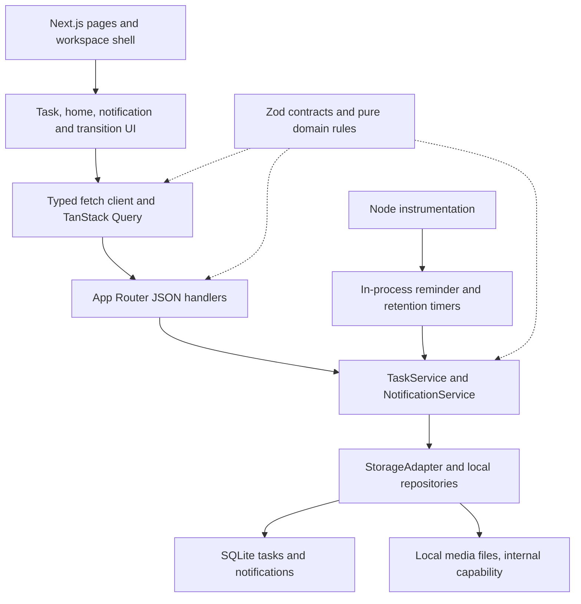

# Architecture audit

Audited 6 November 2026, Asia/Saigon. Application version 0.1.0. Source baseline `2955b454f713a38a66c29cab3f0a7b3f84852bf8` (`first commit`), with a pre-existing modification to [md/current_task.md](<D:/Vibe Coding/HiepTrong's Space/md/current_task.md>). The active repository is `D:/Vibe Coding/HiepTrong's Space`, which replaces the unavailable workspace path `D:/Vibe Coding/Task Management`.

**Assessment**

The existing Next.js, React, SQLite, and service architecture is adequate for this personal application. Stabilization should preserve it. The most consequential problems are form initialization that overwrites drafts, deadline editing that changes an unchanged past date, and service operations that lack atomic update semantics. All three have isolated executable evidence. Passing static checks and the current test suite do not cover those failure paths.

There is no evidenced P0 issue. Four reproduced defects are P1. Network exposure and dependency advisories also need P1 triage, with reachability qualifications in [BUG_INVENTORY](<D:/Vibe Coding/HiepTrong's Space/docs/audit/BUG_INVENTORY.md>). [TECHNICAL_DEBT](<D:/Vibe Coding/HiepTrong's Space/docs/audit/TECHNICAL_DEBT.md>) explains structural causes, and [STABILIZATION_PLAN](<D:/Vibe Coding/HiepTrong's Space/docs/audit/STABILIZATION_PLAN.md>) sequences small changes with acceptance criteria. No stabilization changes were implemented.

**Scope and evidence**

Reviewed the active [AGENTS.md](<D:/Vibe Coding/HiepTrong's Space/AGENTS.md>), [README.md](<D:/Vibe Coding/HiepTrong's Space/README.md>), root [PROJECT_DESCRIPTION.md](<D:/Vibe Coding/HiepTrong's Space/PROJECT_DESCRIPTION.md>) and its relevant architecture/risk sections, plus [md/human.md](<D:/Vibe Coding/HiepTrong's Space/md/human.md>), [md/context.md](<D:/Vibe Coding/HiepTrong's Space/md/context.md>), [md/agent_readme.md](<D:/Vibe Coding/HiepTrong's Space/md/agent_readme.md>), [md/DESIGN_SPEC.md](<D:/Vibe Coding/HiepTrong's Space/md/DESIGN_SPEC.md>), [md/ASSET_GUIDE.md](<D:/Vibe Coding/HiepTrong's Space/md/ASSET_GUIDE.md>), and [md/ui_readme.md](<D:/Vibe Coding/HiepTrong's Space/md/ui_readme.md>). Inspected configuration, dependency manifests and lockfile, contracts/domain rules, all service/storage/API/client modules, major task/home/notification/transition flows, migration/schema, test inventory, and asset tooling.

Historical prose was checked against source. The AGENTS link to `md/PROJECT_DESCRIPTION.md` is broken because that reference exists at the repository root. Historical descriptions of removed instructions and a 62-test baseline are stale. Earlier claims that drawers lack a focus-trap stack and the day carousel lacks keyboard controls are no longer true. Current code has both.

| Evidence method | Result | What it establishes |
| --- | --- | --- |
| `npm run lint` | Pass, exit 0 | Current ESLint rules pass |
| `npm run typecheck -- --incremental false` | Pass, exit 0 | Current TypeScript program checks without updating the incremental cache |
| `npm test -- --no-cache` | 22 files, 69 tests pass, exit 0 | Existing suite passes on installed dependencies |
| `npm audit --ignore-scripts --json` | Exit 1, 17 affected package entries | Registry advisory matches for this dependency tree, not 17 proven application exploits |
| Isolated service/storage probes | Reproductions recorded in the inventory | Current service behavior against a fresh temporary native SQLite database and controlled clock |
| Isolated component/route/engine probes | Reproductions recorded in the inventory | Actual component behavior in jsdom, direct route handling, and animation scheduling with a mocked canvas |
| Source and configuration comparison | Findings labeled as source evidence | Structural or configuration facts, without claiming live deployment failures |

Checks ran with Node 26.13.0 and npm 11.20.0. AGENTS documents Node 22+, but this audit did not test each supported Node version. The transition test emitted a non-failing jsdom canvas `getContext` warning. DOM tests do not validate real WebGL rendering, focus behavior across browsers, responsive layouts, or animation performance.

Diagnostic scripts lived outside the repository. They transpiled current source using the installed TypeScript compiler and used temporary databases, injected clocks, and jsdom. One initial combined probe stopped at a diagnostic module-loading incompatibility after its service observations. The repaired UI harness ran successfully. That harness problem is not an application defect.

No application database, private environment file, or media contents were inspected or changed. No installation, migration against user data, dependency fix, production source change, or plan implementation was performed. No new production build or live browser session was run. Existing generated build folders and screenshots were not treated as current validation. Deployment binding, firewall rules, backup restoration, and production asset loading remain unverified.

**Current system**

| Layer | Responsibilities and evidence | Assessment |
| --- | --- | --- |
| Routes | [src/app/page.tsx](<D:/Vibe Coding/HiepTrong's Space/src/app/page.tsx>), workspace pages, API handlers | Thin route composition, error boundaries, and consistent JSON error handling |
| Features and shared UI | [src/features/tasks/DailyBoard.tsx](<D:/Vibe Coding/HiepTrong's Space/src/features/tasks/DailyBoard.tsx>), [src/features/tasks/HubList.tsx](<D:/Vibe Coding/HiepTrong's Space/src/features/tasks/HubList.tsx>), [src/ui/WorkspaceShell.tsx](<D:/Vibe Coding/HiepTrong's Space/src/ui/WorkspaceShell.tsx>) | Reuses task cards and forms, but screens duplicate mutation/dialog orchestration |
| Client | [src/client/api-client.ts](<D:/Vibe Coding/HiepTrong's Space/src/client/api-client.ts>), [src/client/queries/tasks.ts](<D:/Vibe Coding/HiepTrong's Space/src/client/queries/tasks.ts>), [src/client/queries/notifications.ts](<D:/Vibe Coding/HiepTrong's Space/src/client/queries/notifications.ts>) | Typed requests and centralized caching. Successful responses are cast rather than validated at runtime |
| Contracts and domain | [src/contracts/task.ts](<D:/Vibe Coding/HiepTrong's Space/src/contracts/task.ts>), [src/domain/date-input.ts](<D:/Vibe Coding/HiepTrong's Space/src/domain/date-input.ts>), [src/domain/reminder.ts](<D:/Vibe Coding/HiepTrong's Space/src/domain/reminder.ts>), [src/domain/task-status.ts](<D:/Vibe Coding/HiepTrong's Space/src/domain/task-status.ts>) | Pure rules and injectable clocks are useful seams. Date contracts do not guarantee canonical instants or real calendar dates |
| Services | [src/services/task-service.ts](<D:/Vibe Coding/HiepTrong's Space/src/services/task-service.ts>), [src/services/notification-service.ts](<D:/Vibe Coding/HiepTrong's Space/src/services/notification-service.ts>) | Centralizes business behavior. Multi-write transitions and read-modify-write patches are not atomic |
| Storage | [src/services/storage/storage-adapter.ts](<D:/Vibe Coding/HiepTrong's Space/src/services/storage/storage-adapter.ts>), [src/services/storage/local/local-storage-adapter.ts](<D:/Vibe Coding/HiepTrong's Space/src/services/storage/local/local-storage-adapter.ts>) | Filesystem and SQL are contained in adapters. Generic whole-record saves lack patch, transaction, or revision semantics |
| Runtime | [src/server/container.ts](<D:/Vibe Coding/HiepTrong's Space/src/server/container.ts>), [src/server/scheduler.ts](<D:/Vibe Coding/HiepTrong's Space/src/server/scheduler.ts>), [src/instrumentation.ts](<D:/Vibe Coding/HiepTrong's Space/src/instrumentation.ts>) | Suitable for one long-lived local process. Timers and health do not establish durable background delivery |

The intended UI → client → API → services → storage boundary is largely present. Lint passes, and the reviewed task UI does not access SQL or the filesystem. A reverse presentation dependency remains where shared `WorkspaceShell` imports Daily feature components/styles and branches on the pathname. The development preview's server-config import is an explicit ESLint exception, and instrumentation's runtime check supports Next's runtime separation. Neither is evidence of an accidental database boundary bypass.

**Product scope and major flows**

The registry exposes 13 destinations. Daily and Tasks Hub are implemented task surfaces. The other 11 destinations are intentional placeholders. Daily statistics are also a placeholder. Drive storage deliberately throws a not-implemented error. Local media has adapter tests but no matching application route for its returned `/api/media/[id]` URL. These are incomplete capabilities, not evidence that shipped upload or Drive features are malfunctioning.

1. **Task creation and retrieval.** UI forms call query mutations, the fetch client sends JSON to App Router handlers, and services validate Zod input. Creation requires a future deadline, derives the reminder, and writes one task. Listing applies repository filters, domain sorting, and DTO derivation. Daily and Hub currently request the complete task collection and derive their views locally.
2. **Scheduling, transfer, and editing.** `scheduledDate` is nullable calendar placement, independent of the deadline instant. Scheduling changes only placement. Transfer changes both placement and deadline and requires a future deadline. Ordinary editing deliberately supports existing past deadlines. This distinction is implemented and tested. Fixes must preserve it.
3. **Completion and reopening.** Completing writes task status, clears the reminder, removes old alerts, and conditionally adds a completed notification. Reopening sets the task active and derives a reminder again. These sequential operations permit partial state after failure. Reopening also leaves the previous completion notification.
4. **Notifications.** Node startup purges expired entries and runs catch-up. Reminder ticks default to every 30 seconds, with a minimum of 5 seconds. Retention runs hourly. Reading notifications also triggers a tick when the last tick is more than 15 seconds old. A unique dedupe key includes task ID, kind, and the deadline string. Lists join current task data, rather than immutable notification snapshots.
5. **Reminder timing.** Tasks with at least 24 hours remaining receive a reminder 24 hours before the deadline. Shorter tasks use a quarter of the remaining duration as the lead. Catch-up after the deadline produces an overdue alert. Seven-day deletion also removes dedupe history, so a later tick can create a fresh alert for an unchanged overdue task. The intended recurrence policy needs an explicit decision.
6. **Home and navigation.** HomeJourney owns a dynamic Three.js Earth scene, local texture/poster assets, and canvas starfield. The collection uses pinned desktop scrolling with native scrolling for smaller/coarse-pointer/reduced-motion contexts. Route transitions use a three-second full sequence with destination readiness, a failsafe, and a shorter reduced-motion path. These custom state machines are integration-test priorities.
7. **Daily views.** The carousel supports pointer drag, horizontal wheel, arrow keys, and inert inactive boards. DayTaskList measures card height for its visible-card viewport. Week and Month views share day-drawer task actions. Current drawers use portals where required, a focus-trap stack, and shared body-scroll-lock accounting.

**Persistence and state consistency**

The initial [drizzle/0000_lush_gravity.sql](<D:/Vibe Coding/HiepTrong's Space/drizzle/0000_lush_gravity.sql>) migration defines tasks and notifications. SQLite uses WAL and foreign keys. Task deletion cascades linked notifications. Indexes cover status/date, status/deadline, reminders, task-linked notifications, and notification creation order. Unique notification dedupe keys protect against duplicate inserts for the same stored key.

Timestamps are stored as text. Inputs accept timezone offsets, while deadline ranges compare text lexically. Equal or ordered instants therefore need not compare correctly until normalized. Scheduled dates have a shape check but no calendar validity check. TypeScript enum annotations do not create database CHECK constraints, and repository reads do not revalidate every row. These matter for future schema migrations and imported or pre-existing records.

The adapter exposes asynchronous methods over synchronous SQLite calls. Awaiting independent whole-row reads and saves permits lost changes at the service boundary. WAL protects database consistency but does not make an application read-modify-write sequence atomic. Completion also spans repositories with no unit of work. C03 and C04 demonstrate these distinct failures.

The container caches one initialization promise and clears it after rejection. This helps ordinary concurrent startup, but the local adapter opens its database before migration and assigns its owned handle only after migration. Failure cleanup needs an isolated test before concluding that open handles leak in normal startup.

**Client state**

Tasks poll every 60 seconds and notifications every 30 seconds. The query provider uses a 15-second stale time and one retry. Mutation hooks cancel queries, snapshot cached task lists, apply optimistic changes, restore snapshots on error, and invalidate task/notification queries on settlement.

This works for simple serialized interactions but has untested overlapping-mutation behavior. Restoring a whole snapshot can erase a newer optimistic change, and transformed list contents are not consistently checked against each list's query filter. Derived reminder fields can remain stale until refetch. These are S01 hypotheses, not observed HTTP races. Backend C03 and client S01 need separate fixes and tests.

**Configuration and operating assumptions**

| Setting or interface | Current behavior | Consequence |
| --- | --- | --- |
| `APP_TIMEZONE` | Defaults to Asia/Saigon, accepts any nonempty string | Notifications receive configuration, major task UI uses the constant default, and invalid identifiers fail later |
| `DATA_DIR`, `DATABASE_FILE` | Runtime resolves a configurable database path | CLI migration configuration stays fixed to the default database |
| `MEDIA_DIR` | Independently defaults to `./data/media` | Changing the data directory alone does not move media |
| `STORAGE_DRIVER` | Local works, Drive is an explicit stub | Nonlocal deployment requires product work outside stabilization |
| `SCHEDULER_TICK_SECONDS` | Positive integer, runtime minimum 5 seconds | No in-flight guard, durable job history, or cross-process ownership |
| `GET /api/health` | Returns healthy after successful container initialization | Does not freshly probe storage operations or scheduler progress |
| `dev` and `start` scripts | Invoke Next without a hostname | Installed Next defaults to all interfaces, while application trust assumes local use |
| Lifecycle | Timers are process-local and unref'd | No reminders while the process is absent, no verified shutdown/restore runbook |

No authentication or authorization layer exists. This can fit a genuinely local application, but the launch binding must match that assumption. No remote compromise or cross-origin exploit was reproduced. Source inspection found static SQL identifiers and ordinary React text rendering for task text, rather than an identified task-text SQL injection or HTML injection path. R01 records the actual exposure conditions.

**Dependencies**

Versions below are lockfile resolutions, not the lower bounds shown in `package.json`.

| Concern | Installed packages |
| --- | --- |
| Application framework | Next 15.5.28, React and React DOM 19.3.1 |
| Storage and validation | better-sqlite3 13.0.3, drizzle-orm 0.39.3, Zod 3.25.76 |
| Client cache and time | TanStack Query 5.105.0, date-fns 4.4.0, @date-fns/tz 1.5.0 |
| UI and rendering | Motion 12.43.0, Three 0.187.0, lucide-react 0.475.0, Tailwind CSS 4.3.3 |
| Toolchain | TypeScript 5.9.3, ESLint 9.39.5, Vitest 3.2.7, jsdom 26.1.0, drizzle-kit 0.30.6 |
| Relevant nested copies | Next's PostCSS 8.4.31 despite root PostCSS 8.5.32, tinypool 1.1.1, esbuild 0.19.12 and 0.18.20 |

The audit returned 12 moderate, 3 high, and 2 critical affected package entries, including parent packages affected through dependencies. The critical entries are in the Vitest/tinypool tooling chain. Do not translate these counts directly into application exploit severity. R02 records advisory prerequisites and links. Remediation should identify reachable paths and the smallest compatible corrected versions, then test each dependency group. A blanket `npm audit fix --force` would introduce unreviewed framework, validation, and test-runner changes.

**Design weaknesses and boundaries to preserve**

| Priority | Weakness | Related findings | Smallest useful response |
| --- | --- | --- | --- |
| P1 | Form initialization coupled to live time and refreshed objects | C01 | Define form-session initialization without changing the live clock |
| P1 | Display shorthand reused as persisted edit identity | C02 | Preserve the unchanged instant and canonical selected date |
| P1 | Generic full-row repository writes and no atomic transition | C03, C04 | Add only the storage operations needed for safe task mutations |
| P2 | Timezone, timestamp, and calendar invariants differ by layer | C05, C06, C09 | Normalize at contract/service boundaries and validate legacy data |
| P2 | Notification lifecycle spread across services and timers | C07, C14, S02 | Specify state transitions, retention visibility, and recurrence |
| P2 | UI action orchestration duplicated across Daily and Hub | D01, S01 | Add regression coverage, then share narrowly scoped behavior |
| P2 | Local deployment assumptions are implicit | R01, C10, D06 | Align binding, configuration, migration, and restore guidance |
| P2 | Custom motion/overlay systems lack browser regression evidence | C11, S04, S05 | Test the actual keyboard, layout, and navigation boundaries |
| P3 | Stale docs and phase-specific tooling | D07, D08 | Reconcile current behavior and distinguish asset generation from verification |

Keep the single shared task record, explicit domain rules, injectable clocks, existing service/storage separation, schema migrations, design tokens, and established UI components. There is no evidence justifying a framework migration, new database, external queue, general state-machine framework, or broad visual rewrite.
